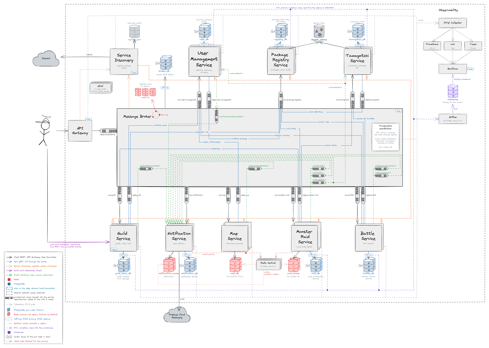

# Tamagotchi Go

Virtual pets and beating up your friends. A distributed system.

Players raise Tamagotchis in apps of their own creation, all connected to a common backend where these worlds meet: encounter nearby players, battle their creatures, join guilds and take down raid monsters together, while keeping your own pet from starving to death.

Developed for the PAD (Distributed Applications Programming) course at FAF, Technical University of Moldova.

## Table of Contents

- [Service Boundaries](#service-boundaries)
- [Architecture Diagram](#architecture-diagram)
- [Communication Patterns](#communication-patterns)
- [Communication Contract](#communication-contract)
- [Project Management](#project-management)
- [Development Guidelines](#development-guidelines)
- [Gateway](#gateway)
- [Deployment](#deployment)
- [Service Ownership and Technology Stack](#service-ownership-and-technology-stack)
- [Technology Stack Rationale](#technology-stack-rationale)

## Service Boundaries

### User Management Service

Microservice responsible for the global identity of every user and their account data (username, password, email, and the package(s) they are registered with). Handles authentication and security, and maintains each user's social graph of friends and enemies.

Each user holds two currencies: a **local currency**, whose value and means of acquisition are determined by the individual package the user belongs to, and a **global currency**, shared across the entire ecosystem and primarily earned through battles and other global activities.

This service is the authority for questions such as *"Who is this user?"*, *"Are these two users friends?"*, and *"Does this user have enough global currency?"*. Other services consult it to authenticate players and to resolve relationships and balances before performing currency-affecting operations.

### Tamagotchi Service

Maintains the globally relevant state of all Tamagotchis. A user has a **primary Tamagotchi**, initially provided by the package they downloaded, and may acquire **secondary Tamagotchis** originating from other users or packages. Crucially, secondary Tamagotchis are not new entries but **references to existing ones**.

For each Tamagotchi it stores identity, owner, combat type, level, sprite references, and package-local health statistics (e.g. hunger, tiredness, happiness). These statistics are deliberately **not normalized**, as their management is package-specific.

The service defines six predefined combat types with a cyclic type-advantage system:

```
Flame → Nature → Earth → Electric → Water → Shadow → Flame
```

It provides combat type, level, and health information to the **Battle Service** and **Monster Raid Service** when computing damage, and settles battles by granting XP and transferring ownership for the **Battle Service**.

### Battle Service

Executes the actual turn-based PvP combat after a match has been created. Each player selects one **primary** and one **secondary** Tamagotchi and may equip available battle boosts.

Combat calculates:

- starting health based on Tamagotchi levels,
- damage based on primary/secondary level, type advantage/disadvantage, equipped boosts, and current Tamagotchi health stats,
- the current battle state and turn.

At the end of the battle, the **winner** receives global currency, XP, and the loser's primary Tamagotchi. The **loser** loses some global currency and receives a smaller amount of XP. XP is distributed between the primary and secondary Tamagotchis following a defined rule (e.g. 60/40).

This service consults the **Tamagotchi Service** for combat stats, XP grants, and ownership transfer; the **User Management Service** for global-currency credit and debit operations; and the **Package Registry Service** for package-specific combat bonuses.

### Map Service

Receives continuous geolocation updates from the user's application. It stores the user's latest known coordinates and timestamp, discarding or ignoring stale locations.

It provides a map of nearby users: friends and enemies are always visible, while unknown users become relevant only when they come within roughly **6 meters** of one another. When two previously unrelated users cross the proximity threshold, the service generates an event that can result in suggestions to befriend or battle one another.

The service **does not** directly manage battles or notifications - it only emits proximity events. It relies on the **User Management Service** for friend/enemy relationships and publishes events consumed by the **Notification Service**.

### Guild Service

Allows users to create and participate in guilds, maintaining guild identity, membership, roles, and permissions. A guild may have an owner/leader, officers, and ordinary members.

It provides **Guild Chat**, letting members communicate in real time. Messages are associated with a guild and carry timestamps and authors; the service may use **WebSockets** directly for the guild-chat connection.

Guilds act as the social context for **Monster Raids**: members can join an active raid and their primary Tamagotchis become participants in the shared battle. Membership and invitation rules use **User Management Service** for user identity and relationships and **Package Registry Service** for package-registration restrictions.

### Monster Raid Service

Provides a cooperative, clicker-style raid in which members of a guild collectively fight a single powerful monster. A raid has a monster with a large amount of health and a defined duration.

Any eligible guild member may contribute their **primary Tamagotchi** to the raid. Instead of a one-on-one battle, every participating Tamagotchi contributes damage to the same monster. The service maintains the current monster HP, participating users, damage dealt, timestamps, and raid status. Actions may be deliberately simple - players repeatedly attack/click to deal damage, with the amount determined by their primary Tamagotchi's combat properties and any equipped boosts.

When the monster dies, the service distributes rewards (global currency, XP, or other globally managed rewards) to participating users. A raid may also **fail** when its timer expires.

It consults the **Guild Service** for eligible members and the **Tamagotchi Service** for combat properties. Rewards travel in the `raid.completed.v1` event, from which the **User Management Service** credits global currency and the **Tamagotchi Service** grants XP.

### Package Registry Service

Maintains the packages of the apps participating in the ecosystem and acts as the configuration service for package-specific and global game content.

It stores package information (identifier/name, version, description, status, associated developers/moderators) and records which users are registered with which packages.

**Moderators** are privileged users associated with a package, representing its developers. They define the package's local Tamagotchi growth mechanics and statistics. Different packages may use completely different, non-normalized statistics - for example, one package may use *hunger, happiness, tiredness*, while another uses *energy, mood, discipline, creativity*. The service stores the definition and interpretation rules for these statistics, including a statistic's maximum value and thresholds that may produce a combat bonus. The **Battle Service** may consult these definitions to compute package-specific bonuses without requiring all packages to share the same data structure.

**Admins** are globally privileged users who design and schedule Monster Raids. They define monster name, description, sprites, maximum HP, combat statistics, weaknesses, resistances, special properties, raid duration, participant limits, and reward configuration, and may schedule, activate, deactivate, or cancel raids.

### Notification Service

Provides asynchronous communication to users through **Firebase push notifications**. Other services publish events, and this service decides how those events are delivered to the client.

Examples include:

- friend request received,
- nearby player detected,
- battle request received,
- another player used or captured a Tamagotchi,
- guild invitation,
- raid started.

It consumes events published by other services (notably the **User Management Service**, **Map Service**, **Battle Service**, **Guild Service**, and **Monster Raid Service**) and delivers them to the appropriate clients.

[Back to top](#table-of-contents)

## Architecture Diagram

The API Gateway verifies client bearer tokens and sends allowed REST operations to the message broker. The broker queues each request, chooses a service instance, and returns its reply. Services call peers as gRPC operations through the same broker. Guild chat uses a direct WebSocket after its REST ticket negotiation.

Each service owns its datastore. Events are published to broker topics and persisted in per-subscriber queues in `broker-db`. For example, `raid.completed.v1` reaches Notification, User Management and Tamagotchi independently. Failed deliveries enter the dead letter channel. Service Discovery handles registration, probes and health, and the broker reads its catalogue. The collector sends telemetry to Prometheus, Loki and Tempo, with Grafana providing dashboards.



The diagram shows the Lab 5 target: every PostgreSQL database as a Patroni pair behind its HAProxy, the Redis replicas with their Sentinels, the broker's response cache and transaction coordinator, and the analytics path from the replicas through Airflow and ClickHouse to Grafana. Replication, the Redis failover and the warehouse are being added to the deployment in #135, #136 and #137. Object storage is tracked in #66.

[Back to top](#table-of-contents)

## Communication Patterns

The architecture uses different communication patterns according to whether a caller needs an immediate result, whether services should remain decoupled, and whether clients require live updates. Solid arrows in the architecture diagram represent synchronous communication, while dashed green arrows represent asynchronous events.

### Client-to-Service Communication

Clients send HTTPS requests to the API Gateway. The gateway authenticates the caller, checks the route against its allowlist and hands the request to the [message broker](#message-broker) as a message addressed to the service that owns the functionality; the broker delivers it to one instance and returns that instance's reply. Public APIs use versioned REST endpoints and JSON payloads because REST is supported consistently by both C# and Go and is easy to inspect and test. The trade-off is additional HTTP and JSON overhead compared with a binary protocol.

### Synchronous Service-to-Service Communication

Services call each other through the message broker over gRPC when the caller needs an immediate response before it can continue. Examples include validating a user, checking guild membership, retrieving Tamagotchi combat statistics, and loading package-specific rules. The contracts are protobuf definitions in [`docs/schemas/proto`](docs/schemas/proto): binary messages over long-lived HTTP/2 connections cost less than JSON over HTTP/1.1, and the same definition generates the C# and the Go code.

Synchronous calls keep request and response flows simple, but they also make the caller depend on the availability of the receiving service. Calls therefore use bounded timeouts. Only requests that are safe to repeat are retried automatically: reads, and commands that carry an idempotency key.

### Asynchronous Event Communication

Services publish JSON domain events to topics in the message broker when the producer does not require an immediate response. This is used for events such as a nearby player being detected, a guild invitation being created, a battle finishing, or a raid starting. A producer never knows who is interested: each service declares the topics it subscribes to when it registers with Service Discovery, and the broker delivers every event to one instance of each subscribing service. Notification Service subscribes to every user-facing event and decides whether a Firebase push notification should be sent; User Management and Tamagotchi also subscribe to `raid.completed.v1` to credit raid rewards.

The broker keeps a durable queue per subscribing service, so an event survives a broker restart or a subscriber outage and is delivered once the subscriber is back; an event that can never be delivered moves to a dead letter channel. Because an event may be delivered more than once, every event has a unique `eventId` and consumers handle duplicate delivery idempotently.

### Real-Time Client Communication

WebSockets provide bidirectional, low-latency communication for Guild Chat. REST remains responsible for creating or retrieving guild resources; WebSockets are used only for live chat messages. Persistent connections require reconnection handling and make horizontal scaling more complex, so they are limited to the feature that needs live bidirectional updates.

### Push Notifications

Only Notification Service communicates directly with Firebase Cloud Messaging. Other services publish domain events instead of calling Firebase themselves. This keeps provider-specific delivery logic outside the business services, at the cost of depending on an external provider whose delivery is not guaranteed to be immediate.

### Data Ownership

Each microservice owns its database and exposes its data only through its API or published events. A service must never read from or write to another service's database directly. Cross-service operations store identifiers rather than duplicating the authoritative entity.

### Service Interaction Matrix

The following interactions correspond to the arrows in the architecture diagram and the real-time Guild Chat requirement. Every service-to-service row goes through the message broker.

| Caller / Producer | Receiver / Consumer | Pattern | Purpose |
|---|---|---|---|
| Client | API Gateway | Synchronous HTTPS | Enter the system |
| API Gateway | Any service | Broker `Send`, delivered as REST | Route an authenticated client request to the responsible service |
| Client | Guild Service | WebSocket | Send and receive Guild Chat messages in real time |
| Map Service | User Management Service | gRPC through the broker | Resolve user identity and friend/enemy relationships for proximity results |
| Map Service | Notification Service | Event through a broker topic | Report that nearby players were detected |
| User Management Service | Package Registry Service | gRPC through the broker | Validate package information associated with a user |
| User Management Service | Notification Service | Event through a broker topic | Report newly created friend requests |
| Guild Service | User Management Service | REST operation through `Broker.Send` (gRPC migration pending) | Validate users, relationships, and permissions used by guild operations |
| Guild Service | Package Registry Service | REST operation through `Broker.Send` (gRPC migration pending) | Validate package-related membership information when required |
| Guild Service | Notification Service | Event through a broker topic | Report newly created guild invitations |
| Monster Raid Service | Guild Service | gRPC through the broker | Validate guild membership and raid eligibility |
| Monster Raid Service | Tamagotchi Service | gRPC through the broker | Obtain participating Tamagotchi combat properties |
| Monster Raid Service | Package Registry Service | gRPC through the broker | Obtain raid and package-specific combat configuration |
| Monster Raid Service | Notification Service | Event through a broker topic | Report that a raid started, completed, or failed |
| Monster Raid Service | User Management Service | Event through a broker topic (`raid.completed.v1`) | Credit participating users with global rewards |
| Monster Raid Service | Tamagotchi Service | Event through a broker topic (`raid.completed.v1`) | Grant XP to participating Tamagotchis |
| Battle Service | User Management Service | gRPC through the broker | Validate players and apply global currency rewards or losses |
| Battle Service | Tamagotchi Service | gRPC through the broker | Obtain combat properties, grant XP, and transfer Tamagotchi ownership |
| Battle Service | Package Registry Service | gRPC through the broker | Obtain package-specific combat bonus rules |
| Battle Service | Notification Service | Event through a broker topic | Report battle invitations and results |
| Tamagotchi Service | Package Registry Service | gRPC through the broker | Obtain definitions and interpretation rules for package-local statistics |
| Notification Service | Firebase Cloud Messaging | Provider API | Deliver push notifications to user devices |

### Common Communication Rules

- REST endpoints are versioned under `/api/v1` and use `application/json`.
- Calls between services use gRPC with the protobuf contracts in [`docs/schemas/proto`](docs/schemas/proto), sent through the message broker.
- Resource paths use plural, lowercase, kebab-case nouns. The same resource collection keeps the same path across HTTP methods; the method expresses the operation.
- State-changing decisions use noun subresources such as `/responses` or a `PATCH` to the resource instead of verb segments such as `/accept` or `/cancel`.
- Event names include a version suffix, for example `guild.invitation.created.v1`. The event name is also the broker topic.
- Resource and event identifiers use UUID strings.
- Timestamps use UTC ISO 8601 strings.
- Clients present bearer JWTs to the gateway; services present their service token to the broker. Services receive trusted identity headers or metadata.
- `X-Correlation-ID` traces one operation across services and events.
- Commands that can be submitted more than once accept an `Idempotency-Key`.
- Services return consistent JSON error objects containing `code`, `message`, and `correlationId`.

[Back to top](#table-of-contents)

## Communication Contract

The communication contract defines the data that callers and services exchange. Endpoint and event payloads use JSON, except the OAuth2 token request uses URL-encoded form fields. Payload schemas below are also represented as JSON: each property value states its type, requirement and meaning. These schema strings document the wire contract and are not literal runtime values. Fields marked as optional may be omitted; all other fields are required. Unknown fields should be ignored by consumers so that compatible fields can be added later.

### REST Contract Conventions

| Item | Contract |
|---|---|
| Base path | `/api/v1` |
| Content type | `application/json`, except OAuth token requests use `application/x-www-form-urlencoded` |
| Authentication | Bearer JWT at the gateway; trusted `X-Caller-Kind` and identity headers at each service |
| Correlation | Nonempty `X-Correlation-ID` preserved across calls; UUID generated when absent |
| Idempotency | `Idempotency-Key: <uuid>` on retriable commands that create side effects |
| Identifier type | UUID encoded as a JSON string |
| Timestamp type | UTC ISO 8601 string, for example `2026-09-07T14:30:00Z` |
| Currency type | Integer amount in the currency's smallest unit |

Successful operations use the following HTTP statuses:

| Status | Meaning |
|---:|---|
| `200 OK` | Resource returned or command completed |
| `201 Created` | New resource created |
| `202 Accepted` | Command accepted for asynchronous processing |
| `204 No Content` | Command completed without a response body |

Errors use an appropriate `4xx` or `5xx` status and the following common body. OAuth2 issuance errors use the standard `{ "error": "<code>" }` shape described in the UMS contract:

```json
{
  "error": {
    "code": "RESOURCE_NOT_FOUND",
    "message": "The requested resource does not exist.",
    "correlationId": "b991f2c1-44db-4c41-bc00-24b72fe93e93",
    "details": []
  }
}
```

Common error statuses are `400` for an invalid request, `401` for missing or invalid authentication, `403` for insufficient permissions, `404` for a missing resource, `409` for a state conflict, `422` for a rejected domain operation, `429` for rate limiting, and `503` when a required dependency is unavailable.

### Operational Endpoints

Every service, the gateway and Service Discovery included, serves the same two endpoints at the root of its own listener, outside `/api/v1`. Both are unauthenticated, exempt from the concurrency limiter and sent with `Cache-Control: no-store`. They are internal: neither the gateway nor the message broker ever delivers either one (see [Gateway](#gateway)), so only Docker and Service Discovery reach them.

| Endpoint | Purpose | Caller | Answer |
|---|---|---|---|
| `GET /health` | Liveness | the Docker `healthcheck` | `200 {"status":"UP"}`, always, for as long as the process serves HTTP |
| `GET /status` | Readiness and telemetry | Service Discovery, every 4 seconds | the document below; `200` when `UP` or `DEGRADED`, `503` when `DOWN` |

**A liveness endpoint checks nothing.** `/health` touches no database, cache or peer and has no other return value. A liveness probe that checks a shared dependency restarts every replica at once the moment that dependency fails, and a restart does not bring the dependency back. Readiness belongs to `/status`.

```json
{
  "status": "UP",
  "service": "map",
  "instanceId": "3f9a1c2e8b11",
  "uptimeSeconds": 1423,
  "load": { "cpu": 0.31, "memory": 0.42, "utilization": 0.42, "inFlight": 12, "limit": 64 },
  "dependencies": [
    { "name": "redis",           "status": "UP",   "latencyMs": 2 },
    { "name": "user-management", "status": "DOWN", "circuit": "OPEN" }
  ],
  "checkedAt": "2026-10-15T09:12:05.331Z"
}
```

| Field | Type | Rule |
|---|---|---|
| `status` | enum | `UP`, `DEGRADED` or `DOWN`, computed below |
| `service` | string | the canonical service name ([Instance Identity and Load Balancing](#instance-identity-and-load-balancing)), a compile-time constant |
| `instanceId` | string | the container hostname |
| `uptimeSeconds` | integer | seconds since the process started serving |
| `load.cpu` | number, two decimals | the container's CPU use as a share of its CPU limit, see below |
| `load.memory` | number, two decimals | the container's memory working set as a share of its memory limit |
| `load.utilization` | number, two decimals | `max(load.cpu, load.memory)`: the instance's load |
| `load.inFlight` | integer | requests currently held by the concurrency limiter, for information |
| `load.limit` | integer | the service's `MAX_CONCURRENCY`, for information |
| `dependencies[].name` | string | an own datastore (`postgres`, `redis`) or a peer's canonical service name |
| `dependencies[].status` | enum | `UP` or `DOWN` |
| `dependencies[].latencyMs` | integer, optional | omitted when `DOWN` |
| `dependencies[].circuit` | enum, optional | `CLOSED` or `OPEN`, peers only |
| `checkedAt` | timestamp | ISO 8601 UTC with milliseconds |

Services may add blocks of their own (the message broker reports its queues and instance pools, Service Discovery its registry summary) but never change these fields.

The status is computed in order, the first match winning:

| Condition | Status | HTTP |
|---|---|---|
| an own datastore is unreachable, so the instance cannot serve | `DOWN` | `503` |
| `load.utilization` at or above `0.8` | `DEGRADED` | `200` |
| a peer is `DOWN` or its circuit is open | `DEGRADED` | `200` |
| otherwise | `UP` | `200` |

**Load is measured from the container, not from requests in flight.** Requests in flight measure concurrency, not load: an instance whose requests wait on a slow peer looks busy while it idles, a CPU-heavy request counts as one slot, and background work (outbox relays, event consumers, workers) does not count at all. Every process therefore reads its own container's cgroup v2 files, with no Docker socket and no extra dependency:

| Share | Source |
|---|---|
| `cpu` | the growth of `usage_usec` in `/sys/fs/cgroup/cpu.stat`, sampled every second in the background, divided by the elapsed time and by the CPU limit from `/sys/fs/cgroup/cpu.max` (quota / period; with `max`, the number of CPUs the container may use), smoothed over about 10 seconds |
| `memory` | `memory.current` minus the `inactive_file` line of `memory.stat`, divided by `memory.max` (with `max`, the host's total memory) |

Outside a container (tests, a local run) both are `0.0`. Each process also exports them as the gauges `container.cpu.utilization` and `container.memory.utilization`, which the System overview dashboard shows per instance. A share only means something against a limit, so every application container sets one in `compose.yaml`:

| Containers | `cpus` | memory limit |
|---|---:|---:|
| User Management, Battle, Tamagotchi, Notification (C#) | 1.0 | 512M |
| Map, Monster Raid, Guild, Package Registry (Go) | 0.5 | 256M |
| gateway, Service Discovery (Python) | 1.0 | 384M |
| broker | 2.0 | 1G |

The memory limit must leave headroom: an idle instance should stay below 0.4 memory, or it would sit near `DEGRADED` doing nothing. An owner whose service needs more raises its limit in their own compose block and states it here.

**Load never produces `DOWN`.** A saturated instance taken out of rotation pushes its share onto the others, which saturate in turn, and the service goes from slow to absent within a few intervals. Load lowers an instance's routing priority and raises an alert; it never removes it. **A failing peer never produces `DOWN` either**, because the instance can still serve everything that does not need that peer, and taking it out would spread one service's outage to another.

Each datastore probe has its own one second deadline and its result is cached for one second, so frequent polling cannot turn the endpoint into an amplifier. A service probes only its own datastores and never calls a peer's `/status`: peer entries come from the local circuit breaker state, not from a live call.

### Authentication and Request Flow

User Management is the only token issuer. Clients log in to obtain a user token.
Services obtain a service token using OAuth2 client credentials, cache it and
refresh it when fewer than 30 seconds remain. The issuer signs its own outbound
service tokens with `sub: user-management-service` and needs no client secret.

Clients call the gateway at `/<service>/api/v1/...`; the gateway validates the
signature and claims against the public JWKS, removes caller-supplied identity
headers and `Authorization`, and passes the verified user identity to the message
broker. Services present their service token to the broker on every `Send` and
`Publish`; the broker validates it the same way. Either way the callee receives the
verified identity below, as HTTP headers on a REST request or as gRPC metadata with
lower-case names. Services authorize this identity rather than verifying JWTs
themselves. Missing `X-Caller-Kind` is rejected with 401 (`UNAUTHENTICATED` over
gRPC); bearer tokens alone grant no direct access. The broker accepts a user
identity only from the gateway.

| Header | Caller | Value |
|---|---|---|
| `X-Caller-Kind` | Every delivered request | `user`, `service` or `anonymous` |
| `X-User-ID` | User | Authenticated user UUID |
| `X-Session-ID` | User, when present | Session UUID |
| `X-Service-Name` | Service | Authenticated service name |
| `X-Scopes` | Service, when present | Space-separated scopes |

Public client operations are explicitly listed in [`config/gateway.yaml`](config/gateway.yaml).
The gateway ignores bearer tokens on those operations and passes anonymous
identity. Registration, login and session refresh are public POST operations;
`GET /user-management/.well-known/jwks.json` is public key discovery. Services
obtain their token through the broker: the client credentials request
(`POST /api/v1/oauth2/token` to `user-management`) and the JWKS read are the only
`Send`s the broker accepts without a token. Health checks are internal probe
endpoints and need no identity.

All JWTs use RS256, `kid`, issuer and audience `tamagotchi-go`. User claims: `sub` user UUID, `sid` session UUID, `kind: user`, `iat`, `nbf`, `exp` after 900 seconds. Service claims: `sub` client ID, `kind: service`, optional/empty `scope`, `iat`, `nbf`, `exp` after 300 seconds, UUID `jti`. JWKS contains public RSA `kty`, `kid`, `use: sig`, `alg: RS256`, `n`, `e`, and can expose old and current keys concurrently. No symmetric keys or private parameters are published.

| Client ID | Scopes |
|---|---|
| battle-service | tamagotchis:read, users.balances:write, packages:read |
| monster-raid-service | tamagotchis:read, guilds:read, packages:read |
| map-service | users:read |
| guild-service | users:read, packages:read |
| tamagotchi-service | packages:read |
| package-registry-service | none |
| notification-service | none |
| api-gateway | none; identifies the gateway to the broker |

Scopes follow `<resource>:<action>` and are advisory; callees authorize by service name. Each client authenticates with its own secret; disabled clients are rejected.

Outbound service calls go through the broker and preserve `X-Correlation-ID`. An identifier is generated only when absent. Retriable commands
keep their `Idempotency-Key` across attempts. Each service bounds handlers with a
configurable deadline and passes the remaining time to outbound calls. Deadline
expiry returns 504 `REQUEST_TIMEOUT` in the common error envelope. Concurrency
admission is bounded and immediate: saturation returns 503
`CONCURRENCY_LIMIT_REACHED` with `Retry-After: 1` instead of queueing.

### Instance Identity and Load Balancing

Each service runs as several interchangeable instances behind the message broker. Every service has one **canonical service name**. It is the route key in [`config/gateway.yaml`](config/gateway.yaml), and the same string is used in registration, in `/status`, in the `service` field of every log line and in headers. It is a compile-time constant, never configuration.

| Canonical name | Gateway prefix | Instances |
|---|---|---:|
| `user-management` | `/user-management` | 2 |
| `battle` | `/battle` | 2 |
| `tamagotchi` | `/tamagotchi` | 2 |
| `notification` | `/notification` | 2 |
| `map` | `/map` | 3 |
| `monster-raid` | `/monster-raid` | 3 |
| `guild` | `/guild` | 2 |
| `package-registry` | `/package-registry` | 2 |
| `api-gateway` | none, it is the ingress | 1 |
| `service-discovery` | none, internal only | 1 |
| `broker` | none, internal only | 1 |

An instance's **instance id** is its container hostname, which Docker sets to the short container id. It is unique per replica and Docker's embedded DNS resolves it from any container on the same network, so an instance's address is `http://<instanceId>:8080` and neither value is configured.

| Header | Set by | On | Value |
|---|---|---|---|
| `X-Instance-Id` | every service | every response, errors included | the instance id of the instance that produced it |
| `X-Broker-Upstream` | the message broker | every reply to a `Send`, passed on by the gateway to clients | `<service>/<instanceId>`, the instance that actually answered |

**A caller addresses a service by name, never an instance.** The gateway and every service send a message to a service name, and the broker picks the instance from the instances Service Discovery reports: preferring `UP` ones and falling back to `DEGRADED` ones, skipping instances that are `DOWN`, quarantined or at their concurrency limit, round-robin or by least load (see [Message Broker](#message-broker)). No service keeps instance addresses, pins a caller to an instance or reads the catalogue, so every instance of a service must be able to serve every request. Shared state therefore lives in the service's datastore, never in process memory.

### Control Plane and Data Plane

Traffic falls into two planes, which take different paths on purpose.

| Plane | What | Path |
|---|---|---|
| Data plane | anything acting on behalf of a user or carrying business state: client requests, service-to-service calls, events, token issuance | through the message broker, without exception; client requests enter at the gateway |
| Control plane | registration and deregistration, health probing, catalogue reads, the broker's breaker reports | direct on the internal network to `http://service-discovery:8080` or to an instance address; never through the broker |

The control plane bypass is deliberate, not a regression of the data plane rule. The broker resolves a service name to *some* instance, so a health probe sent through it would check a random instance and attribute the result to the one that was asked about. It would also be circular: the broker's instance list comes from the registry, so the registry cannot learn about instances by going through the broker. Control plane endpoints carry no user data and are unreachable from outside: services publish no ports, and Service Discovery and the broker's admin endpoints publish only on the host's loopback.

| Conversation | Direction | When |
|---|---|---|
| Registration | instance to Service Discovery | once at startup, and a deregistration once at shutdown |
| Probing | Service Discovery to instance, `GET /status` | every 4 seconds |
| Catalogue | message broker to Service Discovery, conditional on `ETag` | every 4 seconds |

**Registration.** Once its listener accepts connections, an instance posts `{"service": "<canonical name>", "instanceId": "<hostname>", "address": "http://<hostname>:8080"}` to `{SERVICE_DISCOVERY_URL}/api/v1/registrations`. Two optional fields complete it: `grpcAddress` (`"<hostname>:9090"`) when the instance serves gRPC, and `topics` (an array of exact event types, such as `["raid.completed.v1"]`) when its service subscribes to events. The catalogue returns both per instance; the broker reads them to deliver gRPC calls and events. `SERVICE_DISCOVERY_URL` defaults in code to `http://service-discovery:8080` and is never set in `.env`. `201` or `200` means registered and logs `registration_sent`. `409` (the instance id is registered under another service) and `422` (a malformed body) are configuration bugs: logged at `ERROR` and not retried. Anything else, an unreachable registry included, logs `registration_failed` with the next delay and retries with exponential backoff from 1 second to a 30 second cap, forever. Registration runs in the background and never blocks or fails startup. There is no heartbeat: Service Discovery establishes liveness by probing `/status`, so registration happens exactly once and has to be reliable.

**Deregistration.** On `SIGTERM`, before the listener closes, an instance sends `DELETE {SERVICE_DISCOVERY_URL}/api/v1/registrations/{instanceId}` with a 2 second timeout, treats `404` as success, logs `deregistration_sent`, and never delays shutdown by more than those 2 seconds. The instance leaves the catalogue at once, which is why a planned stop or restart produces no failed requests and no alert.

### Message Broker

The message broker (canonical name `broker`) carries every request to a service, every call between services and every event. The gateway and every service talk to it through one gRPC interface, [`tamagotchigo.broker.v1.Broker`](docs/schemas/proto/tamagotchigo/broker/v1/broker.proto), with one envelope; nobody proxies HTTP or gRPC calls through it.

| Call | Destination | Use |
|---|---|---|
| `Send(Message) returns (Reply)` | a service | a request that needs an answer; waits for the reply |
| `Publish(Message) returns (Empty)` | a topic | an event; fire and forget |

| `Message` field | Meaning |
|---|---|
| `message_id` | UUID set by the sender; the `eventId` for events |
| `service` or `topic` | the destination: a canonical service name, or an event type such as `raid.completed.v1` |
| `operation` | a REST operation `METHOD /path?query` (relative to the service root), a full gRPC method name such as `/tamagotchigo.usermanagement.v1.UserManagement/GetUser`, or the event type |
| `headers` | lower-case: `x-correlation-id`, `idempotency-key`, `traceparent`; the gateway adds the verified user identity |
| `content_type`, `body` | `application/json`, `application/protobuf` or `application/x-www-form-urlencoded`, and the bytes |
| `deadline` | the remaining time of the sender's own request |

A `Reply` carries `correlation_id` (the request's `message_id`), `status` (the HTTP status for a REST operation, the gRPC status code for a gRPC operation), `headers` (`x-instance-id`, `x-broker-upstream`, and for a failed gRPC operation `grpc-status-details-bin`), `content_type` and `body`. Every outcome of a delivery is a `Reply`, including the broker's own refusals; the `Send` call itself fails only for a missing or invalid token or a malformed message.

| Sender | Call and operation | Delivered to one instance as |
|---|---|---|
| gateway | `Send`, REST operation, `service` from the route prefix | an ordinary REST request to the instance's `address` |
| service | `Send`, REST operation | an ordinary REST request |
| service | `Send`, gRPC operation, body = the request serialized with the callee's generated types | an ordinary gRPC call to the instance's `grpcAddress` |
| service | `Publish`, `topic` = event type, body = the JSON event envelope | `EventConsumer.Deliver(Message)` on one instance of every subscribing service |

Services stay plain servers: they receive ordinary REST requests and gRPC calls and implement no message handling, except `Deliver` when they subscribe to events.

**Calls are request and reply messages.** Inside the broker a `Send` becomes a request message on the target service's queue `svc.<service>`. The queue's dispatchers take it when an instance has a free slot, pick the instance and deliver it; the answer becomes a reply message on the caller's reply queue `reply.<caller>`, matched by message id, and `Send` returns it. Each `Send` is handled by its own thread from arrival to reply. Request and reply messages live in memory and carry the sender's deadline: a request still queued when its deadline passes is answered with `504`, and a reply that arrives after its caller stopped waiting is dropped. When every instance is at its limit, requests wait in the queue instead of failing at once; a full queue answers `503`.

**Failover is a re-queue.** A delivery that fails in a way that counts against the instance (see [Failure Handling](#failure-handling)) is recorded in that instance's circuit breaker. If the request is safe to repeat, it goes back to the front of the queue and is delivered to another instance within its deadline; otherwise the failure becomes the reply. A request is safe to repeat when the connection was never established, when the operation is idempotent (`GET`, `PUT`, `DELETE`, or a gRPC method marked `NO_SIDE_EFFECTS`), or when it carries an `idempotency-key`.

**Instance selection.** The broker reads the Service Discovery catalogue every 4 seconds, prefers `UP` instances, falls back to `DEGRADED` ones, and skips instances that are `DOWN`, quarantined or at their concurrency limit. Among them it chooses round-robin or by least load: the lowest container `utilization` Service Discovery last reported (see [Operational Endpoints](#operational-endpoints)); among instances within 0.1 of each other, the one with the lowest share of its limit the broker itself has in flight, so a value up to 8 seconds old does not send every request to the same instance. The per-instance circuit breaker and quarantine follow the rules in [Failure Handling](#failure-handling).

**Identity.** Every `Send` and `Publish` carries the sender's service token as `authorization: Bearer <token>` gRPC metadata, verified against User Management's JWKS. The broker delivers the verified identity to the callee (`x-caller-kind`, `x-service-name`, `x-scopes`) and accepts a user identity only from the gateway; values a sender puts in those headers are discarded. The OAuth2 client credentials request and the JWKS read are the only `Send`s accepted without a token.

**gRPC conventions.**

| Item | Rule |
|---|---|
| Broker address | `MESSAGE_BROKER_ADDRESS`, default `broker:9090` in code, never in `.env`; one long-lived connection per process |
| Serving gRPC | port `9090` on the internal network, announced as `grpcAddress` in the registration |
| Request metadata on the callee | `x-caller-kind`, `x-service-name`, `x-scopes`, `x-correlation-id`, `idempotency-key`, `traceparent` |
| Response metadata | `x-instance-id: <hostname>` |
| Deadlines | every call carries the remaining time of the request that caused it |
| Errors | a gRPC status from the table below, with a `google.rpc.ErrorInfo` whose `reason` is the error code of the REST contract (`USER_NOT_FOUND`, `PEER_CIRCUIT_OPEN`, ...) and whose `domain` is the canonical service name |

| HTTP | gRPC | HTTP | gRPC |
|---|---|---|---|
| 400 | `INVALID_ARGUMENT` | 422 | `FAILED_PRECONDITION` |
| 401 | `UNAUTHENTICATED` | 429 | `RESOURCE_EXHAUSTED` |
| 403 | `PERMISSION_DENIED` | 500 | `INTERNAL` |
| 404 | `NOT_FOUND` | 503 | `UNAVAILABLE` |
| 409 | `ALREADY_EXISTS` for a duplicate, `ABORTED` for a conflict | 504 | `DEADLINE_EXCEEDED` |

**Contracts.** The protobuf definitions live in [`docs/schemas/proto`](docs/schemas/proto), with the conventions for mapping the REST contracts onto them. Every RPC mirrors one REST operation: same fields, same authorization, same error codes. Each repository copies the files it uses and keeps them identical to this folder; a change is made here first and reviewed by the owners of the affected services.

**Events and subscriptions.** A subscription belongs to a service, not an instance: the broker subscribes a service to the union of the `topics` its live instances registered, and keeps the subscription even while none of them is alive, queuing events meanwhile. A service that newly subscribes receives events published from then on. An event published to a topic without subscribers is logged and dropped. The broker adds `x-producer`, the publisher's verified service name, to every delivered event; consumers authorize on it, never on the envelope's `producer` field. Delivery is at least once and unordered, and the return of `Deliver` is the acknowledgement:

| `Deliver` returns | The broker |
|---|---|
| `OK` | removes the event |
| `INVALID_ARGUMENT`, `NOT_FOUND`, `FAILED_PRECONDITION`, `PERMISSION_DENIED` | moves it to the dead letter channel at once |
| `UNAVAILABLE`, `DEADLINE_EXCEEDED`, `INTERNAL`, or no answer | retries later with backoff, and moves it to the dead letter channel after the attempt limit |

A consumer deduplicates by business reference, not only by `eventId`, returns `OK` only after its own commit, and never depends on event order. A producer whose event drives state in another service (a reward, a balance) writes it to a transactional outbox in the same transaction as its own state change, so an event is never lost between the commit and `Publish`.

The broker's admin endpoints list its topics with their subscribers and queue depths, and the messages in the dead letter channel.

The broker also caches the replies their owners mark cacheable ([Caching](#caching)) and coordinates two-phase commits and sagas ([Distributed Transactions](#distributed-transactions)) through three more calls on the same interface: `ExecuteTransaction`, `GetTransactionDecision` and `StartSaga`.

### Failure Handling

**One rule for every failure detector: three failures within fourteen seconds.** The count is windowed, not consecutive: a success in between does not reset it, only the window expiring does. Every timing constant derives from the platform request deadline, `REQUEST_TIMEOUT_SECONDS = 4`:

| Constant | Value | Why |
|---|---:|---|
| Service request deadline | 4 s | below the broker's per-delivery timeout, so a slow request ends with the service's own error |
| Broker per-delivery timeout | 5 s | |
| Gateway end-to-end deadline | 10 s | |
| Failure window | 14 s | `3.5 x 4`, so three timed-out calls fit inside one window |
| Failure threshold | 3 | |
| Probe interval and catalogue poll | 4 s | at most `14 / 3 = 4.67` s, or three failed probes cannot fit in the window |
| Probe timeout | 2 s | |
| Broker quarantine recovery | 30 s | continuous `UP` in the catalogue |
| Registry deletion | 120 s | after an instance goes `DOWN` |

**What counts as a failure.** A circuit breaker counts what proves the callee unhealthy and nothing that a healthy callee would answer.

| Outcome | Counts | Why |
|---|---|---|
| connection refused, DNS failure, reset before a response, the broker unreachable | yes | nothing is listening |
| timeout after 4 seconds, `DEADLINE_EXCEEDED` | yes | |
| `500`, `502`, `504`; gRPC `INTERNAL`, `UNKNOWN` | yes | |
| any other `5xx` or gRPC `UNAVAILABLE`, including the broker's `503 NO_HEALTHY_UPSTREAM` | yes | with no routable instance the peer is unavailable as far as the caller can tell |
| `503 PEER_CIRCUIT_OPEN`, or `UNAVAILABLE` with reason `PEER_CIRCUIT_OPEN` | no | the callee is healthy and failing fast because one of *its* peers is down |
| any `4xx`, `429` included, and every gRPC client error status | no | a `404` or a `409` is a correct answer from a healthy callee |

**Peer circuit breaker.** Each service keeps one breaker per peer service name, the destination of its `Send`; never per endpoint or per instance, since a service only ever addresses the broker. It is implemented once, at the service's single outbound HTTP chokepoint.

```
CLOSED --3 failures in 14 s--> OPEN --14 s--> HALF_OPEN --trial succeeds--> CLOSED
                                 ^                 |
                                 +--trial fails----+
```

While `OPEN`, the service does not make the call: it returns `503 PEER_CIRCUIT_OPEN` with `Retry-After: 14`, or takes its existing degradation path where the call site has one. `HALF_OPEN` allows exactly one trial call and concurrent callers fail fast. Transitions log `circuit_opened` at `ERROR` and `circuit_closed` at `INFO`, and the state feeds `dependencies[].circuit` in `/status`. The value is latency: without a breaker every request to a dead peer pays the full 4 second timeout to learn what the previous request already knew.

**Three scopes of removal.** A failing component is taken out of service at three scopes, by three owners. Keeping them apart is what stops a load balancer and a registry from fighting each other.

| | Mechanism | Owner | Removes | Until |
|---|---|---|---|---|
| A | Peer circuit breaker | each calling service | one peer service, for that caller | 14 s, then one trial call |
| B | Instance quarantine | the message broker | one instance, from the broker's rotation | 30 s of continuous `UP` in the catalogue |
| C | Registry eviction | Service Discovery | one instance, for everyone | its probes pass again; deleted after 120 s `DOWN` |

- **Only Service Discovery writes the registry.** The broker's view is one consumer's view: an instance it cannot reach may be serving everyone else correctly. When its breaker trips it quarantines the instance locally and reports `CIRCUIT_OPEN` to Service Discovery, which runs one immediate probe and changes the registry only on the probe's result. A service never deregisters anyone but itself, and only on graceful shutdown.
- **Membership and health are separate.** A `DOWN` instance stays listed and marked rather than vanishing, so failing and gone can be told apart. A catalogue refresh never clears the broker's own quarantine, or the breaker would be undone every 4 seconds.
- **Load never removes anything.** See [Operational Endpoints](#operational-endpoints).

Alerts go to Discord from Service Discovery only, and only for unhealthy instances: an instance evicted, recovered or deleted, critical load and its recovery, and self-preservation engaging when it is switched on. A tripped circuit breaker, in a service or in the broker, is logged and never alerted on. A trip that reflects a dead instance reaches Discord anyway, as the eviction raised by Service Discovery's own probes.

### Asynchronous Event Contract

Every event is published with `Broker.Publish`: the topic is the event type, and the body is the following JSON envelope. Subscribers receive the same body in `Deliver`.

```json
{
  "eventId": "44b37851-48e1-480e-a668-7f0e02f85c24",
  "eventType": "guild.invitation.created.v1",
  "eventVersion": 1,
  "occurredAt": "2026-09-07T14:30:00Z",
  "producer": "guild-service",
  "correlationId": "b991f2c1-44db-4c41-bc00-24b72fe93e93",
  "data": {}
}
```

```json
{
  "eventId": "UUID string. Unique event identifier used for deduplication",
  "eventType": "String. Stable event name including the version suffix",
  "eventVersion": "Integer. Schema version of the event",
  "occurredAt": "UTC timestamp. Time at which the business event occurred",
  "producer": "String. Service that published the event",
  "correlationId": "String. Opaque identifier connecting the event to the originating operation",
  "data": "Object. Event-specific payload defined in the event catalog"
}
```

`producer` is informative; the authoritative publisher is the `x-producer` header the broker sets from the publisher's token.

| Topic | Producer | Subscribers |
|---|---|---|
| `user.friend-request.created.v1` | user-management | notification |
| `map.proximity.detected.v1` | map | notification |
| `guild.invitation.created.v1` | guild | notification |
| `battle.request.created.v1`, `battle.completed.v1` | battle | notification |
| `raid.started.v1`, `raid.failed.v1` | monster-raid | notification |
| `raid.completed.v1` | monster-raid | notification, user-management, tamagotchi |
| `battle.voided.v1` | battle | notification |
| `cache.invalidate.v1` | user-management, tamagotchi, guild, package-registry | none: the broker handles it itself, see [Caching](#caching) |

### Data Ownership and Storage

| Service | Authoritative data | Store |
|---|---|---|
| User Management Service | Accounts, sessions, relationships, wallets and ledger | PostgreSQL |
| Tamagotchi Service | Creatures, package-local vitals, XP grants and ownership transfers | PostgreSQL; flexible vitals are stored in a `jsonb` column |
| Package Registry Service | Packages, moderators, statistic definitions and rules, boosts, monsters, raid schedules and global configuration | PostgreSQL |
| Map Service | Latest location per user and the proximity markers that deduplicate detection events | Redis with a TTL per location, so stale positions expire on their own |
| Battle Service | Battle requests, battles, sides, turns and results | PostgreSQL |
| Guild Service | Guilds, memberships, membership requests and chat messages | PostgreSQL |
| Monster Raid Service | Raids, participants, attack batches and rewards | PostgreSQL; current monster HP is kept in Redis |
| Notification Service | Devices, preferences, notification history and dead-lettered events | PostgreSQL; Redis keeps short-lived delivery deduplication keys and cached preferences |

MongoDB is not part of the selected architecture. An S3-compatible object store keeps blobs, images and large JSON documents. Services store only the corresponding object key or URL in their own database; Package Registry Service owns shared package and monster assets, while Tamagotchi Service stores references to creature assets.

Cross-service references use resource identifiers rather than direct database access. APIs and events may include the data snapshot required to complete an operation. Package Registry Service is the authority for package definitions and registrations; User Management Service keeps only the package references needed in a user profile. Tamagotchi Service remains the authority for Tamagotchi ownership, including transfers after battles.

### Replication and Failover

Every database and every Redis instance that holds state has a replica and fails over on its own. Services do not change their connection strings, and every private service already runs at least two instances (User Management 2, Battle 2, Tamagotchi 2, Notification 2, Guild 2, Package Registry 2, Map 3, Monster Raid 3).

**PostgreSQL: Patroni, etcd and HAProxy.** Each database is a Patroni cluster of two PostgreSQL 17 nodes, `<db>-1` and `<db>-2`, one volume each. Whichever node holds the cluster's leader lease in etcd is the primary; the other streams the primary's WAL asynchronously. One etcd cluster of three nodes (`etcd-1..3`) serves every Patroni cluster, each under its own scope. In front of each cluster an HAProxy keeps the database's old host name:

| Host and port | Reaches | Use |
|---|---|---|
| `<db>:5432` | the node whose Patroni `/primary` answers `200` | every service connection, unchanged |
| `<db>:5433` | the nodes whose Patroni `/replica` answers `200`, the primary as fallback | read-only: the ETL ([Analytics](#analytics)) |

The clusters are `broker-db`, `user-management-db`, `battle-db`, `tamagotchi-db`, `guild-db`, `package-registry-db`, `monster-raid-db` and `notification-db`. Patroni runs with `ttl: 10`, `loop_wait: 2`, `retry_timeout: 5` and `pg_rewind` on, so a dead primary is replaced within about 10 seconds and rejoins as a replica when it comes back. `user-management-db` and `package-registry-db` set `max_prepared_transactions: 64` for [two-phase commits](#distributed-transactions). The image is `grdz/patroni` (PostgreSQL 17 with Patroni), built from `infra/patroni`; its bootstrap creates the service's user and database from the same `POSTGRES_USER`, `POSTGRES_PASSWORD` and `POSTGRES_DB` values as before, and the read-only role `analytics_reader`.

**Why Patroni with etcd.** The leader holds a lease in a consensus store: without the lease there is no primary, so a network partition cannot produce two primaries, and two database nodes per cluster are enough because etcd's three nodes provide the quorum. etcd is a small Go binary implementing Raft. The alternatives were rejected: Stolon is no longer maintained, repmgr has no consensus store and its usual images are gone, pg_auto_failover's monitor is a single point of failure, ZooKeeper is a heavy JVM, and Consul is far more product than we need.

**Redis: replicas and Sentinel.** `map-redis`, `monster-raid-redis` and `notification-redis` each get a replica (`<name>-replica`). Three Sentinels (`sentinel-1:26379`, `sentinel-2:26379`, `sentinel-3:26379`, quorum 2, `down-after-milliseconds 3000`) watch the three primaries under the names `map`, `monster-raid` and `notification` and promote a replica within about 5 seconds. Clients ask the Sentinels for the current primary (Go `redis.NewFailoverClient`, StackExchange.Redis with `serviceName`), so a promotion reaches them without a proxy in between. Replication is asynchronous: a write acknowledged by a primary that dies before replicating it is lost, which every one of the three tolerates (a position is resent, a lost HP decrement makes a monster slightly easier, a lost deduplication key may repeat a notification). The broker's cache nodes `cache-1..3` have no replicas, see [Caching](#caching).

**What a service must handle.** On a failover, connections to the old primary drop and new connections reach the new primary through the same host name. A dropped connection may fail the request in flight, never the process: no exit, no connection pool left holding dead connections, startup that waits for the database as before. A service never pins a node and never reads from `5433`.

### Caching

The message broker is the system's only response cache. It sits on the path of every read that crosses it: client requests from the gateway and calls between services alike, which is where the repeated reads are (Battle reads the same user, Tamagotchi and package data on every challenge, Map reads relationships on every location update). **The owner of a reply decides whether it is cached**, through metadata on the reply; the broker never caches anything its owner did not mark.

**Which requests are looked up.** REST `GET`, and gRPC methods marked `option idempotency_level = NO_SIDE_EFFECTS`. Nothing else is ever looked up or stored; `PUT` and `DELETE` are idempotent but not reads.

**Reply metadata** (REST response headers, or gRPC response metadata):

| Metadata | Meaning |
|---|---|
| `cache-control: max-age=N` | the reply may be stored for N seconds. Without it, or with `no-store` or `private`, it is never stored |
| `cache-control: public` | the reply is the same for every caller: one entry for everyone |
| `vary: x-user-id` | the reply depends only on the listed request headers: one entry per value |
| `x-cache-tags: <prefix>:<id> ...` | space-separated entities the reply depends on, at most 32 |

Without `public` or `vary`, the entry is keyed by every identity header the broker delivered (`x-caller-kind`, `x-user-id`, `x-service-name`), so a reply can never reach another caller. Only `200` and gRPC `OK` replies are stored, for `min(max-age, 3600)` seconds and up to 256 KiB. The broker removes `x-cache-tags` from what it returns.

**What the caller sees.** A looked-up request gets `x-cache: HIT`, `MISS` (delivered, and stored if cacheable) or `BYPASS` (the cache was unavailable or switched off; delivered as usual). A hit carries the stored reply with the caller's own `x-correlation-id`, the `x-instance-id` of the instance that produced it, and `age` in seconds. The gateway passes all three to clients unchanged. A cache failure is never a request failure: the broker gives the cache 50 ms and delivers normally without it.

**Invalidation.** After committing a write that changes a tagged entity, the owner publishes `cache.invalidate.v1` with `Broker.Publish` in the common envelope, `data: {"tags": ["guild:<guildId>"]}`. The broker handles this topic itself: it checks every tag's prefix against the publisher's verified name (`x-producer`), refuses the whole event with `PERMISSION_DENIED` when one prefix belongs to another service, and deletes every entry carrying an accepted tag. A read that started before the invalidation is not stored afterwards. Invalidation is not stored as an event and has no subscribers; publish it after the commit, log a failed publish and carry on, since the TTL bounds how long a missed invalidation matters. A reply may carry any service's tags, because it can depend on another service's entities; only invalidation is restricted to the owner.

| Tag prefix | Owner (may invalidate) | Entity |
|---|---|---|
| `user:<userId>` | user-management | a user's profile, relationships and package list |
| `tamagotchi:<tamagotchiId>` | tamagotchi | a Tamagotchi's record and combat profile |
| `tamagotchi-owner:<userId>` | tamagotchi | the list and the primary Tamagotchi of a user |
| `guild:<guildId>` | guild | a guild and its members |
| `guild-user:<userId>` | guild | the guilds of a user |
| `package:<packageId>` | package-registry | a package with its statistic definitions and battle boosts |
| `registration:<userId>` | package-registry | a user's package registrations |
| `raid-config:<raidConfigurationId>` | package-registry | a raid configuration |
| `raid-schedule:<scheduleId>` | package-registry | a raid schedule |
| `<prefix>:all` | the prefix's owner | a list reply that any create, delete or status change of that entity kind may change, e.g. `package:all` on `ListPackages` |

**What is cached.** Each owner marks these reads on both transports (the REST `GET` and the gRPC method that mirrors it) and invalidates the tags on every write that changes them:

| Owner | Reads | `max-age` | Keyed by | Tags |
|---|---|---:|---|---|
| Package Registry | `GetPackage` | 300 | `public` | `package:<packageId>` |
| Package Registry | `ListStatDefinitions`, `ListBattleBoosts`, `GetBattleBoost` | 300 | caller | `package:<packageId>` |
| Package Registry | `ListPackages` | 60 | `public` | `package:all` |
| Package Registry | `ListRaidConfigurations`, `ListRaidSchedules` | 60 | caller | `raid-config:all`, `raid-schedule:all` |
| Package Registry | `GetRaidConfiguration`, `GetRaidSchedule` | 300 | caller | `raid-config:<id>`, `raid-schedule:<id>` |
| Package Registry | `GetRegistration`, `ListUserRegistrations` | 60 | caller | `registration:<userId>` |
| User Management | `GetUser`, `ListUserPackages` | 60 | caller | `user:<userId>` |
| User Management | `ListRelationships`, `GetRelationship` | 60 | caller | `user:<userId>` (and `user:<otherUserId>`) |
| Guild | `GetGuild`, `ListMembers`, `GetMember` | 60 | caller | `guild:<guildId>` |
| Guild | `ListUserGuilds` | 60 | caller | `guild-user:<userId>` and every `guild:<guildId>` listed |
| Tamagotchi | `GetTamagotchi`, `GetCombatProfile` | 30 | caller | `tamagotchi:<tamagotchiId>` |
| Tamagotchi | `ListUserTamagotchis`, `GetPrimaryTamagotchi` | 30 | caller | `tamagotchi-owner:<userId>` and every `tamagotchi:<id>` listed |

"Caller" means no `public` and no `vary`: one entry per verified caller. **Never cached:** balances and the ledger (money is always read fresh), `/health` and `/status`, the OAuth2 token request and the JWKS read, Map's views (a position lives 60 seconds anyway), notification history, raid state and anything read inside a [transaction or saga](#distributed-transactions) step.

**Sharding.** The cache is spread over `cache-1..3` (plain Redis, no persistence, `allkeys-lru`) by a consistent-hash ring in the broker: each node owns about 150 points on a 64-bit ring, and an entry belongs to the first point clockwise of its key's hash. Adding or removing a node moves only about `1/N` of the entries, where `hash mod N` would move nearly all of them. A node that fails leaves the ring and its share misses until it refills; it rejoins empty. The nodes have no replicas, because a lost node costs misses, not data. `docs/consistent-hashing.md` compares the ring with Redis Cluster's hash slots. The broker's admin listener shows the cache: `GET /cache` (nodes, state, keys, memory, hit ratio, the last membership change and the share of keys it moved), `POST /cache/nodes` and `DELETE /cache/nodes/{node}` (loopback only, like `/topics`).

**Authentication data.** Every piece of authentication data is cached where it is used, and nothing is cached for its own sake:

| Data | Cached where | Why there |
|---|---|---|
| JWKS | in each verifier's memory (gateway, broker): 300 s, refetched at once for an unknown `kid` with a cooldown, kept when User Management is unreachable | a few hundred public bytes read by two processes; a shared cache would add a network hop and a failure mode to every token check |
| Service tokens | in each calling service's memory until shortly before they expire | a per-caller credential: sharing it would be a leak, not a cache |
| User and permission lookups between services | the broker's response cache (relationships, profiles, package registrations, guild membership) | the authorization reads that actually repeat on hot paths |
| User sessions | not cached and not checked per request | the gateway is stateless by design: an access token is valid until it expires (15 minutes) and a revoked session ends at its next refresh |

### Distributed Transactions

The broker contains a **transaction coordinator** for the two kinds of distributed transaction the system uses: a two-phase commit when a short change must land in two databases or in neither, and a saga when a long-running process spans several services and each step can be undone. The coordinator keeps its log in `broker-db` and reaches participants only through the broker's ordinary delivery path, with the same queues, load balancing, circuit breakers, tracing and identity as any `Send`. It could run as a separate service (as Temporal or Camunda would in production) without any participant changing.

| | Two-phase commit | Saga |
|---|---|---|
| Started with | `Broker.ExecuteTransaction`, which returns once decided | `Broker.StartSaga`, which returns once the plan is stored |
| Used for | a user joining a package | battle settlement |
| Participants | User Management, Package Registry | User Management, Tamagotchi; Battle receives the callbacks |
| Isolation | locks held between the phases | none: each step commits on its own; the battle's `SETTLING` status is the semantic lock |
| Failure | every participant rolls back | the completed steps are compensated in reverse order |
| Admin (loopback) | `GET /transactions?state=`, `GET /transactions/{id}` | `GET /sagas?type=&state=`, `GET /sagas/{id}` |

**Identity.** Calls the coordinator makes for a two-phase commit (`Prepare`, `Commit`, `Abort`) and saga callbacks carry `x-service-name: broker`; `Prepare` also carries `x-transaction-initiator`: the client id of the service that called `ExecuteTransaction`, the same value its direct calls carry in `x-service-name` (for example `user-management-service`). Saga steps and compensations are delivered **as the initiator**: with the identity of the service that called `StartSaga` (`x-service-name: battle-service`), plus `x-saga-id`, so a participant authorizes them exactly as it authorizes that service's direct calls today.

#### Two-phase commit

The protocol is [`tamagotchigo.transactions.v1.Participant`](docs/schemas/proto/tamagotchigo/transactions/v1/participant.proto), served on the gRPC port of every participant.

1. The initiator calls `ExecuteTransaction` with a `transaction_id` (a UUID derived from the operation's idempotency key, so a retry reuses it) and one `Prepare` operation per participant.
2. **Phase 1.** The coordinator records the transaction and sends `Prepare` to every participant in parallel, within the request's deadline and at most 3 seconds. A participant runs the change in one database transaction and ends it with `PREPARE TRANSACTION '<transaction_id>'`: `OK` is a yes vote. A business refusal is a no vote, with the same status and `ErrorInfo` the equivalent direct call would return, and leaves nothing behind.
3. **Decision.** All yes: `COMMIT` is logged. Any no vote, error or timeout: `ABORT` is logged. The decision is written before phase 2 starts.
4. **Phase 2.** `Commit` (`COMMIT PREPARED`) or `Abort` (`ROLLBACK PREPARED`) is sent to every participant and retried until each acknowledges, also after a broker restart: on startup, decided transactions are finished and undecided ones aborted. Both calls are idempotent, and any instance may receive them for a transaction another instance prepared.
5. `ExecuteTransaction` answers with the decision; on abort it carries the refusing participant's status and error details, which the initiator maps to its own client response as before.

**In-doubt recovery.** Every participant instance checks `pg_prepared_xacts` of its own database every 10 seconds. A transaction prepared more than 30 seconds ago is resolved with `Broker.GetTransactionDecision`: `COMMIT` commits it, `ABORT` rolls it back, `PENDING` or an unreachable broker means asking again next time. A participant never decides alone. The coordinator answers `ABORT` for a transaction it has no record of, which is safe because nothing is logged `COMMIT` before every vote is in. A prepared transaction keeps its locks until it is resolved: that blocking is the protocol's known cost.

**Joining a package** is the two-phase commit. Registration with `initialPackageId` and `PUT /api/v1/users/{userId}/packages/{packageId}` both run it, initiated by User Management:

| Participant | `Prepare` operation | Body | Effect | No votes |
|---|---|---|---|---|
| user-management | `JoinPackage` | `tamagotchigo.usermanagement.v1.JoinPackageOperation` | adds the package reference and creates the local wallet; at registration, inside the transaction that creates the account | `USER_NOT_FOUND`, `PACKAGE_ALREADY_REGISTERED` |
| package-registry | `RegisterUserPackage` | `tamagotchigo.packageregistry.v1.RegisterUserPackageRequest` | records the registration | `PACKAGE_NOT_FOUND`, `PACKAGE_NOT_ACTIVE`, `PACKAGE_ALREADY_REGISTERED` |

Package Registry accepts `RegisterUserPackage` only when `x-transaction-initiator` is `user-management-service`. The endpoints keep their responses and error codes; the earlier sequence (call Package Registry, then write locally) is removed.

#### Sagas

The initiator sends the whole plan to `Broker.StartSaga`: an id, a type, the ordered steps (each an action and its compensation, ready to deliver), and a completion and a failure callback. The broker stores it and runs it in the background, recording every step's attempts and outcome, so a broker restart resumes the saga where it stood.

| Outcome of an action | The coordinator |
|---|---|
| success | runs the next step |
| `UNAVAILABLE`, `DEADLINE_EXCEEDED`, `INTERNAL`, `RESOURCE_EXHAUSTED`, a broker refusal (`503`, `504`), or the REST equivalents | retries with backoff (0.5 s doubling, at most 30 s) up to the step's `max_attempts` (default 5); then compensates |
| `INVALID_ARGUMENT`, `NOT_FOUND`, `FAILED_PRECONDITION`, `ALREADY_EXISTS`, `PERMISSION_DENIED`, `ABORTED`, or a REST `4xx` | compensates at once |

Compensation runs the compensations of the completed steps in reverse order, each retried with the same backoff until it succeeds, for at most 20 attempts; a compensation that still fails leaves the saga `FAILED`, logged at `ERROR` and shown in `GET /sagas`, for manual repair. Then the failure callback is called with `x-saga-failed-step` and `x-saga-failure-reason` (the refusing service's error code, or `ATTEMPTS_EXHAUSTED`). After the last step the completion callback is called instead. Callbacks are retried until acknowledged. Saga states: `RUNNING`, `COMPENSATING`, `COMPLETED`, `COMPENSATED`, `FAILED`.

**Rules for participants.** An action and its compensation are idempotent by their business reference, and each call carries an `idempotency-key` derived from the saga id and the step. A compensation of an action that never arrived succeeds, records that it ran, and makes a later arrival of that action fail with `FAILED_PRECONDITION`, so a delayed action cannot land after its undo. A compensation never deletes history: it records an opposite entry.

**Battle settlement** is the saga, initiated by Battle when an action or a forfeiture ends the fight (see the [Battle Service contract](#battle-service-1)). Its id is the battle id, its type `battle-settlement`, and every reference is the battle id:

| # | Step | Action | Compensation |
|---|---|---|---|
| 1 | `credit-winner` | User Management `CreateBalanceTransaction`, `+winnerGlobalCurrency`, `BATTLE_REWARD` | `ReverseBalanceTransaction` |
| 2 | `debit-loser` | User Management `CreateBalanceTransaction`, `-loserGlobalCurrencyLoss`, `BATTLE_LOSS`; may be refused with `INSUFFICIENT_BALANCE` | `ReverseBalanceTransaction` |
| 3-6 | `grant-xp-<n>` | Tamagotchi `GrantXp` for each of the four Tamagotchis, source `BATTLE` | `RevokeXp` |
| 7 | `transfer-primary` | Tamagotchi `TransferOwnership` of the loser's primary to the winner; may be refused if it changed owner | `RevertTransfer` |
| | completion | Battle `CompleteSettlement`: `COMPLETED` (or `FORFEITED`), `battle.completed.v1` | |
| | failure | Battle `VoidSettlement`: `VOIDED`, `battle.voided.v1` | |

The credit comes before the debit on purpose: a loser who cannot pay voids the battle and exercises the compensation path. While the saga runs, other players may already see the winner's credit; that missing isolation is the price of not holding locks across services.

### Analytics

A data warehouse holds the history of the game for analysis, separate from the services' operational databases.

```
<db>:5433 (a replica)  ──extract──>  Airflow (ETL)  ──load──>  ClickHouse  ──>  Grafana "Analytics"
  analytics.* views, role analytics_reader     every 5 minutes        staging.*  →  dw.* (star schema)
```

- **Warehouse**: ClickHouse (`clickhouse`), a columnar database built for aggregations over large tables. `staging` keeps the extracted rows (`ReplacingMergeTree`, one row per key in its latest version); `dw` is a star schema of dimensions and facts, transformed with SQL inside ClickHouse.
- **ETL**: Apache Airflow 3 running the DAGs of [`m33ga/etl`](https://github.com/m33ga/etl) (image `grdz/etl`): one extract DAG per source every 5 minutes, then a transform DAG; retries, backfills and a run history in its UI. Each owner maintains the ETL of their own source in that repository.
- **Sources**: each service with a database publishes read-only views in a schema `analytics`, created by its own migrations, and grants `SELECT` on them to `analytics_reader`. The ETL reads only these views, only through the replica port `5433`, so it never couples to private tables and never loads a primary. A view never exposes credentials, password hashes, tokens, e-mail addresses or message contents. Changing a view's columns is a contract change.
- **Watermarks**: every view has an `updated_at` column (`timestamptz`), set on insert and on every change of the row. The ETL reads rows with `updated_at` greater than its stored watermark minus 5 minutes (late commits with an earlier timestamp are caught by the overlap; the staging engine drops the duplicates) and advances the watermark after the load. Rows the owner deletes disappear from the view and stay in the warehouse as last loaded; entities whose end matters keep their row and set an end timestamp instead.

| Service | View | Columns (key first) |
|---|---|---|
| User Management | `analytics.users` | `user_id`, `username`, `created_at`, `updated_at` |
| User Management | `analytics.user_packages` | `user_id`, `package_id`, `registered_at`, `updated_at` |
| User Management | `analytics.ledger_entries` | `entry_id`, `user_id`, `currency` (`GLOBAL`, `LOCAL`), `package_id` (null for `GLOBAL`), `amount` (signed), `reason` (`BATTLE_REWARD`, `BATTLE_LOSS`, `RAID_REWARD`, `ADMIN_ADJUSTMENT`, `REVERSAL`), `reference_id`, `reverses_entry_id` (null unless `REVERSAL`), `resulting_balance`, `created_at`, `updated_at` |
| Battle | `analytics.battles` | `battle_id`, `battle_request_id`, `status`, `challenger_user_id`, `opponent_user_id`, `winner_user_id`, `loser_user_id`, `winner_global_currency`, `loser_global_currency_loss`, `transferred_tamagotchi_id`, `turn_count`, `void_reason`, `created_at`, `ended_at` (the fight ended), `settled_at` (completed or voided), `updated_at` |
| Battle | `analytics.battle_combatants` | `battle_id`, `tamagotchi_id`, `user_id`, `role` (`PRIMARY`, `SECONDARY`), `xp_awarded`, `defeated`, `updated_at` |
| Tamagotchi | `analytics.tamagotchis` | `tamagotchi_id`, `owner_user_id`, `package_id`, `combat_type`, `ownership_role`, `level`, `total_xp`, `created_at`, `updated_at` |
| Tamagotchi | `analytics.xp_grants` | `grant_id`, `tamagotchi_id`, `owner_user_id` (at grant time), `source` (`BATTLE`, `RAID`), `reference_id`, `amount`, `previous_level`, `new_level`, `revoked_at`, `created_at`, `updated_at` |
| Tamagotchi | `analytics.ownership_transfers` | `transfer_id`, `tamagotchi_id`, `from_user_id`, `to_user_id`, `reason`, `reference_id`, `transferred_at`, `reverted_at`, `updated_at` |
| Guild | `analytics.guilds` | `guild_id`, `name`, `owner_id`, `required_package_id`, `member_count`, `created_at`, `deleted_at`, `updated_at` |
| Guild | `analytics.guild_members` | `guild_id`, `user_id`, `role`, `joined_at`, `left_at` (null while a member), `updated_at`; one row per membership, kept after the member leaves |
| Package Registry | `analytics.packages` | `package_id`, `name`, `version`, `status`, `created_at`, `updated_at` |
| Monster Raid | `analytics.raids` | `raid_id`, `guild_id`, `schedule_id`, `raid_configuration_id`, `monster_name`, `maximum_hp`, `status`, `participant_count`, `total_damage`, `starts_at`, `ends_at`, `finished_at`, `updated_at` |
| Monster Raid | `analytics.raid_participants` | `raid_id`, `user_id`, `tamagotchi_id`, `damage_dealt`, `global_currency_reward`, `xp_reward`, `joined_at`, `updated_at` |

Map and Notification publish no views: Map keeps only the last 60 seconds of positions, and notification history is not game data.

### Logging

Every service, the gateway and Service Discovery write one JSON object per line to stdout, with camelCase keys, so that lines from several instances of several services can be read together and correlated.

```json
{"timestamp":"2026-10-15T09:12:05.331Z","level":"INFO","service":"map",
 "instanceId":"3f9a1c2e8b11","event":"request","correlationId":"8f14e45fceea167a",
 "method":"GET","path":"/api/v1/locations","status":200,"durationMs":14,"message":"..."}
```

| Field | Present | Rule |
|---|---|---|
| `timestamp` | always | ISO 8601 UTC with milliseconds and a `Z` suffix |
| `level` | always | `DEBUG`, `INFO`, `WARN` or `ERROR` |
| `service` | always | the canonical service name |
| `instanceId` | always | the container hostname |
| `event` | always | a value from the vocabulary below |
| `message` | always | human readable; structured data goes in fields, not in the message |
| `correlationId`, `method`, `path`, `status`, `durationMs` | request-scoped lines | `correlationId` is the `X-Correlation-ID` of the request |
| `traceId`, `spanId` | lines written inside a traced request | the W3C trace and span ids of the request's span, so a line leads to its trace in Grafana |
| `errorCode` | failures | the error code of the common error envelope |
| `peer`, `failures`, `windowSeconds` | breaker events | |

The `event` values are fixed, because they are what we search for:

| Event | Level | When |
|---|---|---|
| `startup`, `shutdown` | `INFO` | the process is ready to serve; `SIGTERM` was received |
| `request` | `INFO` | exactly one per handled request, after the response |
| `upstream_call` | `DEBUG` | an outbound call completed |
| `upstream_timeout` | `WARN` | an outbound call timed out |
| `limit_reached` | `WARN` | the concurrency limiter rejected a request |
| `registration_sent`, `registration_failed`, `deregistration_sent` | `INFO`, `WARN` or `ERROR`, `INFO` | see [Control Plane and Data Plane](#control-plane-and-data-plane); `registration_failed` is `ERROR` for `409` and `422` |
| `circuit_opened`, `circuit_closed` | `ERROR`, `INFO` | a peer circuit breaker changed state |

The gateway and Service Discovery add events of their own, such as `instance_quarantined` and `instance_evicted`, listed in their specifications. When a line is about another service, its name goes in `serviceName`, because `service` always names the writer.

The [observability stack](#observability) reads these lines from every container and makes them searchable in Grafana by service, instance, level and correlation id.

**Never logged, at any level:** a bearer token, an `Authorization` header, a client secret, a private key, the Discord webhook URL, or a request or response body. User identifiers such as `X-User-ID` appear only at `DEBUG`.

### Service API Contracts

#### User Management Service

User Management runs as two interchangeable instances with a shared mounted RSA signing key and byte-identical JWKS. Every response carries `X-Instance-Id`. Public `GET /health` always returns `200 {"status":"UP"}` without dependency checks. Public `GET /status` returns readiness, hostname, uptime, admission load, direct-dependency status and a millisecond UTC timestamp: Postgres unavailable means `503 DOWN`; utilization >= 0.8 or an unavailable/open Package Registry circuit means `200 DEGRADED`; otherwise `200 UP`. Both endpoints bypass admission and use `Cache-Control: no-store`; the old health route is removed. Postgres probes have a one-second deadline and cache; peer status comes from the local circuit breaker. Peer-calling operations can return `503 PEER_CIRCUIT_OPEN` with `Retry-After: 14` after three failures within 14 seconds.

User Management Service owns user identity, authentication, social relationships, and currency balances. Passwords are accepted only by registration and authentication endpoints and are never returned. Internal balance commands require an authenticated service identity in addition to the common correlation and idempotency headers.

User Management serves REST on internal port 8080 and `tamagotchigo.usermanagement.v1.UserManagement` on internal gRPC port 9090. Its six RPCs are GetUser, ListRelationships, GetRelationship, GetBalances, CreateBalanceTransaction and ListUserPackages. The broker supplies verified service metadata; handlers reuse the REST application layer and return structured ErrorInfo reasons. Only Battle may call CreateBalanceTransaction; the legacy balance POST route remains temporarily available to Battle/Monster Raid on the internal network until their migrations finish; the gateway still refuses it. Both transports share admission and deadlines, with RESOURCE_EXHAUSTED on gRPC saturation.

Discovery registration adds `grpcAddress: <hostname>:9090` and `topics: [raid.completed.v1]`. The service accepts `api-gateway` as an eighth OAuth client with no scopes. The OAuth endpoint remains REST behind Broker.Send; JWKS remains directly readable. Package Registry GetPackage/RegisterUserPackage calls use generated protobuf messages over Broker.Send, a cached locally signed User Management service token, the incoming correlation ID, stable idempotency key, traceparent and remaining deadline.

The 4.1.0 image includes .NET zero-code instrumentation; OTLP/gRPC goes to `http://otel-collector:4317`, with `service.name=user-management`, the hostname as `service.instance.id`, and traceId/spanId in request logs. Release 4.1.0 after broker deployment (#100), discovery topics/gRPC support, Package Registry gRPC (#97 stage 1) and observability (#101). It supplies the server needed by the caller migrations. Keep the compatibility REST adapter until Battle #93 stage 3 and Monster Raid #99 stage 4 are deployed; only then remove it in a later release. The coordinated Compose change pins the published 4.1.0 image.

##### Endpoint Catalog

| Method and path | Caller | Request | Success response | Main errors |
|---|---|---|---|---|
| `GET /health` | Public probe | None | `200 {"status":"UP"}` | None |
| `GET /status` | Public registry probe | None | `200 UP / DEGRADED` readiness telemetry | `503 DOWN` when Postgres is unavailable |
| `GET /.well-known/jwks.json` | Public key discovery | None | `200 JwksDocument`, public cache for 300 seconds | `503`, `504` |
| `POST /api/v1/oauth2/token` | Confidential service client; no bearer token | `OAuthTokenRequest` form | `200 OAuthTokenResponse` | `400 invalid_request`, `400 unsupported_grant_type`, `400 invalid_scope`, `401 invalid_client`, `429 temporarily_unavailable` |
| `POST /api/v1/users` | Client | `CreateUserRequest` | `201 UserResponse` | `400`, `409 USERNAME_OR_EMAIL_TAKEN`, `503 PACKAGE_REGISTRY_UNAVAILABLE / PEER_CIRCUIT_OPEN` |
| `POST /api/v1/auth/sessions` | Client | `LoginRequest` | `200 AuthSessionResponse` | `400`, `401 INVALID_CREDENTIALS` |
| `POST /api/v1/auth/session-refreshes` | Client | `RefreshSessionRequest` | `200 AuthSessionResponse` | `401 INVALID_REFRESH_TOKEN` |
| `DELETE /api/v1/auth/sessions/current` | Client | None | `204` | `401 INVALID_IDENTITY` |
| `GET /api/v1/users/{userId}` | Client or internal service | None | `200 UserResponse` | `401`, `403`, `404 USER_NOT_FOUND` |
| `PATCH /api/v1/users/{userId}` | Account owner | `UpdateUserRequest` | `200 UserResponse` | `400`, `401`, `403`, `404`, `409 EMAIL_TAKEN` |
| `GET /api/v1/users/{userId}/relationships?cursor={cursor}&limit={limit}&status={status}` | Account owner, Map, or Guild Service | Optional cursor, limit and status query parameters | `200 RelationshipPageResponse` | `400 INVALID_REQUEST`, `401`, `403`, `404 USER_NOT_FOUND` |
| `GET /api/v1/users/{userId}/relationships/{otherUserId}` | Client, Map, or Guild Service | None | `200 RelationshipResponse` | `401`, `403`, `404 USER_NOT_FOUND` |
| `POST /api/v1/users/{userId}/friend-requests` | Client | `CreateFriendRequest` | `201 FriendRequestResponse` | `400`, `403`, `404`, `409 RELATIONSHIP_EXISTS` |
| `POST /api/v1/users/{userId}/friend-requests/{requestId}/responses` | Request recipient | `RespondToFriendRequest` | `200 FriendRequestResponse` | `400`, `403`, `404`, `409 REQUEST_ALREADY_RESOLVED` |
| `PUT /api/v1/users/{userId}/enemies/{enemyUserId}` | Account owner | None | `204` | `403`, `404`, `409 RELATIONSHIP_CONFLICT` |
| `DELETE /api/v1/users/{userId}/enemies/{enemyUserId}` | Account owner | None | `204` | `403`, `404` |
| `GET /api/v1/users/{userId}/balances` | Account owner, Battle, or legacy Monster Raid (REST) | None | `200 BalanceResponse` | `403`, `404 USER_NOT_FOUND` |
| `POST /api/v1/users/{userId}/balances` (deprecated) | Legacy Battle or Monster Raid, internal only | `BalanceTransactionRequest` | `200 BalanceTransactionResponse` | `400`, `403`, `404`, `422 INSUFFICIENT_BALANCE` |
| `GET /api/v1/users/{userId}/packages` | Account owner or internal service | None | `200 PackageReference[]` | `403`, `404 USER_NOT_FOUND` |
| `PUT /api/v1/users/{userId}/packages/{packageId}` | Account owner | None | `201 PackageReference` | `403`, `404 USER_OR_PACKAGE_NOT_FOUND`, `409 PACKAGE_ALREADY_REGISTERED`, `503 PACKAGE_REGISTRY_UNAVAILABLE / PEER_CIRCUIT_OPEN` |

Registration accepts an omitted or null `initialPackageId`. This creates an account with `packageIds: []` and only the global wallet, without calling Package Registry. If a package is supplied, it must exist and be ACTIVE. The account owner can later join an ACTIVE package with `PUT /api/v1/users/{userId}/packages/{packageId}`, which also creates its local wallet. Existing registration requests with a package remain valid.

Joining a package, at registration or later, is a [two-phase commit](#two-phase-commit) between User Management (`JoinPackage`) and Package Registry (`RegisterUserPackage`), initiated by User Management with `Broker.ExecuteTransaction`: the package reference, the local wallet and the registration commit together or not at all. User Management serves `tamagotchigo.transactions.v1.Participant` and `ReverseBalanceTransaction`, the compensation of `CreateBalanceTransaction` in [battle settlement](#sagas); a reversal is a new ledger entry with reason `REVERSAL`, never a change to the original. Its cacheable reads and the tag `user:<userId>` are listed in [Caching](#caching), its views in [Analytics](#analytics).

##### Token Issuance

Token request fields: `grant_type=client_credentials`, `client_id`, `client_secret`,
and optional `scope` as a space-separated subset of the client's configured scopes.
Credentials are sent as URL-encoded form fields. Missing credentials yield
`invalid_client`; a missing grant type or malformed/non-form body yields
`invalid_request`. `invalid_client` includes
`WWW-Authenticate: Basic realm="tamagotchi-go"`. Errors use
`{"error":"<OAuth2 code>"}`. Success uses
`{"access_token":"<JWT>","token_type":"Bearer","expires_in":300,"scope":"<space-separated scopes>"}`
with `Cache-Control: no-store`. The endpoint allows 60 requests per minute per
client, with `Retry-After: 60` on rejection.

Logout terminates the session in `X-Session-ID`. Owner checks compare `X-User-ID`
with the path parameter. The gRPC balance command accepts only `battle-service`. The deprecated REST adapter temporarily accepts Battle and Monster Raid until #93 stage 3 and #99 stage 4 are deployed.

##### Relationship Lists

The bulk relationships endpoint returns only existing `FRIEND` and `ENEMY`
connections, ordered by `otherUserId`; unrelated users and pending or rejected
friend requests are absent. `limit` defaults to 50 and must be between 1 and 100.
Omit `cursor` on the first request, then pass `nextCursor` until it is null.
An optional `status=FRIEND` or `status=ENEMY` filters the list. Keep the same
`userId` and status filter when following a cursor; an invalid cursor, limit or
status yields `400 INVALID_REQUEST`. Pages reflect the current relationships,
so changes between requests are not a fixed snapshot.

The account owner reads with `X-Caller-Kind: user` and `X-User-ID` equal to the
path's `userId`. Service callers require `X-Caller-Kind: service` and
`X-Service-Name: map-service` or `guild-service`; other users and services
receive `403`. An unknown subject returns `404 USER_NOT_FOUND`.
Map Service can obtain the classifications for all candidates from this list
instead of querying each pair; it follows additional pages for larger graphs.

##### Payload Schemas

```json
{
  "JwksDocument": {
    "keys": [
      {
        "kty": "RSA; required",
        "kid": "String; required. Signing key ID",
        "use": "sig; required",
        "alg": "RS256; required",
        "n": "Base64url string; required. Public RSA modulus",
        "e": "Base64url string; required. Public RSA exponent"
      }
    ]
  },
  "OAuthTokenRequest": {
    "grant_type": "client_credentials; required. URL-encoded form field",
    "client_id": "String; required. Configured confidential client ID",
    "client_secret": "Base64url string; required. 32 random bytes; never logged or persisted as plaintext",
    "scope": "Space-separated string; optional. Subset of configured scopes"
  },
  "OAuthTokenResponse": {
    "access_token": "String; required. RS256 service JWT",
    "token_type": "Bearer; required",
    "expires_in": "Integer; required. 300 seconds",
    "scope": "Space-separated string; required. Empty when no scopes"
  },
  "OAuthTokenError": {
    "error": "String; required. invalid_request, unsupported_grant_type, invalid_scope, invalid_client or temporarily_unavailable"
  },
  "UserTokenClaims": {
    "iss": "tamagotchi-go; required",
    "aud": "tamagotchi-go; required",
    "kind": "user; required",
    "sub": "UUID string; required. User ID",
    "sid": "UUID string; required. Session ID",
    "iat": "Integer epoch seconds; required",
    "exp": "Integer epoch seconds; required. iat + 900"
  },
  "ServiceTokenClaims": {
    "iss": "tamagotchi-go; required",
    "aud": "tamagotchi-go; required",
    "kind": "service; required",
    "sub": "String; required. Client ID or user-management-service for issuer outbound calls",
    "scope": "Space-separated string; required. May be empty",
    "jti": "UUID string; required",
    "iat": "Integer epoch seconds; required",
    "exp": "Integer epoch seconds; required. iat + 300"
  },
  "CreateUserRequest": {
    "username": "String, 3-32 characters; required. Public username",
    "email": "Email string; required. Unique account email",
    "password": "String, 8-72 characters; required. Plain password transported only over HTTPS",
    "initialPackageId": "UUID string or null; optional. Existing ACTIVE package selected during registration; omit to register without a package"
  },
  "UpdateUserRequest": {
    "username": "String, 3-32 characters; optional. New public username",
    "email": "Email string; optional. New unique email address"
  },
  "LoginRequest": {
    "email": "Email string; required. Account email",
    "password": "String; required. Account password"
  },
  "RefreshSessionRequest": {
    "refreshToken": "String; required. Previously issued refresh token"
  },
  "AuthSessionResponse": {
    "accessToken": "String; required. Bearer JWT used for authenticated requests",
    "refreshToken": "String; required. Token used to renew the session",
    "expiresAt": "UTC timestamp; required. Access-token expiration time"
  },
  "UserResponse": {
    "userId": "UUID string; required. Global user identifier",
    "username": "String; required. Public username",
    "email": "Email string; required. Account email, visible only to the owner or authorized services",
    "packageIds": "Array of UUID strings; required. References to registered packages",
    "createdAt": "UTC timestamp; required. Account creation time"
  },
  "RelationshipPageResponse": {
    "items": "Array of UserRelationship; required. Relationships in the current page",
    "nextCursor": "String or null; required. Cursor for the next page; null on the last page"
  },
  "UserRelationship": {
    "otherUserId": "UUID string; required. The related user",
    "relationship": "FRIEND or ENEMY; required. Current relationship classification"
  },
  "RelationshipResponse": {
    "userId": "UUID string; required. First user in the relationship query",
    "otherUserId": "UUID string; required. Second user in the relationship query",
    "relationship": "FRIEND, ENEMY, or NONE; required. Current relationship classification"
  },
  "CreateFriendRequest": {
    "targetUserId": "UUID string; required. User who should receive the request"
  },
  "RespondToFriendRequest": {
    "decision": "ACCEPT or REJECT; required. Recipient's decision"
  },
  "FriendRequestResponse": {
    "requestId": "UUID string; required. Friend-request identifier",
    "senderUserId": "UUID string; required. User who sent the request",
    "recipientUserId": "UUID string; required. User who receives the request",
    "status": "PENDING, ACCEPTED, or REJECTED; required. Current request state",
    "createdAt": "UTC timestamp; required. Request creation time"
  },
  "BalanceResponse": {
    "userId": "UUID string; required. Balance owner",
    "globalBalance": "Integer; required. Global currency in its smallest unit",
    "localBalances": "Array of LocalBalance; required. One local balance per registered package"
  },
  "LocalBalance": {
    "packageId": "UUID string; required. Package defining the local currency",
    "balance": "Integer; required. Local currency in its smallest unit"
  },
  "BalanceTransactionRequest": {
    "currency": "GLOBAL or LOCAL; required. Balance that should be changed",
    "packageId": "UUID string; conditional. Required when currency is LOCAL",
    "amount": "Non-zero integer; required. Positive for credit and negative for debit",
    "reason": "BATTLE_REWARD, BATTLE_LOSS, RAID_REWARD, or ADMIN_ADJUSTMENT; required. Business reason for the balance change",
    "referenceId": "UUID string; required. Battle, raid, or administrative operation identifier"
  },
  "BalanceTransactionResponse": {
    "transactionId": "UUID string; required. Recorded transaction identifier",
    "resultingBalance": "Integer; required. Balance after applying the transaction",
    "processedAt": "UTC timestamp; required. Processing time"
  },
  "PackageReference": {
    "packageId": "UUID string; required. Registered package identifier",
    "registeredAt": "UTC timestamp; required. Time at which the user registered with the package"
  }
}
```

##### Published Queue Event

`user.friend-request.created.v1` is published through Broker.Publish in the common event envelope; a failed publication rolls back the friend command. Notification Service consumes it to notify the recipient.

```json
{
  "requestId": "UUID string; required. Friend-request identifier",
  "senderUserId": "UUID string; required. User who sent the request",
  "recipientUserId": "UUID string; required. User who should be notified",
  "createdAt": "UTC timestamp; required. Request creation time"
}
```

##### Consumed Event

`tamagotchigo.events.v1.EventConsumer/Deliver` consumes `raid.completed.v1`. Authorize only the broker's `Message.headers["x-producer"] == "monster-raid"`, never the envelope's producer. Each positive globalCurrency reward creates a GLOBAL/RAID_REWARD transaction with referenceId raidId. Deduplicate per (raidId, userId), including REST-era ledger entries. Commit each user independently; after partial failure a replay applies only missing rewards. XP and tamagotchiId are ignored. Return OK after commit, NOT_FOUND for unknown users, PERMISSION_DENIED for another producer, INVALID_ARGUMENT for malformed events, and UNAVAILABLE for database failures.

##### Outbound Dependencies

| Receiver | Operation | Reason |
|---|---|---|
| Package Registry Service through Broker.Send | gRPC GetPackage | Validate that a package exists and is active |
| Package Registry Service through Broker.ExecuteTransaction | `Participant.Prepare` `RegisterUserPackage`, then `Commit` or `Abort` | Make Package Registry the authority for the registration, atomically with the local wallet |

#### Package Registry Service

Package Registry Service owns package metadata, package membership, package-specific Tamagotchi statistic definitions, and Monster Raid configurations and schedules. External bearer tokens terminate at the gateway; the service authorizes from trusted gateway identity headers and rejects direct requests without `X-Caller-Kind`. Package moderators come from the service database, while globally privileged admins are authenticated users configured through `ADMIN_USER_IDS` - the former caller-supplied role header is not accepted.

The deployment runs two Package Registry instances on the internal network, with REST on 8082 and gRPC on 9090. Each registers its REST address, `grpcAddress: <hostname>:9090` and `topics: []` with Service Discovery. Internal `GET /health` reports liveness; `GET /status` reports readiness, load and PostgreSQL health. These endpoints and both listeners have no published host port. Responses include the instance ID, and PostgreSQL serializes startup migrations so both replicas may start together.

The `tamagotchigo.packageregistry.v1.PackageRegistry` API serves all 12 methods in the [protobuf contract](docs/schemas/proto/tamagotchigo/packageregistry/v1/package_registry.proto). REST and gRPC share application authorization, registration idempotency, concurrency slots and deadlines. The broker supplies verified service metadata; gRPC errors include `google.rpc.ErrorInfo` with the business error code and domain `package-registry`. Both transports and PostgreSQL export OpenTelemetry to the collector. The service-only REST routes remain available during the migration to gRPC.

Raid attack/defense accept `0..2147483647`; duration, participant limit and battle-boost `maxUsesPerBattle` accept `1..2147483647`. Invalid writes return `422`; legacy stored values outside those ranges return gRPC `FAILED_PRECONDITION` instead of wrapping or returning partial results. HP and rewards retain their `int64` range. An administrator can inspect and repair a legacy record through REST.

`POST /packages/{packageId}/registrations` and `GET /users/{userId}/package-registrations` require `X-Service-Name: user-management-service`. Raid schedule reads accept `X-Service-Name: monster-raid-service` or a configured administrator. Every handler has a bounded deadline and fail-fast concurrency limit, returning `504 REQUEST_TIMEOUT` or `503 CONCURRENCY_LIMIT_REACHED` with `Retry-After: 1`.

##### Lab 5

Package details and lists use a shared broker cache. Stat definitions, boosts, raid configurations, raid schedules and registrations are cached per verified caller so that access restrictions still apply on cache hits. The TTLs and tags are in [Caching](#caching). A committed write publishes `cache.invalidate.v1` for the changed detail and any affected list. The [Registry Postman collection](collections/package-registry-service.postman_collection.json) includes a Lab 5 cache sequence that warms a package, confirms a hit and checks the new response after a write.

Package Registry also serves [`Participant`](docs/schemas/proto/tamagotchigo/transactions/v1/participant.proto). It prepares registration for an active package when the broker calls on behalf of User Management. Either replica can finish the prepared write. When a prepared registration is older than 30 seconds, each replica polls the coordinator on its 10-second recovery cycle. A committed registration invalidates `registration:<userId>`.

`analytics.packages` exposes the six package fields in [Analytics](#analytics) and is readable through the database proxy's replica port. `/status` uses the container's CPU and memory shares for utilization and still exposes the concurrency counters.

##### Endpoint Catalog

| Method and path | Caller | Request | Success response | Main errors |
|---|---|---|---|---|
| `GET /api/v1/packages?status={status}&cursor={cursor}&limit={limit}` | Client or internal service | Query parameters | `200 PackagePageResponse` | `400 INVALID_QUERY` |
| `POST /api/v1/packages` | Developer or admin | `CreatePackageRequest` | `201 PackageResponse` | `400`, `403`, `409 PACKAGE_NAME_TAKEN` |
| `GET /api/v1/packages/{packageId}` | Client or internal service | None | `200 PackageResponse` | `404 PACKAGE_NOT_FOUND` |
| `PATCH /api/v1/packages/{packageId}` | Package moderator or admin | `UpdatePackageRequest` | `200 PackageResponse` | `400`, `403`, `404`, `409 VERSION_CONFLICT` |
| `POST /api/v1/packages/{packageId}/moderators` | Package developer or admin | `AddModeratorRequest` | `201 ModeratorResponse` | `403`, `404`, `409 MODERATOR_EXISTS` |
| `DELETE /api/v1/packages/{packageId}/moderators/{userId}` | Package developer or admin | None | `204` | `403`, `404 MODERATOR_NOT_FOUND` |
| `POST /api/v1/packages/{packageId}/registrations` | User Management Service | `RegisterUserPackageRequest` | `201 PackageRegistrationResponse` | `400`, `403`, `404`, `409 PACKAGE_ALREADY_REGISTERED` |
| `GET /api/v1/packages/{packageId}/registrations/{userId}` | User Management or Guild Service | None | `200 PackageRegistrationResponse` | `403`, `404 REGISTRATION_NOT_FOUND` |
| `GET /api/v1/users/{userId}/package-registrations` | User Management Service | None | `200 PackageRegistrationResponse[]` | `403` |
| `PUT /api/v1/packages/{packageId}/stat-definitions` | Package moderator | `ReplaceStatDefinitionsRequest` | `200 StatDefinitionResponse[]` | `400`, `403`, `404 PACKAGE_NOT_FOUND`, `422 INVALID_STAT_RULE` |
| `GET /api/v1/packages/{packageId}/stat-definitions` | Tamagotchi, Battle, or Monster Raid Service | None | `200 StatDefinitionResponse[]` | `403`, `404 PACKAGE_NOT_FOUND` |
| `PUT /api/v1/packages/{packageId}/battle-boosts` | Package moderator | `ReplaceBattleBoostsRequest` | `200 BattleBoostResponse[]` | `400`, `403`, `404 PACKAGE_NOT_FOUND`, `422 INVALID_BOOST` |
| `GET /api/v1/packages/{packageId}/battle-boosts` | Client or Battle Service | None | `200 BattleBoostResponse[]` | `403`, `404 PACKAGE_NOT_FOUND` |
| `GET /api/v1/packages/{packageId}/battle-boosts/{boostKey}` | Battle Service | None | `200 BattleBoostResponse` | `403`, `404 BOOST_NOT_FOUND` |
| `GET /api/v1/raid-configurations?cursor={cursor}&limit={limit}` | Client, admin, or Monster Raid Service | Query parameters | `200 RaidConfigurationPageResponse` | `400 INVALID_QUERY` |
| `POST /api/v1/raid-configurations` | Admin | `CreateRaidConfigurationRequest` | `201 RaidConfigurationResponse` | `400`, `403`, `422 INVALID_RAID_CONFIGURATION` |
| `GET /api/v1/raid-configurations/{raidConfigurationId}` | Client or Monster Raid Service | None | `200 RaidConfigurationResponse` | `404 RAID_CONFIGURATION_NOT_FOUND` |
| `PATCH /api/v1/raid-configurations/{raidConfigurationId}` | Admin | `UpdateRaidConfigurationRequest` | `200 RaidConfigurationResponse` | `400`, `403`, `404`, `409 ACTIVE_CONFIGURATION_LOCKED` |
| `POST /api/v1/raid-schedules` | Admin | `CreateRaidScheduleRequest` | `201 RaidScheduleResponse` | `400`, `403`, `404`, `409 SCHEDULE_CONFLICT` |
| `GET /api/v1/raid-schedules?status={status}&at={timestamp}` | Monster Raid Service or admin | Query parameters | `200 RaidScheduleResponse[]` | `400 INVALID_QUERY`, `403` |
| `GET /api/v1/raid-schedules/{scheduleId}` | Monster Raid Service or admin | None | `200 RaidScheduleResponse` | `403`, `404 RAID_SCHEDULE_NOT_FOUND` |
| `PATCH /api/v1/raid-schedules/{scheduleId}` | Admin | `UpdateRaidScheduleRequest` | `200 RaidScheduleResponse` | `400`, `403`, `404`, `409 INVALID_SCHEDULE_STATE` |

##### Package and Registration Schemas

```json
{
  "CreatePackageRequest": {
    "name": "String, 1-100 characters; required. Unique package name",
    "version": "Semantic-version string; required. Initial package version",
    "description": "String, maximum 2,000 characters; required. Package description",
    "developerIds": "Array of UUID strings; required. Users responsible for developing the package"
  },
  "UpdatePackageRequest": {
    "version": "Semantic-version string; optional. New package version",
    "description": "String, maximum 2,000 characters; optional. Updated description",
    "status": "DRAFT, ACTIVE, or INACTIVE; optional. Package availability"
  },
  "PackageResponse": {
    "packageId": "UUID string; required. Package identifier",
    "name": "String; required. Package name",
    "version": "Semantic-version string; required. Current version",
    "description": "String; required. Package description",
    "status": "DRAFT, ACTIVE, or INACTIVE; required. Current package state",
    "developerIds": "Array of UUID strings; required. Associated developers",
    "moderatorIds": "Array of UUID strings; required. Associated moderators",
    "createdAt": "UTC timestamp; required. Creation time",
    "updatedAt": "UTC timestamp; required. Last update time"
  },
  "PackagePageResponse": {
    "items": "Array of PackageResponse; required. Packages in the current page",
    "nextCursor": "String or null; required. Cursor for the next page"
  },
  "AddModeratorRequest": {
    "userId": "UUID string; required. User who receives moderator privileges"
  },
  "ModeratorResponse": {
    "packageId": "UUID string; required. Associated package",
    "userId": "UUID string; required. Moderator user identifier",
    "assignedAt": "UTC timestamp; required. Assignment time"
  },
  "RegisterUserPackageRequest": {
    "userId": "UUID string; required. User being registered"
  },
  "PackageRegistrationResponse": {
    "packageId": "UUID string; required. Registered package",
    "userId": "UUID string; required. Registered user",
    "registeredAt": "UTC timestamp; required. Registration time"
  }
}
```

##### Statistic Definition Schemas

```json
{
  "ReplaceStatDefinitionsRequest": {
    "definitions": "Array of StatDefinition; required. Complete replacement for the package's statistic definitions"
  },
  "StatDefinition": {
    "key": "Lowercase string; required. Stable machine-readable statistic name, such as hunger",
    "displayName": "String; required. Human-readable statistic name",
    "valueType": "INTEGER, DECIMAL, or BOOLEAN; required. Data type accepted for the statistic",
    "minimumValue": "Number; conditional. Minimum for numeric statistics",
    "maximumValue": "Number; conditional. Maximum for numeric statistics",
    "combatBonusRules": "Array of CombatBonusRule; required. Rules for translating local statistics into combat bonuses"
  },
  "CombatBonusRule": {
    "operator": "LT, LTE, GT, GTE, or BETWEEN; required. Comparison applied to the statistic",
    "threshold": "Number or two-number array; required. Value or range used by the comparison",
    "bonusType": "ATTACK, DEFENSE, or HEALTH; required. Combat property affected by the rule",
    "modifier": "Decimal number; required. Bonus added when the condition matches"
  },
  "StatDefinitionResponse": {
    "packageId": "UUID string; required. Package owning the definition",
    "definition": "StatDefinition; required. Stored statistic definition",
    "updatedAt": "UTC timestamp; required. Last definition update time"
  }
}
```

##### Battle Boost Schemas

```json
{
  "ReplaceBattleBoostsRequest": {
    "boosts": "Array of BattleBoostDefinition; required. Complete replacement for the package's battle boosts"
  },
  "BattleBoostDefinition": {
    "key": "Lowercase string; required. Stable boost identifier within the package",
    "displayName": "String; required. Human-readable boost name",
    "affectedStat": "ATTACK, DEFENSE, or HEALTH; required. Combat property modified by the boost",
    "modifier": "Decimal number; required. Value added while the boost is active",
    "maxUsesPerBattle": "Positive integer; required. Maximum number of uses in one battle"
  },
  "BattleBoostResponse": {
    "packageId": "UUID string; required. Package owning the boost",
    "definition": "BattleBoostDefinition; required. Stored boost definition",
    "updatedAt": "UTC timestamp; required. Last update time"
  }
}
```

##### Raid Configuration and Schedule Schemas

```json
{
  "CreateRaidConfigurationRequest": {
    "name": "String; required. Monster name",
    "description": "String; required. Monster and raid description",
    "spriteUrl": "URL string; required. Monster sprite location",
    "maximumHp": "Positive integer; required. Starting monster health",
    "combatStats": "RaidCombatStats; required. Attack and defense properties",
    "weaknesses": "Array of combat-type strings; required. Types that deal increased damage",
    "resistances": "Array of combat-type strings; required. Types that deal reduced damage",
    "specialProperties": "JSON object; required. Extensible special raid behavior",
    "durationSeconds": "Positive integer; required. Maximum raid duration",
    "participantLimit": "Positive integer; required. Maximum number of participants",
    "rewards": "RaidRewardConfiguration; required. Reward rules for a successful raid"
  },
  "UpdateRaidConfigurationRequest": {
    "Any create field": "Same as create field; optional. Field to update before activation"
  },
  "RaidCombatStats": {
    "attack": "Non-negative integer; required. Monster attack value",
    "defense": "Non-negative integer; required. Monster defense value"
  },
  "RaidRewardConfiguration": {
    "globalCurrency": "Non-negative integer; required. Global currency awarded per eligible participant",
    "xp": "Non-negative integer; required. XP awarded per eligible participant",
    "otherRewards": "Array of JSON objects; required. Optional globally managed rewards"
  },
  "RaidConfigurationResponse": {
    "raidConfigurationId": "UUID string; required. Raid configuration identifier",
    "All create fields": "Corresponding types; required. Stored configuration values",
    "createdAt": "UTC timestamp; required. Creation time",
    "updatedAt": "UTC timestamp; required. Last update time"
  },
  "RaidConfigurationPageResponse": {
    "items": "Array of RaidConfigurationResponse; required. Configurations in the current page",
    "nextCursor": "String or null; required. Cursor for the next page"
  },
  "CreateRaidScheduleRequest": {
    "raidConfigurationId": "UUID string; required. Raid configuration to schedule",
    "startsAt": "Future UTC timestamp; required. Scheduled activation time",
    "endsAt": "UTC timestamp; required. Scheduled end time"
  },
  "UpdateRaidScheduleRequest": {
    "status": "ACTIVE, INACTIVE, or CANCELLED; required. Requested schedule state"
  },
  "RaidScheduleResponse": {
    "scheduleId": "UUID string; required. Schedule identifier",
    "raidConfigurationId": "UUID string; required. Configuration used by the scheduled raid",
    "startsAt": "UTC timestamp; required. Scheduled start time",
    "endsAt": "UTC timestamp; required. Scheduled end time",
    "status": "SCHEDULED, ACTIVE, INACTIVE, CANCELLED, or COMPLETED; required. Current schedule state",
    "createdByAdminId": "UUID string; required. Admin who created the schedule"
  }
}
```

##### Outbound and Inbound Dependencies

| Direction | Service | Operation | Reason |
|---|---|---|---|
| Inbound | User Management Service | Read package and registrations; create the registration as a two-phase commit participant (`Participant.Prepare` `RegisterUserPackage`, delivered by the broker with `x-transaction-initiator: user-management-service`) | Validate and record a user's package membership |
| Inbound | Tamagotchi Service | Read statistic definitions | Validate package-local Tamagotchi statistics |
| Inbound | Battle Service | Read statistic and battle-boost definitions | Calculate package-specific combat bonuses |
| Inbound | Monster Raid Service | Read statistic definitions, raid configurations, and active schedules | Calculate combat bonuses and initialize scheduled raids |
| Inbound | Guild Service | Read a package registration when package membership affects a guild rule | Enforce the configured membership rule |

#### Guild Service

Guild Service owns guild identity, membership, roles, permissions, and Guild Chat. Guilds, memberships, membership requests and chat messages are stored in PostgreSQL. The service uses User Management Service for user identity and relationships and Package Registry Service only when a guild restricts membership to a package.

The deployment runs two explicit Guild instances. Both register their REST address, `grpcAddress: <hostname>:9090` and `topics: []` with Service Discovery. REST on 8081 and gRPC on 9090 stay internal; the separate WebSocket listeners retain their published ports. Internal `GET /health` reports liveness and `GET /status` reports readiness, load, PostgreSQL, peer circuits and chat fan-out. REST and gRPC share application rules, deadlines and concurrency slots; gRPC serves `GetGuild`, `ListUserGuilds`, `ListMembers` and `GetMember` for Monster Raid and returns instance/correlation metadata plus rich business errors.

Every outbound call uses the broker's long-lived gRPC connection. In this release the OAuth token request and User Management/Package Registry checks are REST operations inside `Broker.Send`; converting peer checks to generated gRPC messages is #96 stage 4, after the User Management rollout and Registry release. Each peer retains its circuit breaker; an open one returns `503 PEER_CIRCUIT_OPEN` with `Retry-After: 14` without disconnecting existing chat sockets. HTTP, gRPC and PostgreSQL export OpenTelemetry, and request logs include trace IDs.

The transactional invitation outbox publishes `guild.invitation.created.v1` using `Broker.Publish`. Workers claim rows exclusively across replicas, keep the event ID and trace context across retries, and mark an event published only after durable acknowledgement. Before rolling out Guild, verify Notification's broker-consuming version is running and has registered this topic: the broker does not replay events published before the first subscription. This release completes #96 stages 1–3 and 5; the combined notification, chat and trace demonstrations remain part of integration acceptance.

##### Lab 5

Guild detail and membership reads use the broker cache for 60 seconds per verified caller. The tags in [Caching](#caching) link a response to its guild and, for a user's guild list, to that user and the guilds in the result. Lists with more than 31 guilds are served without cache metadata. Commits that change a guild or membership invalidate the affected tags. The [Guild collection](collections/guild-service.postman_collection.json) demonstrates a membership hit followed by removal and a fresh read.

`analytics.guilds` retains deleted guilds, and `analytics.guild_members` keeps each completed membership with its `left_at`. A new membership after rejoining gets its own row. Read both views on the database proxy's replica port using `analytics_reader`. The instance's `/status` includes cgroup CPU and memory shares, along with its concurrency and dependency checks.

##### Endpoint Catalog

| Method and path | Caller | Request | Success response | Main errors |
|---|---|---|---|---|
| `GET /api/v1/guilds?cursor={cursor}&limit={limit}` | Client | Query parameters | `200 GuildPageResponse` | `400 INVALID_QUERY` |
| `POST /api/v1/guilds` | Client | `CreateGuildRequest` | `201 GuildResponse` | `400`, `403`, `404 PACKAGE_NOT_FOUND`, `409 GUILD_NAME_TAKEN` |
| `GET /api/v1/guilds/{guildId}` | Client or Monster Raid Service | None | `200 GuildResponse` | `404 GUILD_NOT_FOUND` |
| `PATCH /api/v1/guilds/{guildId}` | Guild owner | `UpdateGuildRequest` | `200 GuildResponse` | `400`, `403`, `404`, `409 GUILD_NAME_TAKEN` |
| `DELETE /api/v1/guilds/{guildId}` | Guild owner | None | `204` | `403`, `404`, `409 ACTIVE_RAID_EXISTS` |
| `GET /api/v1/users/{userId}/guilds` | Account owner or internal service | None | `200 GuildResponse[]` | `403`, `404 USER_NOT_FOUND` |
| `GET /api/v1/guilds/{guildId}/members?cursor={cursor}&limit={limit}` | Guild member or Monster Raid Service | Query parameters | `200 GuildMemberPageResponse` | `400`, `403`, `404 GUILD_NOT_FOUND` |
| `GET /api/v1/guilds/{guildId}/members/{userId}` | Guild member or Monster Raid Service | None | `200 GuildMemberResponse` | `403`, `404 MEMBERSHIP_NOT_FOUND` |
| `PATCH /api/v1/guilds/{guildId}/members/{userId}` | Guild owner | `UpdateGuildMemberRequest` | `200 GuildMemberResponse` | `400`, `403`, `404`, `409 INVALID_ROLE_CHANGE` |
| `DELETE /api/v1/guilds/{guildId}/members/{userId}` | Member, officer, or owner | None | `204` | `403`, `404`, `409 OWNER_CANNOT_LEAVE` |
| `POST /api/v1/guilds/{guildId}/ownership-transfers` | Guild owner | `TransferGuildOwnershipRequest` | `200 GuildResponse` | `400`, `403`, `404`, `409 INVALID_NEW_OWNER` |
| `POST /api/v1/guilds/{guildId}/invitations` | Guild owner or officer | `CreateGuildInvitationRequest` | `201 GuildInvitationResponse` | `400`, `403`, `404`, `409 INVITATION_OR_MEMBERSHIP_EXISTS`, `422 MEMBERSHIP_RULE_NOT_SATISFIED` |
| `GET /api/v1/guilds/{guildId}/invitations?status={status}` | Guild owner or officer | Query parameter | `200 GuildInvitationResponse[]` | `400`, `403`, `404 GUILD_NOT_FOUND` |
| `GET /api/v1/users/{userId}/guild-invitations?status={status}` | Invitation recipient | Query parameter | `200 GuildInvitationResponse[]` | `400`, `403`, `404 USER_NOT_FOUND` |
| `POST /api/v1/guilds/{guildId}/invitations/{invitationId}/responses` | Invitation recipient | `RespondToGuildInvitationRequest` | `200 GuildInvitationResponse` | `400`, `403`, `404`, `409 INVITATION_ALREADY_RESOLVED`, `422 MEMBERSHIP_RULE_NOT_SATISFIED` |
| `GET /api/v1/guilds/{guildId}/messages?before={messageId}&limit={limit}` | Guild member | Query parameters | `200 GuildMessagePageResponse` | `400`, `403`, `404 GUILD_NOT_FOUND` |
| `POST /api/v1/guilds/{guildId}/chat-sessions` | Active guild member | None | `201 ChatSessionResponse` | `403 NOT_A_MEMBER`, `404 GUILD_NOT_FOUND`, `503`, `504` |

##### Guild and Membership Schemas

```json
{
  "CreateGuildRequest": {
    "name": "String, 3-80 characters; required. Unique guild name",
    "description": "String, maximum 1,000 characters; required. Public guild description",
    "requiredPackageId": "UUID string; optional. Package required for membership, if the guild is restricted"
  },
  "UpdateGuildRequest": {
    "name": "String, 3-80 characters; optional. Updated guild name",
    "description": "String, maximum 1,000 characters; optional. Updated description",
    "requiredPackageId": "UUID string or null; optional. Add, replace, or remove the package restriction"
  },
  "GuildResponse": {
    "guildId": "UUID string; required. Guild identifier",
    "name": "String; required. Guild name",
    "description": "String; required. Guild description",
    "ownerId": "UUID string; required. Current guild owner",
    "requiredPackageId": "UUID string or null; required. Required package, if configured",
    "memberCount": "Non-negative integer; required. Current number of members",
    "createdAt": "UTC timestamp; required. Guild creation time",
    "updatedAt": "UTC timestamp; required. Last guild update time"
  },
  "GuildPageResponse": {
    "items": "Array of GuildResponse; required. Guilds in the current page",
    "nextCursor": "String or null; required. Cursor for the next page"
  },
  "GuildMemberResponse": {
    "guildId": "UUID string; required. Guild containing the member",
    "userId": "UUID string; required. Member's user identifier",
    "role": "OWNER, OFFICER, or MEMBER; required. Member's guild role",
    "joinedAt": "UTC timestamp; required. Membership creation time"
  },
  "GuildMemberPageResponse": {
    "items": "Array of GuildMemberResponse; required. Members in the current page",
    "nextCursor": "String or null; required. Cursor for the next page"
  },
  "UpdateGuildMemberRequest": {
    "role": "OFFICER or MEMBER; required. New role; ownership uses the separate transfer endpoint"
  },
  "TransferGuildOwnershipRequest": {
    "newOwnerId": "UUID string; required. Existing member who becomes the owner"
  }
}
```

##### Invitation Schemas

```json
{
  "CreateGuildInvitationRequest": {
    "inviteeUserId": "UUID string; required. User invited to the guild"
  },
  "RespondToGuildInvitationRequest": {
    "decision": "ACCEPT or REJECT; required. Invitation recipient's decision"
  },
  "GuildInvitationResponse": {
    "invitationId": "UUID string; required. Invitation identifier",
    "guildId": "UUID string; required. Target guild",
    "inviterUserId": "UUID string; required. Owner or officer who sent the invitation",
    "inviteeUserId": "UUID string; required. User receiving the invitation",
    "status": "PENDING, ACCEPTED, REJECTED, EXPIRED, or CANCELLED; required. Current invitation state",
    "createdAt": "UTC timestamp; required. Invitation creation time",
    "expiresAt": "UTC timestamp; required. Time after which it can no longer be accepted"
  }
}
```

##### Guild Chat REST Schema

```json
{
  "GuildMessageResponse": {
    "messageId": "UUID string; required. Stored message identifier",
    "guildId": "UUID string; required. Guild chat containing the message",
    "authorUserId": "UUID string; required. Message author",
    "content": "String, 1-2,000 characters; required. Message text",
    "sentAt": "UTC timestamp; required. Message creation time"
  },
  "GuildMessagePageResponse": {
    "items": "Array of GuildMessageResponse; required. Messages ordered from newest to oldest",
    "nextCursor": "String or null; required. Cursor for older messages"
  },
  "ChatSessionResponse": {
    "url": "ws:// or wss:// URL; required. Public direct WebSocket address",
    "ticket": "43-character base64url string; required. Single-use encoding of 32 random bytes",
    "expiresAt": "UTC timestamp; required. Exactly 60 seconds after ticket issue"
  }
}
```

##### Guild Chat WebSocket Contract

Guild members first make the authenticated REST call `POST /guild/api/v1/guilds/{guildId}/chat-sessions` through the gateway. The service verifies the trusted `X-User-ID` membership and returns `url`, `ticket`, and `expiresAt`. The ticket contains 32 random bytes encoded base64url, is bound to the guild and user, expires after 60 seconds, and is stored only as a hash.

The client then connects directly to `{url}?ticket={ticket}`. The returned URL is instance-specific: it uses the published socket port of the Guild instance that answered negotiation (`8081` or `8083` by default). The dedicated WebSocket listener atomically deletes a matching ticket from shared PostgreSQL before upgrading; missing, expired, reused, or wrong-guild tickets return `401`. Connection identity comes only from the stored ticket, and the handshake does not accept a bearer token. PostgreSQL `LISTEN`/`NOTIFY` fans persisted messages and aggregated presence out to sockets connected to either instance. REST remains on the internal listener; only the separate socket listener is published, so public clients cannot forge trusted gateway headers against REST.

The client sends:

```json
{
  "type": "guild.chat.message.send.v1",
  "clientMessageId": "a30b3bd2-3c74-4fe1-9f53-c67ea72171db",
  "content": "Ready for the raid?"
}
```

After storing the message, the server broadcasts:

```json
{
  "type": "guild.chat.message.created.v1",
  "clientMessageId": "a30b3bd2-3c74-4fe1-9f53-c67ea72171db",
  "messageId": "197a02a7-253e-4ec6-a4ee-b5d41c6e3142",
  "guildId": "813e29b1-4471-4111-9c51-c8f293fd7ab6",
  "authorUserId": "ad01bf52-d4d8-47a2-8b2f-d71757a9ae75",
  "content": "Ready for the raid?",
  "sentAt": "2026-09-07T14:30:00Z"
}
```

If a message cannot be processed, the sender receives `guild.chat.error.v1` with `clientMessageId`, an error `code`, a human-readable `message`, and `correlationId`. Reusing a `clientMessageId` returns the previously stored message instead of creating a duplicate.

##### Published Queue Event

`guild.invitation.created.v1` is published after an invitation is stored successfully. Notification Service consumes it to notify the invited user.

```json
{
  "invitationId": "UUID string; required. Invitation identifier",
  "guildId": "UUID string; required. Guild sending the invitation",
  "guildName": "String; required. Name displayed in the notification",
  "inviterUserId": "UUID string; required. User who sent the invitation",
  "inviteeUserId": "UUID string; required. User who should be notified",
  "expiresAt": "UTC timestamp; required. Invitation expiration time"
}
```

##### Service Dependencies

| Direction | Service | Operation | Reason |
|---|---|---|---|
| Outbound | User Management Service through `Broker.Send` | REST user and relationship reads; gRPC migration pending | Validate inviter, invitee, and relationship rules |
| Outbound | Package Registry Service through `Broker.Send` | REST package and registration reads; gRPC migration pending | Enforce an optional package membership restriction |
| Inbound | Monster Raid Service through the broker | Guild gRPC reads | Validate whether a user may participate in a guild raid |
| Outbound | Broker topic `guild.invitation.created.v1` | `Broker.Publish` from the transactional outbox | Deliver the invitation event to Notification's durable subscription |

#### Tamagotchi Service

Tamagotchi Service owns every Tamagotchi and its current owner, role, combat type, level, XP, sprite reference, and package-local health statistics. A secondary Tamagotchi is a reference to the original entity after an ownership transfer; the service never creates a duplicate of it.

Tamagotchi Service runs as two interchangeable instances, and every response carries `X-Instance-Id`, the hostname of the instance that answered. `GET /health` always answers `200 {"status":"UP"}` and checks nothing. `GET /status` reports readiness to Service Discovery: PostgreSQL unreachable gives `503 DOWN`; utilization at or above 0.8, or Package Registry down or its circuit open, gives `200 DEGRADED`; otherwise `200 UP`. Both sit at the service root, need no identity, bypass admission and are not exposed through the gateway. Package Registry is never probed: its `/status` entry comes from the instance's circuit breaker and carries `"circuit": "CLOSED"` or `"OPEN"`; it is `DOWN` while the circuit refuses calls or for 14 seconds after a failed call, and a half-open circuit waiting for its trial reports `CLOSED`, so a quarantined instance can still be readmitted. A call to Package Registry gets 3 of the 4 seconds, so a registry that does not answer gives `503 PACKAGE_REGISTRY_UNAVAILABLE`, which the broker does not hold against the instance. After three Package Registry failures within 14 seconds, creating a Tamagotchi and updating its health statistics answer `503 PEER_CIRCUIT_OPEN` with `Retry-After: 14` without calling it, until a trial call succeeds. The service runs no scheduled or background work such as statistic decay: statistics change only through requests, so two instances never apply the same change twice.

Tamagotchi serves REST on internal port 8080 and `tamagotchigo.tamagotchi.v1.Tamagotchi` on internal gRPC port 9090. Its six RPCs are GetTamagotchi, ListUserTamagotchis, GetPrimaryTamagotchi and GetCombatProfile for Battle and Monster Raid, and GrantXp and TransferOwnership for Battle only. The broker supplies verified service metadata; handlers reuse the REST application layer and return `google.rpc.ErrorInfo` with the REST error code as `reason` and `tamagotchi` as `domain` (`ALREADY_EXISTS` for `XP_ALREADY_GRANTED` and `OWNERSHIP_ALREADY_TRANSFERRED`, `ABORTED` for `TAMAGOTCHI_NOT_OWNED`, `FAILED_PRECONDITION` for `INVALID_TRANSFER`). The former combat-profile, XP-grant and ownership-transfer REST routes are removed.

Discovery registration adds `grpcAddress: <hostname>:9090` and `topics: [raid.completed.v1]`. Every outbound call is a `Broker.Send` to `MESSAGE_BROKER_ADDRESS` (`broker:9090` in code): the OAuth client-credentials request to User Management stays a REST operation, the one `Send` without a token, and Package Registry's `ListStatDefinitions` is a gRPC operation with the generated protobuf messages. Each `Send` carries the cached `tamagotchi-service` token, the incoming correlation ID, `traceparent` and three quarters of the request deadline; the peer circuit breaker sits around it unchanged. `GATEWAY_URL` is gone.

The final 4.2.0 image includes the .NET zero-code instrumentation; OTLP/gRPC goes to `http://otel-collector:4317`, with `service.name=tamagotchi`, the hostname as `service.instance.id`, and `traceId`/`spanId` on every log line written inside a request. Release this contract only after broker deployment (#100), discovery topics/gRPC support, Package Registry gRPC (#97 stage 1), Battle on gRPC (#93 stage 3), Monster Raid on gRPC and event settlement (#99), and observability (#101). Publish the service image before pinning 4.2.0 in a separate compose release PR.

##### Endpoint Catalog

| Method and path | Caller | Request | Success response | Main errors |
|---|---|---|---|---|
| `GET /health` | Docker healthcheck, internal network only | None | `200 {"status":"UP"}` | None |
| `GET /status` | Service Discovery, internal network only | None | `200` readiness document, `UP` or `DEGRADED` | `503 DOWN` when PostgreSQL is unreachable |
| `GET /api/v1/tamagotchi-combat-types` | Any authenticated caller | None | `200 CombatTypeResponse[]` | None |
| `POST /api/v1/tamagotchis` | The user named in `ownerUserId` | `CreateTamagotchiRequest` | `201 TamagotchiResponse` | `400`, `403`, `404 PACKAGE_NOT_FOUND`, `409 PRIMARY_TAMAGOTCHI_EXISTS`, `422 INVALID_LOCAL_STATS`, `503 PACKAGE_REGISTRY_UNAVAILABLE`, `503 PEER_CIRCUIT_OPEN` |
| `GET /api/v1/tamagotchis/{tamagotchiId}` | Account owner, Battle, or Monster Raid Service | None | `200 TamagotchiResponse` | `403`, `404 TAMAGOTCHI_NOT_FOUND` |
| `PATCH /api/v1/tamagotchis/{tamagotchiId}` | Account owner | `UpdateTamagotchiRequest` | `200 TamagotchiResponse` | `400`, `403`, `404` |
| `GET /api/v1/users/{userId}/tamagotchis?role={role}` | Account owner, Battle, or Monster Raid Service | Query parameter | `200 TamagotchiResponse[]`, empty when the user has none | `400 INVALID_ROLE`, `403` |
| `GET /api/v1/users/{userId}/primary-tamagotchi` | Account owner, Battle, or Monster Raid Service | None | `200 TamagotchiResponse` | `403`, `404 PRIMARY_TAMAGOTCHI_NOT_FOUND` |
| `PUT /api/v1/users/{userId}/primary-tamagotchi` | Account owner | `SetPrimaryTamagotchiRequest` | `200 TamagotchiResponse` | `400`, `403`, `404`, `409 TAMAGOTCHI_NOT_OWNED` |
| `PATCH /api/v1/tamagotchis/{tamagotchiId}/health-stats` | Account owner | `UpdateHealthStatsRequest` | `200 TamagotchiResponse` | `400`, `403`, `404`, `422 INVALID_LOCAL_STATS`, `503 PACKAGE_REGISTRY_UNAVAILABLE`, `503 PEER_CIRCUIT_OPEN` |

##### Tamagotchi Schemas

```json
{
  "CreateTamagotchiRequest": {
    "ownerUserId": "UUID string; required. Initial owner",
    "packageId": "UUID string; required. Package that defines the Tamagotchi's local statistics",
    "name": "String, 1-80 characters; required. Tamagotchi display name",
    "combatType": "FLAME, NATURE, EARTH, ELECTRIC, WATER, or SHADOW; required. Predefined combat type",
    "spriteUrl": "URL string; required. Sprite reference",
    "healthStats": "JSON object; required. Package-local statistics validated against Package Registry definitions"
  },
  "UpdateTamagotchiRequest": {
    "name": "String, 1-80 characters; optional. Updated display name",
    "spriteUrl": "URL string; optional. Updated sprite reference"
  },
  "TamagotchiResponse": {
    "tamagotchiId": "UUID string; required. Global Tamagotchi identifier",
    "ownerUserId": "UUID string; required. Current owner",
    "packageId": "UUID string; required. Originating package",
    "name": "String; required. Display name",
    "ownershipRole": "PRIMARY or SECONDARY; required. Role for the current owner",
    "combatType": "Combat-type string; required. Current combat type",
    "level": "Positive integer; required. Current level",
    "xp": "Non-negative integer; required. Total accumulated XP",
    "spriteUrl": "URL string; required. Sprite reference",
    "healthStats": "JSON object; required. Non-normalized package-local statistics",
    "createdAt": "UTC timestamp; required. Creation time",
    "updatedAt": "UTC timestamp; required. Last update time"
  },
  "SetPrimaryTamagotchiRequest": {
    "tamagotchiId": "UUID string; required. Owned Tamagotchi that becomes primary"
  },
  "UpdateHealthStatsRequest": {
    "stats": "JSON object; required. Statistic keys and new values"
  }
}
```

Package-local `healthStats` values may be integer, decimal, or Boolean values according to the definitions returned by Package Registry Service. Tamagotchi Service rejects unknown keys and values outside their configured ranges.

##### Combat and Progression Schemas

```json
{
  "CombatTypeResponse": {
    "type": "Combat-type string; required. One of the six predefined types",
    "strongAgainst": "Combat-type string; required. Type against which it has an advantage"
  },
  "CombatProfileResponse": {
    "tamagotchiId": "UUID string; required. Tamagotchi identifier",
    "ownerUserId": "UUID string; required. Current owner",
    "packageId": "UUID string; required. Package used to interpret local statistics",
    "combatType": "Combat-type string; required. Type used for advantage calculations",
    "level": "Positive integer; required. Level used for combat calculations",
    "healthStats": "JSON object; required. Current package-local statistics"
  },
  "GrantXpRequest": {
    "amount": "Positive integer; required. XP to grant",
    "source": "BATTLE or RAID; required. Activity producing the XP",
    "referenceId": "UUID string; required. Battle or raid identifier used for deduplication"
  },
  "GrantXpResponse": {
    "tamagotchiId": "UUID string; required. Updated Tamagotchi",
    "previousLevel": "Positive integer; required. Level before the grant",
    "newLevel": "Positive integer; required. Level after the grant",
    "totalXp": "Non-negative integer; required. Total XP after the grant",
    "processedAt": "UTC timestamp; required. Grant processing time"
  }
}
```

The type-advantage cycle is `FLAME > NATURE > EARTH > ELECTRIC > WATER > SHADOW > FLAME`.

##### Ownership Transfer Schemas

```json
{
  "TransferTamagotchiRequest": {
    "tamagotchiId": "UUID string; required. Existing Tamagotchi to transfer",
    "fromUserId": "UUID string; required. Current owner",
    "toUserId": "UUID string; required. New owner",
    "reason": "BATTLE_REWARD; required. Business reason for the transfer",
    "referenceId": "UUID string; required. Completed battle identifier used for deduplication"
  },
  "OwnershipTransferResponse": {
    "transferId": "UUID string; required. Ownership-transfer identifier",
    "tamagotchiId": "UUID string; required. Transferred Tamagotchi",
    "fromUserId": "UUID string; required. Previous owner",
    "toUserId": "UUID string; required. New owner",
    "newOwnershipRole": "SECONDARY; required. Role assigned to the captured Tamagotchi",
    "transferredAt": "UTC timestamp; required. Transfer completion time"
  }
}
```

The transfer updates the existing Tamagotchi instead of creating a new entry. The winner receives it as a secondary Tamagotchi. Selection of a new primary for the previous owner is a separate user action.

##### Consumed Event

`tamagotchigo.events.v1.EventConsumer/Deliver` consumes `raid.completed.v1`. Authorize only the broker's `Message.headers["x-producer"] == "monster-raid"`, never the envelope's producer. Each reward with positive `xp` is granted to its `tamagotchiId` with source `RAID` and referenceId raidId, under the XP grant rules. Deduplicate per (raidId, tamagotchiId): `XP_ALREADY_GRANTED` counts as done, so after a partial failure a replay grants only the missing XP. Each grant commits on its own. `globalCurrency` is ignored. Return OK after the commits, NOT_FOUND for an unknown Tamagotchi, PERMISSION_DENIED for another producer, INVALID_ARGUMENT for a malformed event, and UNAVAILABLE for database failures.

##### Service Dependencies

| Direction | Service | Operation | Reason |
|---|---|---|---|
| Outbound | Package Registry Service through Broker.Send | gRPC ListStatDefinitions as the `tamagotchi-service` client | Validate package-local health statistics |
| Outbound | User Management Service through Broker.Send | REST `POST /api/v1/oauth2/token` | Obtain the service token |
| Inbound | Battle Service through the broker | gRPC reads; GrantXp, TransferOwnership and their compensations RevokeXp and RevertTransfer as steps of the settlement saga | Execute and settle PvP combat |
| Inbound | Monster Raid Service through the broker | gRPC reads and combat profiles; `raid.completed.v1` | Calculate raid damage and distribute raid XP |

#### Battle Service

Battle runs as two instances. `GET /health` is dependency-free liveness (`200 {"status":"UP"}`). `GET /status` exposes hostname, uptime, numeric load and direct-dependency telemetry: Postgres failure gives `503 DOWN`; utilization >= 0.8 or a failed/open peer gives `200 DEGRADED`; otherwise `200 UP`. Both probes use `Cache-Control: no-store` and bypass identity and admission. Postgres probes have a one-second deadline/cache; peer status comes from local circuit state. Every response includes `X-Instance-Id`. Peer-calling operations may return `503 PEER_CIRCUIT_OPEN` with `Retry-After: 14`, or retain durable SETTLING recovery. Three independent breakers share a 14-second rolling failure window and open duration.

Battle Service owns battle requests, active turn-based battles, actions, and final results. It reads authoritative user, Tamagotchi, and package configuration through service APIs and stores battle requests, sides, turns and results in PostgreSQL.

##### Gateway Identity and Collaborators

External callers reach Battle through `/battle` with a bearer token. The internal
API requires gateway-generated `X-Caller-Kind`; user operations use `X-User-ID`
for challenger, opponent, participant and path ownership checks. `X-Session-ID`
is optional. Service callers supply `X-Service-Name` and optional `X-Scopes`, but
cannot perform player operations. Missing or malformed identity yields
`401 INVALID_IDENTITY`; a disallowed caller yields `403`.

Battle calls User Management, Tamagotchi and Package Registry through `Broker.Send` on one long-lived gRPC connection to `MESSAGE_BROKER_ADDRESS` (in-code default `broker:9090`, not an environment-file requirement). `USER_MANAGEMENT_PROTOCOL`, `TAMAGOTCHI_PROTOCOL` and `PACKAGE_REGISTRY_PROTOCOL` select `rest` or `grpc` per peer. The images retain REST transport switches for compatibility; this Compose release selects `grpc` for all three peers and uses generated protobuf types. Battle serves no gRPC API and subscribes to no topics; only REST port 8080 listens. Its `battle-service` client sends OAuth credentials in the
token request's form body, caches the token and refreshes below 30 seconds remaining. A collaborator
`401` / UNAUTHENTICATED causes one refresh and one retry. The OAuth form request itself uses Send to user-management without a service token. Every outbound request retains the
inbound `X-Correlation-ID`; an identifier is generated only when absent.
Commands retain contract-defined idempotency keys and use the battle ID as the
business reference so settlement can resume after a deadline. Each message has a fresh UUID, propagated traceparent and the remaining deadline, also set on the gRPC call. Independent peer breakers count transport/UNKNOWN/INTERNAL/UNAVAILABLE/DEADLINE_EXCEEDED failures, excluding client errors and PEER_CIRCUIT_OPEN.

All handlers have a configurable deadline and concurrency budget, defaulting to
4 seconds and 64 requests. Deadline expiry yields `504 REQUEST_TIMEOUT`.
Saturation yields immediate `503 CONCURRENCY_LIMIT_REACHED` with `Retry-After: 1`.
Both use the shared error envelope. The Battle API publishes no host port;
[configuration](docs/configuration.md) describes its private OAuth settings.

##### Endpoint Catalog

| Method and path | Caller | Request | Success response | Main errors |
|---|---|---|---|---|
| `GET /health` | Public probe | None | `200 UP` | None |
| `GET /status` | Public registry probe | None | `200 UP / DEGRADED`, readiness telemetry | `503 DOWN` when Postgres is unavailable |
| `POST /api/v1/battle-requests` | Challenger | `CreateBattleRequest` | `201 BattleRequestResponse` | `400`, `403`, `404`, `409 BATTLE_REQUEST_EXISTS`, `422 INVALID_SELECTION`, `503 PEER_CIRCUIT_OPEN` |
| `GET /api/v1/battle-requests/{battleRequestId}` | Challenger or opponent | None | `200 BattleRequestResponse` | `403`, `404 BATTLE_REQUEST_NOT_FOUND` |
| `GET /api/v1/users/{userId}/battle-requests?direction={direction}&status={status}` | Account owner | Query parameters | `200 BattleRequestResponse[]` | `400`, `403` |
| `POST /api/v1/battle-requests/{battleRequestId}/responses` | Opponent | `RespondToBattleRequest` | `200 BattleRequestDecisionResponse` | `400`, `403`, `404`, `409 REQUEST_ALREADY_RESOLVED`, `422 INVALID_SELECTION`, `503 PEER_CIRCUIT_OPEN` |
| `GET /api/v1/battles/{battleId}` | Participant | None | `200 BattleResponse` | `403`, `404 BATTLE_NOT_FOUND` |
| `GET /api/v1/users/{userId}/battles?status={status}&cursor={cursor}&limit={limit}` | Account owner | Query parameters | `200 BattlePageResponse` | `400`, `403` |
| `POST /api/v1/battles/{battleId}/actions` | Current-turn participant | `CreateBattleActionRequest` | `200 BattleActionResponse`; `202 BattleActionResponse` with the battle `SETTLING` when the action ends the fight | `400`, `403`, `404`, `409 NOT_CURRENT_TURN`, `422 INVALID_ACTION`, `503 PEER_CIRCUIT_OPEN` |
| `POST /api/v1/battles/{battleId}/forfeitures` | Participant | None | `202 BattleResponse` with the battle `SETTLING` | `403`, `404`, `409 BATTLE_NOT_ACTIVE`, `503 PEER_CIRCUIT_OPEN` |

##### Battle Request Schemas

```json
{
  "CreateBattleRequest": {
    "opponentUserId": "UUID string; required. User being challenged",
    "primaryTamagotchiId": "UUID string; required. Challenger's primary Tamagotchi",
    "secondaryTamagotchiId": "UUID string; required. Challenger's selected secondary Tamagotchi",
    "equippedBoosts": "Array of BattleBoostSelection; required. Package-defined boosts selected by the challenger"
  },
  "RespondToBattleRequest": {
    "decision": "ACCEPT or REJECT; required. Opponent's decision",
    "primaryTamagotchiId": "UUID string; conditional. Required when accepting",
    "secondaryTamagotchiId": "UUID string; conditional. Required when accepting",
    "equippedBoosts": "Array of BattleBoostSelection; conditional. Required when accepting"
  },
  "BattleRequestDecisionResponse": {
    "battleRequest": "BattleRequestResponse; required. Resolved challenge",
    "battle": "BattleResponse or null; required. Created battle for ACCEPT, otherwise null"
  },
  "BattleRequestResponse": {
    "battleRequestId": "UUID string; required. Challenge identifier",
    "challengerUserId": "UUID string; required. User who created the challenge",
    "opponentUserId": "UUID string; required. Challenged user",
    "challengerSelection": "BattleSelection; required. Challenger's Tamagotchis and boosts",
    "status": "PENDING, ACCEPTED, REJECTED, or EXPIRED; required. Current request state",
    "createdAt": "UTC timestamp; required. Challenge creation time",
    "expiresAt": "UTC timestamp; required. Time after which the challenge expires"
  },
  "BattleSelection": {
    "primaryTamagotchiId": "UUID string; required. Selected primary Tamagotchi",
    "secondaryTamagotchiId": "UUID string; required. Selected secondary Tamagotchi",
    "equippedBoosts": "Array of BattleBoostSelection; required. Selected package-defined boosts"
  },
  "BattleBoostSelection": {
    "packageId": "UUID string; required. Package defining the boost",
    "boostKey": "String; required. Boost key unique within the package"
  }
}
```

##### Battle State and Action Schemas

```json
{
  "BattleResponse": {
    "battleId": "UUID string; required. Battle identifier",
    "battleRequestId": "UUID string; required. Request that created the battle",
    "status": "ACTIVE, SETTLING, COMPLETED, FORFEITED, or VOIDED; required. Battle lifecycle state",
    "voidReason": "String or null; required. Why settlement was undone, e.g. INSUFFICIENT_BALANCE; null unless VOIDED",
    "participants": "Array of two BattleParticipant objects; required. Current state for both players",
    "currentTurnUserId": "UUID string or null; required. User allowed to act, or null after the battle ends",
    "turnNumber": "Positive integer; required. Current turn number",
    "winnerUserId": "UUID string or null; required. Winner after completion",
    "loserUserId": "UUID string or null; required. Loser after completion",
    "result": "BattleResult or null; required. Settlement result after completion",
    "createdAt": "UTC timestamp; required. Battle creation time",
    "updatedAt": "UTC timestamp; required. Last state-change time"
  },
  "BattlePageResponse": {
    "items": "Array of BattleResponse; required. Battles in the current page",
    "nextCursor": "String or null; required. Cursor for the next page"
  },
  "BattleParticipant": {
    "userId": "UUID string; required. Participant identifier",
    "combatants": "Array of two BattleCombatant objects; required. Primary and secondary battle state",
    "equippedBoosts": "Array of BattleBoostSelection; required. Boosts available during the battle"
  },
  "BattleCombatant": {
    "tamagotchiId": "UUID string; required. Participating Tamagotchi",
    "role": "PRIMARY or SECONDARY; required. Selection role",
    "currentHealth": "Non-negative integer; required. Current battle health",
    "defeated": "Boolean; required. Whether the Tamagotchi can continue fighting"
  },
  "CreateBattleActionRequest": {
    "actionId": "UUID string; required. Client-generated identifier used for deduplication",
    "type": "ATTACK, SWITCH_ACTIVE, or USE_BOOST; required. Requested turn action",
    "actorTamagotchiId": "UUID string; required. Tamagotchi performing the action",
    "targetTamagotchiId": "UUID string; conditional. Required for an attack",
    "boostPackageId": "UUID string; conditional. Required when using a boost",
    "boostKey": "String; conditional. Required when using a boost"
  },
  "BattleActionResponse": {
    "actionId": "UUID string; required. Processed action identifier",
    "type": "Battle-action string; required. Processed action type",
    "damage": "Non-negative integer; required. Damage produced by the action; zero for non-damage actions",
    "battle": "BattleResponse; required. Battle state after applying the action"
  }
}
```

##### Battle Result Schema

```json
{
  "BattleResult": {
    "winnerUserId": "UUID string; required. Winning player",
    "loserUserId": "UUID string; required. Losing player",
    "winnerGlobalCurrency": "Non-negative integer; required. Currency credited to the winner",
    "loserGlobalCurrencyLoss": "Non-negative integer; required. Currency debited from the loser",
    "xpAwards": "Array of BattleXpAward; required. XP distributed to all selected Tamagotchis",
    "transferredTamagotchiId": "UUID string; required. Loser's former primary Tamagotchi transferred to the winner",
    "settledAt": "UTC timestamp; required. Time at which all rewards and transfers completed"
  },
  "BattleXpAward": {
    "userId": "UUID string; required. Owner at the time XP is awarded",
    "tamagotchiId": "UUID string; required. Tamagotchi receiving XP",
    "amount": "Non-negative integer; required. XP amount"
  }
}
```

By default, each participant's total battle XP is split 60 percent to the primary Tamagotchi and 40 percent to the secondary Tamagotchi. The winner receives the larger total award and the loser receives a smaller total award.

##### Settlement Rules

Settlement is a [saga](#sagas) run by the broker's coordinator. When an action knocks out the last Tamagotchi, or a participant forfeits, Battle stores the battle `SETTLING` with its result, builds the plan from the peers' generated request types with `battleId` as every reference (see the battle settlement table in [Sagas](#sagas)), calls `Broker.StartSaga` with saga id `battleId`, and answers `202` with the battle. The client follows the battle with `GET /api/v1/battles/{battleId}` or the events:

| Status | Reached when |
|---|---|
| `SETTLING` | the fight ended; rewards, XP and the transfer are being applied |
| `COMPLETED`, or `FORFEITED` after a forfeiture | the broker called `CompleteSettlement`: every step succeeded; `battle.completed.v1` is published |
| `VOIDED` | the broker called `VoidSettlement`: a step was refused (for example the loser's `INSUFFICIENT_BALANCE`) or kept failing, and every applied step was undone; `voidReason` says why and `battle.voided.v1` is published |

While a battle is `SETTLING`, further actions answer `409 BATTLE_NOT_ACTIVE`, and its Tamagotchis cannot be used in a new challenge. Battle serves `tamagotchigo.battle.v1.Battle` (`CompleteSettlement`, `VoidSettlement`) on gRPC port 9090 and registers its `grpcAddress`; both callbacks accept only `x-service-name: broker` and are idempotent. Retries, durability and resumption after a crash belong to the coordinator, so Battle keeps no settlement worker or step records of its own. The original trace context travels with the saga, so every step and callback stays in the initiating request's trace.

##### Published Queue Events

`battle.request.created.v1` is stored in the transactional PostgreSQL outbox with the challenge, then published through Broker.Publish. Rows are marked published only after broker storage acknowledgement; retries retain the eventId as message_id. Notification Service consumes it to notify the opponent.

```json
{
  "battleRequestId": "UUID string; required. Challenge identifier",
  "challengerUserId": "UUID string; required. User who created the challenge",
  "opponentUserId": "UUID string; required. User who should be notified",
  "expiresAt": "UTC timestamp; required. Challenge expiration time"
}
```

`battle.voided.v1` is published after a settlement is undone. Notification Service consumes it to notify both players that the battle counts for nothing.

```json
{
  "battleId": "UUID string; required. Voided battle",
  "winnerUserId": "UUID string; required. Player who would have won",
  "loserUserId": "UUID string; required. Player who would have lost",
  "reason": "String; required. The refusing service's error code, e.g. INSUFFICIENT_BALANCE, or ATTEMPTS_EXHAUSTED",
  "voidedAt": "UTC timestamp; required. Time at which the battle became VOIDED"
}
```

`battle.completed.v1` is published after currency, XP, and ownership settlement finishes. Notification Service consumes it to notify both players.

```json
{
  "battleId": "UUID string; required. Completed battle",
  "winnerUserId": "UUID string; required. Winning player",
  "loserUserId": "UUID string; required. Losing player",
  "winnerGlobalCurrency": "Non-negative integer; required. Winner's currency reward",
  "loserGlobalCurrencyLoss": "Non-negative integer; required. Loser's currency loss",
  "transferredTamagotchiId": "UUID string; required. Tamagotchi transferred to the winner",
  "settledAt": "UTC timestamp; required. Settlement completion time"
}
```

##### Service Dependencies

| Direction | Service | Operation | Reason |
|---|---|---|---|
| Outbound through Broker.Send | User Management Service | Read users and balances; create balance transactions | Validate participants and settle currency rewards and losses |
| Outbound through Broker.Send | Tamagotchi Service | Read combat profiles; grant XP; transfer ownership | Calculate combat and settle progression and capture rewards |
| Outbound through Broker.Send | Package Registry Service | Read statistic and battle-boost definitions | Calculate package-specific bonuses and validate equipped boosts |
| Broker.StartSaga | the broker's coordinator, then User Management and Tamagotchi | The settlement plan, with the callbacks `CompleteSettlement` and `VoidSettlement` back to Battle | Settle rewards, XP and the transfer, or undo them all |
| Broker.Publish | Notification through broker topics | Publish request, completion and voided events | Notify challenged users and battle participants asynchronously |

##### Tracing and Release

The 4.0.2 image installs verified .NET zero-code instrumentation and exports OTLP/gRPC to `http://otel-collector:4317`, with canonical `service.name=battle` and hostname `service.instance.id`. Request logs include traceId and spanId. No REST route is removed.

The coordinated Lab 4 release pinned Battle 4.0.2 with User Management 4.1.0, Tamagotchi v4.2.0 and Package Registry 4.0.0. All three peer protocols select `grpc`; calls use `Broker.Send` and events use `Broker.Publish`. Notification v4.2.0 consumes the Battle topics. Release 4.0.2 normalizes event payload fields to camelCase, including pending legacy outbox rows. Settlement retries preserve business references and idempotency keys. Traces are available in Grafana Explore through Tempo.

#### Map Service

Map Service owns current location state and map visibility calculations. Clients continuously replace their latest location through the API Gateway. The service keeps only the newest location for each user, in Redis with a TTL, so a position that stops being refreshed disappears from the map on its own.

##### Gateway Identity and Collaborators

Callers reach Map through `/map` with a bearer token. All three operations are
owner-only: the `userId` in the path is compared with `X-User-ID` and a mismatch
yields `403`. Map reads friend and enemy relationships from User Management
over gRPC through the message broker, authenticating as the `map-service` client; an
unreachable User Management yields `503 USER_SERVICE_UNAVAILABLE`.

##### Message Broker

| Role | What |
|---|---|
| Serves gRPC | nothing; Map opens no gRPC port and registers no `grpcAddress` |
| Calls | User Management: `ListRelationships`, `GetUser`, each a `Broker.Send` to `user-management` with the gRPC method as its operation |
| Publishes | `map.proximity.detected.v1`, with `Broker.Publish` |
| Subscribes | nothing; Map registers no `topics` |
| REST routes removed | none |

Map keeps one long-lived gRPC connection to `MESSAGE_BROKER_ADDRESS`, which defaults in code to `broker:9090`; `GATEWAY_URL` is no longer read. Its service token is itself a `Send` to `user-management` (`POST /api/v1/oauth2/token`), and every other `Send` carries it as `authorization` metadata together with `x-correlation-id`, `traceparent` and the remaining request deadline.

##### Instances, Probes and the Circuit Breaker

Map runs as three interchangeable instances, and every response carries `X-Instance-Id`, the hostname of the instance that answered. All of its state is in Redis: the latest location per user, the geo index and the proximity markers. Accepting a location is a single compare-and-write on its sequence number, and the marker that decides whether a proximity event is published is always written to the lower user id's set, so two instances handling the two users of a pair at once still publish one event. There are no startup migrations and no scheduled work.

`GET /health` always answers `200 {"status":"UP"}` and checks nothing, Redis included. `GET /status` reports readiness to Service Discovery with the `redis` and `user-management` dependencies: Redis unreachable gives `503 DOWN`; utilization at or above 0.8, or User Management down or its circuit open, gives `200 DEGRADED`; otherwise `200 UP`. Both sit at the service root, need no identity, bypass the concurrency limit and are not exposed through the gateway.

User Management is never probed: its `/status` entry comes from the instance's circuit breaker around the `Send` calls to it. After three failures within 14 seconds the breaker opens for 14 seconds, covering the OAuth token fetch as well. The broker unreachable, `UNAVAILABLE`, `DEADLINE_EXCEEDED`, `INTERNAL` and `UNKNOWN` count as failures; client errors such as `NOT_FOUND`, and `UNAVAILABLE` with reason `PEER_CIRCUIT_OPEN`, do not. While the breaker is open, updating a location still stores it and takes the degraded proximity path at once instead of waiting out the 4 second timeout, and the map view answers `503 PEER_CIRCUIT_OPEN` with `Retry-After: 14` without calling User Management.

##### Endpoint Catalog

| Method and path | Caller | Request | Success response | Main errors |
|---|---|---|---|---|
| `GET /health` | Docker healthcheck, internal network only | None | `200 {"status":"UP"}` | None |
| `GET /status` | Service Discovery, internal network only | None | `200` readiness document, `UP` or `DEGRADED` | `503 DOWN` when Redis is unreachable |
| `PUT /api/v1/users/{userId}/location` | Account owner | `UpdateLocationRequest` | `200 LocationResponse` | `400`, `403`, `409 STALE_LOCATION_UPDATE` |
| `GET /api/v1/users/{userId}/map` | Account owner | None | `200 MapViewResponse` | `403`, `404 USER_OR_LOCATION_NOT_FOUND`, `503 USER_SERVICE_UNAVAILABLE`, `503 PEER_CIRCUIT_OPEN` |
| `DELETE /api/v1/users/{userId}/location` | Account owner | None | `204` | `403`, `404 LOCATION_NOT_FOUND` |

##### Location Schemas

```json
{
  "UpdateLocationRequest": {
    "latitude": "Decimal from -90 to 90; required. Latest latitude reported by the client",
    "longitude": "Decimal from -180 to 180; required. Latest longitude reported by the client",
    "accuracyMeters": "Non-negative decimal; optional. Accuracy reported by the device",
    "recordedAt": "UTC timestamp; required. Time at which the device obtained the location",
    "sequenceNumber": "Non-negative integer; required. Monotonically increasing client value used to reject out-of-order updates"
  },
  "LocationResponse": {
    "userId": "UUID string; required. User associated with the location",
    "latitude": "Decimal from -90 to 90; required. Stored latitude",
    "longitude": "Decimal from -180 to 180; required. Stored longitude",
    "accuracyMeters": "Non-negative decimal or null; required. Device accuracy when supplied",
    "recordedAt": "UTC timestamp; required. Time at which the device obtained the location",
    "expiresAt": "UTC timestamp; required. Time after which the location is no longer visible"
  }
}
```

##### Map View Schemas

```json
{
  "MapViewResponse": {
    "userId": "UUID string; required. User requesting the map",
    "generatedAt": "UTC timestamp; required. Time at which visibility was calculated",
    "players": "Array of VisiblePlayer; required. Users visible according to the relationship and proximity rules"
  },
  "VisiblePlayer": {
    "userId": "UUID string; required. Visible user identifier",
    "relationship": "FRIEND, ENEMY, or NONE; required. Relationship returned by User Management Service",
    "latitude": "Decimal from -90 to 90; required. Latest unexpired latitude",
    "longitude": "Decimal from -180 to 180; required. Latest unexpired longitude",
    "distanceMeters": "Non-negative decimal; required. Calculated distance from the requesting user",
    "recordedAt": "UTC timestamp; required. Time at which the visible location was obtained"
  }
}
```

Friends and enemies are included whenever both users have unexpired locations. A user with relationship `NONE` is included only when the calculated distance is at most 6 meters. Expired locations are omitted from map results.

##### Published Queue Event

`map.proximity.detected.v1` is published with `Broker.Publish`, to the topic of the same name, when two unrelated users move from outside to inside the 6-meter threshold. Notification Service consumes it to notify the affected users.

```json
{
  "firstUserId": "UUID string; required. First nearby user",
  "secondUserId": "UUID string; required. Second nearby user",
  "distanceMeters": "Non-negative decimal; required. Distance calculated when the threshold was crossed",
  "detectedAt": "UTC timestamp; required. Detection time"
}
```

Map Service records a short-lived proximity marker for the unordered user pair so that continuous location updates do not produce duplicate notifications. A new event may be published only after the pair leaves the threshold and later enters it again.

Map stores only Redis, so it has no outbox. A failed `Publish` logs `event_publish_failed` and clears the pair's proximity marker, so the next crossing of the threshold publishes again. A lost proximity notification is acceptable; a location update never fails because of the broker.

##### Service Dependencies

| Direction | Service | Operation | Reason |
|---|---|---|---|
| Outbound | User Management Service, gRPC over `Broker.Send` | `ListRelationships`, `GetUser` | Classify candidates and apply map visibility rules |
| Outbound | Notification Service through the broker topic `map.proximity.detected.v1` | `Broker.Publish` | Request asynchronous nearby-player notifications without coupling Map Service to Firebase |

#### Monster Raid Service

Monster Raid Service owns each guild's active cooperative raid, its participants, attacks, timer, monster health, and result. An active raid uses a snapshot of the selected Package Registry configuration so that later configuration changes cannot alter a raid already in progress. Raids, participants, attack batches and rewards are stored in PostgreSQL; only the current monster HP is kept in Redis for fast atomic updates.

##### Gateway Identity and Collaborators

Callers reach Monster Raid through `/monster-raid` with a bearer token. The
fallback that accepted a client-supplied `X-User-ID` is gone; the gateway sets
that header and strips what the client sends. Joining and attacking require
`X-Caller-Kind: user` and yield `403` for a service caller. Monster Raid calls
Guild, Package Registry and Tamagotchi over gRPC through the message broker,
authenticating as the `monster-raid-service` client. It no longer calls User
Management: raid rewards are credited by User Management and Tamagotchi from the
`raid.completed.v1` event.

##### Message Broker

| Role | What |
|---|---|
| Serves gRPC | nothing; Monster Raid opens no gRPC port and registers no `grpcAddress` |
| Calls | Guild: `GetGuild`, `ListMembers`, `GetMember`. Tamagotchi: `GetCombatProfile`, `GetPrimaryTamagotchi` (reads only). Package Registry: `ListRaidSchedules`, `GetRaidConfiguration`, `ListStatDefinitions`. Each is a `Broker.Send` to the peer with the gRPC method as its operation |
| Publishes | `raid.started.v1`, `raid.completed.v1` (with `rewards[]`), `raid.failed.v1`, with `Broker.Publish` from a transactional outbox |
| Subscribes | nothing; Monster Raid registers no `topics` |
| REST routes removed | none |

Monster Raid keeps one long-lived gRPC connection to `MESSAGE_BROKER_ADDRESS`, which defaults in code to `broker:9090`; `GATEWAY_URL` is no longer read. It makes no business call to User Management: its only request there is its own service token, a `Send` to `user-management` (`POST /api/v1/oauth2/token`). Every other `Send` carries that token as `authorization` metadata together with `x-correlation-id`, `traceparent` and the remaining request deadline. Settlement retries, `reward_deferred`, the User Management client and its circuit breaker, the XP grant call and the `users.balances:write` scope are gone.

##### Instances, Probes and Circuit Breakers

Monster Raid runs as three interchangeable instances, and every response carries `X-Instance-Id`, the hostname of the instance that answered. Startup migrations run under a PostgreSQL session advisory lock: one instance applies them while the others log `migration_lock_waiting`, and an instance registers with Service Discovery only once its migrations have finished. Raid state changes are compare-and-set on the expected status, so when several instances evaluate the same expired or defeated raid only one of them wins the transition, clears the monster HP and writes the event to the outbox; the others re-read the raid. There is no timer: expiry and defeat are evaluated when a raid is read or attacked. Joins are counted in SQL, monster HP and the five attacks per second per participant limit are atomic Redis scripts, so both hold across all three instances.

`GET /health` always answers `200 {"status":"UP"}` and checks nothing, neither PostgreSQL nor Redis. `GET /status` reports readiness to Service Discovery with `postgres`, `redis`, `guild`, `package-registry` and `tamagotchi`, the datastores probed concurrently: PostgreSQL or Redis unreachable gives `503 DOWN`; utilization at or above 0.8, or a peer down or its circuit open, gives `200 DEGRADED`; otherwise `200 UP`. Both sit at the service root, need no identity, bypass the concurrency limit and are not exposed through the gateway.

Peers are never probed: each has its own circuit breaker around the `Send` calls to it, so Guild being down never stops calls to Tamagotchi. After three failures within 14 seconds a breaker opens for 14 seconds. The broker unreachable, `UNAVAILABLE`, `DEADLINE_EXCEEDED`, `INTERNAL` and `UNKNOWN` count as failures; client errors such as `NOT_FOUND`, and `UNAVAILABLE` with reason `PEER_CIRCUIT_OPEN`, do not. While a breaker is open, the operations that need that peer answer `503 PEER_CIRCUIT_OPEN` with `Retry-After: 14` without calling it.

##### Endpoint Catalog

| Method and path | Caller | Request | Success response | Main errors |
|---|---|---|---|---|
| `GET /health` | Docker healthcheck, internal network only | None | `200 {"status":"UP"}` | None |
| `GET /status` | Service Discovery, internal network only | None | `200` readiness document, `UP` or `DEGRADED` | `503 DOWN` when PostgreSQL or Redis is unreachable |
| `GET /api/v1/guilds/{guildId}/raids?status={status}&cursor={cursor}&limit={limit}` | Authenticated caller | Query parameters | `200 RaidPageResponse` | `400`, `404 GUILD_NOT_FOUND`, `503 PEER_CIRCUIT_OPEN` |
| `POST /api/v1/guilds/{guildId}/raids` | Authenticated caller | `CreateRaidRequest` | `201 RaidResponse` | `400`, `404 SCHEDULE_OR_GUILD_NOT_FOUND`, `409 ACTIVE_GUILD_RAID_EXISTS`, `422 SCHEDULE_NOT_ACTIVE`, `503 PEER_CIRCUIT_OPEN` |
| `GET /api/v1/raids/{raidId}` | Authenticated caller | None | `200 RaidResponse` | `404 RAID_NOT_FOUND` |
| `POST /api/v1/raids/{raidId}/participants` | Guild member | `JoinRaidRequest` | `201 RaidParticipantResponse` | `400`, `403 NOT_GUILD_MEMBER, USER_CALLER_REQUIRED`, `404`, `409 PARTICIPANT_EXISTS`, `422 RAID_NOT_ACTIVE`, `422 PARTICIPANT_LIMIT_REACHED`, `503 PEER_CIRCUIT_OPEN` |
| `GET /api/v1/raids/{raidId}/participants?cursor={cursor}&limit={limit}` | Authenticated caller | Query parameters | `200 RaidParticipantPageResponse` | `400`, `404 RAID_NOT_FOUND` |
| `POST /api/v1/raids/{raidId}/attacks` | Raid participant | `CreateRaidAttackRequest` | `200 RaidAttackResponse` | `400`, `403 NOT_RAID_PARTICIPANT, USER_CALLER_REQUIRED`, `404`, `409 ATTACK_ALREADY_PROCESSED`, `422 RAID_NOT_ACTIVE`, `422 TAMAGOTCHI_UNAVAILABLE`, `429 ATTACK_RATE_LIMITED`, `503 PEER_CIRCUIT_OPEN` |
| `GET /api/v1/raids/{raidId}/result` | Authenticated caller | None | `200 RaidResultResponse` | `404 RAID_NOT_FOUND`, `409 RAID_NOT_FINISHED` |

Creating a raid is idempotent for the combination of `guildId` and `scheduleId`: if concurrent requests attempt to create the same guild raid, only one active instance is stored.

##### Raid State Schemas

```json
{
  "CreateRaidRequest": {
    "scheduleId": "UUID string; required. Active Package Registry schedule used to initialize the raid"
  },
  "RaidResponse": {
    "raidId": "UUID string; required. Guild raid identifier",
    "guildId": "UUID string; required. Guild participating in the raid",
    "scheduleId": "UUID string; required. Schedule from which the raid was created",
    "raidConfigurationId": "UUID string; required. Configuration snapshot source",
    "status": "ACTIVE, COMPLETED, or FAILED; required. Current raid lifecycle state",
    "monster": "RaidMonsterState; required. Current monster state",
    "participantCount": "Non-negative integer; required. Number of joined participants",
    "startsAt": "UTC timestamp; required. Raid activation time",
    "endsAt": "UTC timestamp; required. Deadline copied from the active schedule",
    "finishedAt": "UTC timestamp or null; required. Completion or failure time"
  },
  "RaidPageResponse": {
    "items": "Array of RaidResponse; required. Raids in the current page",
    "nextCursor": "String or null; required. Cursor for the next page"
  },
  "RaidMonsterState": {
    "name": "String; required. Monster name copied from the configuration",
    "spriteUrl": "URL string; required. Monster sprite reference",
    "maximumHp": "Positive integer; required. Monster health at raid start",
    "currentHp": "Non-negative integer; required. Remaining monster health",
    "weaknesses": "Array of combat-type strings; required. Types that deal increased damage",
    "resistances": "Array of combat-type strings; required. Types that deal reduced damage"
  }
}
```

##### Participant and Attack Schemas

```json
{
  "JoinRaidRequest": {
    "primaryTamagotchiId": "UUID string; required. Participant's current primary Tamagotchi"
  },
  "RaidParticipantResponse": {
    "raidId": "UUID string; required. Joined raid",
    "userId": "UUID string; required. Participating guild member",
    "tamagotchiId": "UUID string; required. Tamagotchi contributing damage",
    "damageDealt": "Non-negative integer; required. Participant's accumulated damage",
    "joinedAt": "UTC timestamp; required. Join time"
  },
  "RaidParticipantPageResponse": {
    "items": "Array of RaidParticipantResponse; required. Participants in the current page",
    "nextCursor": "String or null; required. Cursor for the next page"
  },
  "CreateRaidAttackRequest": {
    "actionId": "UUID string; required. Client-generated identifier used for deduplication",
    "tamagotchiId": "UUID string; required. Joined Tamagotchi performing the attack",
    "performedAt": "UTC timestamp; required. Client-observed attack time used for validation"
  },
  "RaidAttackResponse": {
    "actionId": "UUID string; required. Processed action identifier",
    "damage": "Non-negative integer; required. Damage applied by this attack",
    "monsterCurrentHp": "Non-negative integer; required. Remaining health after the attack",
    "raidStatus": "ACTIVE or COMPLETED; required. State after applying the attack",
    "processedAt": "UTC timestamp; required. Server processing time"
  }
}
```

Joining requires an active Guild Service membership and ownership of the submitted primary Tamagotchi. Damage is calculated server side and client-provided damage values are never trusted.

One attack deals `floor(baseDamage x levelFactor x typeMultiplier)`, with a minimum of 1 whenever the configuration carries any base damage:

| Factor | Value |
|---|---|
| `baseDamage` | Base damage of the raid configuration snapshot |
| `levelFactor` | `1 + (level - 1) / 10`, from the attacking Tamagotchi combat profile |
| `typeMultiplier` | `1.5` when the attacker combat type is one of the monster weaknesses, `0.5` when it is one of its resistances, otherwise `1.0` |

The snapshot is fixed when the raid starts, so a later configuration change cannot alter a raid in progress. Attacks are rate limited per participant in fixed windows; an attack over the limit is rejected with `429 ATTACK_RATE_LIMITED` and keeps its `actionId`, so it can simply be retried.

##### Result and Reward Schemas

```json
{
  "RaidResultResponse": {
    "raidId": "UUID string; required. Finished raid",
    "status": "COMPLETED or FAILED; required. Whether the monster was defeated before the deadline",
    "totalDamage": "Non-negative integer; required. Damage contributed by all participants",
    "rewards": "Array of RaidParticipantReward; required. Per-participant rewards; empty for a failed raid",
    "finishedAt": "UTC timestamp; required. Time at which the terminal state was reached"
  },
  "RaidParticipantReward": {
    "userId": "UUID string; required. Rewarded participant",
    "tamagotchiId": "UUID string; required. Tamagotchi receiving XP",
    "globalCurrency": "Non-negative integer; required. Currency awarded; User Management credits it from raid.completed.v1",
    "xp": "Non-negative integer; required. XP awarded; Tamagotchi grants it from raid.completed.v1"
  }
}
```

##### Completion and Failure Rules

When monster HP reaches zero, one transaction stores the raid as `COMPLETED` with its result and per-participant rewards and writes `raid.completed.v1`, carrying those rewards, to a transactional outbox. User Management credits each participant's global currency and Tamagotchi grants each participating Tamagotchi its XP when they receive the event, both deduplicated by `raidId`. Rewards are therefore final in Monster Raid at once and applied in the other services shortly after; an outage of either only delays them.

If the deadline arrives while monster HP is above zero, the raid becomes `FAILED`, no rewards are distributed and `raid.failed.v1` goes to the outbox. Finished results and rewards are persisted in PostgreSQL; the corresponding current-HP entry is removed from Redis after the raid reaches a terminal state.

A raid goes from `ACTIVE` straight to `COMPLETED` or `FAILED`; there is no `SETTLING` state. Both transitions are evaluated whenever a raid is loaded, so every read and command path observes the terminal state without a background scheduler. `GET /api/v1/raids/{raidId}/result` answers `409 RAID_NOT_FINISHED` until the terminal state is stored, and as soon as the raid is `COMPLETED` it returns the awarded rewards, which the other services credit asynchronously.

Every raid event goes through the outbox. A relay in each instance publishes unsent rows with `Broker.Publish` and marks them sent, claiming rows with `SELECT ... FOR UPDATE SKIP LOCKED` so that the three instances never publish the same row; a broker outage only delays publishing.

##### Published Queue Events

`raid.started.v1` is published after a guild raid is created. Notification Service consumes it to notify guild members.

```json
{
  "raidId": "UUID string; required. Created guild raid",
  "guildId": "UUID string; required. Participating guild",
  "monsterName": "String; required. Name displayed in the notification",
  "recipientUserIds": "Array of UUID strings; required. Eligible guild members to notify",
  "startsAt": "UTC timestamp; required. Raid start time",
  "endsAt": "UTC timestamp; required. Raid deadline"
}
```

`raid.completed.v1` and `raid.failed.v1` are published only after the corresponding terminal state is stored. They share the following payload; `rewards` is present only in `raid.completed.v1`. Notification Service consumes both; User Management and Tamagotchi consume `raid.completed.v1` to apply the rewards.

```json
{
  "raidId": "UUID string; required. Finished raid",
  "guildId": "UUID string; required. Participating guild",
  "status": "COMPLETED or FAILED; required. Final raid outcome",
  "participantUserIds": "Array of UUID strings; required. Users who participated",
  "finishedAt": "UTC timestamp; required. Time at which the terminal state was stored",
  "rewards": "Array of RaidParticipantReward; required in raid.completed.v1, absent in raid.failed.v1. Currency and XP per participant"
}
```

##### Service Dependencies

| Direction | Service | Operation | Reason |
|---|---|---|---|
| Outbound | Guild Service, gRPC over `Broker.Send` | `GetGuild`, `ListMembers`, `GetMember` | Resolve notification recipients and validate raid visibility and participant eligibility |
| Outbound | Package Registry Service, gRPC over `Broker.Send` | `ListRaidSchedules`, `GetRaidConfiguration`, `ListStatDefinitions` | Initialize the raid and calculate package-specific damage |
| Outbound | Tamagotchi Service, gRPC over `Broker.Send` | `GetCombatProfile`, `GetPrimaryTamagotchi` (reads only) | Validate combatants and calculate damage |
| Outbound | Notification Service through the broker topics `raid.started.v1`, `raid.completed.v1`, `raid.failed.v1` | `Broker.Publish` from the outbox | Notify guild members and participants asynchronously |
| Outbound | User Management and Tamagotchi Services through the broker topic `raid.completed.v1` | `Broker.Publish` from the outbox, with rewards | Credit global currency and grant XP |

#### Notification Service

Notification Service owns Firebase device registrations, user notification preferences, event deduplication, and delivery state. Business services never call Firebase directly; they publish domain events through the message broker, and Notification Service converts supported events into push messages.

Notification Service runs as two interchangeable instances, and every response carries `X-Instance-Id`, the hostname of the instance that answered. `GET /health` always answers `200 {"status":"UP"}` and checks nothing. `GET /status` reports readiness to Service Discovery: PostgreSQL unreachable gives `503 DOWN`; utilization at or above 0.8, or Redis unreachable, gives `200 DEGRADED`; otherwise `200 UP`. Both sit at the service root, need no identity, bypass admission and are not exposed through the gateway. An event that reaches both instances is delivered once: before sending a push, an instance claims the delivery in Redis with an atomic set-if-absent keyed by event, recipient and device, and the instance that loses the claim skips it. Delivery happens inside the request that carries the event, so there is no outbox relay or scheduler to run twice. The service calls no other service and has no circuit breaker.

Notification serves REST on internal port 8080 and `tamagotchigo.events.v1.EventConsumer` on internal gRPC port 9090. Discovery registration adds `grpcAddress: <hostname>:9090` and the eight `topics` of the consumed events. `Deliver` accepts calls only from the broker and each topic only from its producer in `Message.headers["x-producer"]`, never the envelope's producer, then runs the processing path of the former internal route. Return OK once the event is recorded (sent, skipped by preference, or in Notification's own Firebase dead letters), INVALID_ARGUMENT for `UNSUPPORTED_EVENT` and `MALFORMED_EVENT`, PERMISSION_DENIED for another producer, and UNAVAILABLE for PostgreSQL or Redis failures, each with `google.rpc.ErrorInfo` (`domain` `notification`). The broker's dead letter channel only holds events that could not be handed over; Firebase retries and Notification's own dead-letter flow are unchanged. `POST /api/v1/internal/events` is removed.

The final 4.2.0 image includes the .NET zero-code instrumentation; OTLP/gRPC goes to `http://otel-collector:4317`, with `service.name=notification`, the hostname as `service.instance.id`, and `traceId`/`spanId` on every log line written inside a request. Release this contract only after broker deployment (#100), discovery topics/gRPC support, every producer publishing through the broker (#92 stage 3, #93 stage 2, #96 stage 3, #98, #99 stage 2) and observability (#101). Publish the service image before pinning 4.2.0 in a separate compose release PR.

##### Endpoint Catalog

| Method and path | Caller | Request | Success response | Main errors |
|---|---|---|---|---|
| `GET /health` | Docker healthcheck, internal network only | None | `200 {"status":"UP"}` | None |
| `GET /status` | Service Discovery, internal network only | None | `200` readiness document, `UP` or `DEGRADED` | `503 DOWN` when PostgreSQL is unreachable |
| `GET /api/v1/users/{userId}/notification-devices` | Account owner | None | `200 NotificationDeviceResponse[]` | `403` |
| `PUT /api/v1/users/{userId}/notification-devices/{deviceId}` | Account owner | `RegisterNotificationDeviceRequest` | `200 NotificationDeviceResponse` | `400`, `403` |
| `DELETE /api/v1/users/{userId}/notification-devices/{deviceId}` | Account owner | None | `204` | `403`, `404 DEVICE_NOT_FOUND` |
| `GET /api/v1/users/{userId}/notification-preferences` | Account owner | None | `200 NotificationPreferencesResponse` | `403` |
| `PUT /api/v1/users/{userId}/notification-preferences` | Account owner | `UpdateNotificationPreferencesRequest` | `200 NotificationPreferencesResponse` | `400`, `403`, `422 UNKNOWN_CATEGORY` |
| `POST /api/v1/internal/events` | User Management, Map, Guild, Battle, or Monster Raid Service | Event envelope | `202` | `400`, `403 CALLER_NOT_ALLOWED`, `422 UNSUPPORTED_EVENT`, `422 MALFORMED_EVENT` |

Device registration uses `PUT` because the same application installation may safely submit its current Firebase token multiple times. `X-User-ID` must equal `userId`; Notification Service does not accept a user identifier supplied only in the request body.

Until a message broker is deployed, producers deliver the same event envelope to `POST /api/v1/internal/events` with their service token. It runs the identical processing path as a queue consumer would: deduplication, preferences, delivery and dead-lettering. Only the five producing services may call it.

##### Device and Preference Schemas

```json
{
  "RegisterNotificationDeviceRequest": {
    "fcmRegistrationToken": "String; required. Firebase token for the application installation",
    "platform": "ANDROID, IOS, or WEB; required. Device platform",
    "packageId": "UUID string; required. Tamagotchi application package registering the token",
    "appVersion": "String; optional. Client version used for delivery diagnostics"
  },
  "NotificationDeviceResponse": {
    "deviceId": "UUID string; required. Client-generated stable installation identifier",
    "userId": "UUID string; required. Owner of the registration",
    "packageId": "UUID string; required. Registered application package",
    "platform": "ANDROID, IOS, or WEB; required. Device platform",
    "enabled": "Boolean; required. Whether pushes may be sent to this registration",
    "registeredAt": "UTC timestamp; required. Initial registration time",
    "updatedAt": "UTC timestamp; required. Last token or metadata update"
  },
  "UpdateNotificationPreferencesRequest": {
    "categories": "Object mapping category to Boolean; required. Complete enabled/disabled category selection"
  },
  "NotificationPreferencesResponse": {
    "userId": "UUID string; required. Preference owner",
    "categories": "Object mapping category to Boolean; required. Effective category settings",
    "updatedAt": "UTC timestamp; required. Last preference update; the current time while the defaults were never replaced"
  }
}
```

Supported categories are `FRIEND_REQUEST`, `PROXIMITY`, `BATTLE_REQUEST`, `BATTLE_RESULT`, `GUILD_INVITATION`, and `RAID_LIFECYCLE`. A missing preference record means that all categories are enabled by default. Firebase registration tokens are confidential: they are stored only by Notification Service, never returned in responses, and never written to logs.

##### Consumed Events

All messages use the common asynchronous event envelope and arrive through the broker's `EventConsumer.Deliver`. The service extracts recipients only from the event payload and does not synchronously query a producer while processing an event. The `rewards` of `raid.completed.v1` are ignored.

| Event type | Producer (`x-producer`) | Recipient field | Notification category |
|---|---|---|---|
| `user.friend-request.created.v1` | `user-management` | `recipientUserId` | `FRIEND_REQUEST` |
| `map.proximity.detected.v1` | `map` | `firstUserId` and `secondUserId` | `PROXIMITY` |
| `guild.invitation.created.v1` | `guild` | `inviteeUserId` | `GUILD_INVITATION` |
| `battle.request.created.v1` | `battle` | `opponentUserId` | `BATTLE_REQUEST` |
| `battle.completed.v1` | `battle` | `winnerUserId` and `loserUserId` | `BATTLE_RESULT` |
| `battle.voided.v1` | `battle` | `winnerUserId` and `loserUserId` | `BATTLE_RESULT` |
| `raid.started.v1` | `monster-raid` | `recipientUserIds` | `RAID_LIFECYCLE` |
| `raid.completed.v1` | `monster-raid` | `participantUserIds` | `RAID_LIFECYCLE` |
| `raid.failed.v1` | `monster-raid` | `participantUserIds` | `RAID_LIFECYCLE` |

Unknown event types or unsupported event versions are not converted into notifications. They are moved to a dead-letter flow for inspection instead of being silently acknowledged.

##### Firebase Delivery Contract

For each enabled recipient device, Notification Service sends an HTTPS request to Firebase Cloud Messaging containing:

```json
{
  "token": "firebase-registration-token",
  "notification": {
    "title": "Battle request",
    "body": "A player challenged you to a battle."
  },
  "data": {
    "notificationId": "c07a7592-20f2-45b7-82e4-98495082f114",
    "category": "BATTLE_REQUEST",
    "eventType": "battle.request.created.v1",
    "resourceId": "0d208725-8705-456f-82c0-69748d0e1739",
    "correlationId": "b991f2c1-44db-4c41-bc00-24b72fe93e93"
  }
}
```

All Firebase `data` values are encoded as strings. Delivery attempts are stored internally and are not exposed to producing services.

##### Delivery and Retry Rules

Broker delivery is at least once and unordered. Before contacting Firebase, Notification Service creates a deduplication key from `eventId`, `recipientUserId`, and `deviceId`. Re-delivery of the same event therefore does not intentionally create another push for the same device.

- If the user's category is disabled or no enabled device exists, the event is recorded as skipped and acknowledged.
- A successful Firebase response is recorded and the event is acknowledged.
- Transient Firebase failures are retried with exponential backoff and a bounded attempt count.
- A permanently invalid Firebase token disables that device registration.
- A malformed event, unsupported version, or exhausted retry sequence is moved to a dead-letter flow with its `correlationId`.

PostgreSQL stores device registrations, preferences, notification history with delivery-attempt state, and dead-lettered events. A unique constraint on `eventId`, recipient and device means redelivery cannot create duplicate notifications. Redis keeps the short-lived deduplication keys checked before Firebase is contacted and a cache of preferences. Notification texts are built from templates in the service code.

##### Service Dependencies

| Direction | Service | Operation | Reason |
|---|---|---|---|
| Inbound | User Management Service through the broker | `EventConsumer.Deliver` of friend-request events | Deliver friend-request notifications |
| Inbound | Map Service through the broker | `EventConsumer.Deliver` of proximity events | Deliver nearby-player notifications |
| Inbound | Guild Service through the broker | `EventConsumer.Deliver` of invitation events | Deliver guild-invitation notifications |
| Inbound | Battle Service through the broker | `EventConsumer.Deliver` of battle request and result events | Deliver battle notifications |
| Inbound | Monster Raid Service through the broker | `EventConsumer.Deliver` of raid lifecycle events | Deliver raid notifications |
| Outbound | Firebase Cloud Messaging | Send push messages over the provider HTTPS API | Deliver notifications to registered client devices |

[Back to top](#table-of-contents)

## Project Management

Tasks are tracked on the [GitHub Project board](https://github.com/users/m33ga/projects/1). Work is defined through issues (use the issue templates) and assigned before development starts.

[Back to top](#table-of-contents)

## Development Guidelines

### Getting Started

Every teammate must install the pre-commit hooks after cloning:

```bash
pip install pre-commit
pre-commit install --install-hooks --hook-type pre-commit --hook-type commit-msg
```

### Workflow

We use **trunk-based development**: `main` is the single long-lived branch, and all work happens in short-lived branches merged back via pull requests.

1. Pick or create an issue and assign yourself.
2. Branch off `main` following the naming convention.
3. Commit using Conventional Commits.
4. Open a PR (the template will guide you), get at least **1 approval**, pass the CI checks.
5. **Squash and merge**.

### Branch Naming

Branches must match `<type>/<short-description>` (lowercase letters, digits, `.`, `_`, `-`), enforced by CI:

| Type | Used for | Example |
|------|----------|---------|
| `feat` | New functionality | `feat/battle-service` |
| `fix` | Bug fixes | `fix/currency-overflow` |
| `docs` | Documentation only | `docs/communication-contract` |
| `chore` | Maintenance, tooling | `chore/pre-commit-setup` |
| `refactor` | Code restructuring, no behavior change | `refactor/user-repo` |
| `test` | Adding or fixing tests | `test/battle-damage` |
| `ci` | CI/CD changes | `ci/branch-name-check` |
| `perf` / `build` / `revert` | Performance, build system, reverts | `perf/map-queries` |
| `release` | Lab release branches | `release/lab-1` |
| `hotfix` | Urgent fixes on releases | `hotfix/login-crash` |

### Commits

All commit messages and PR titles follow [Conventional Commits](https://www.conventionalcommits.org/):

```
<type>: <description>

[optional body]
```

### Versioning and Releases

One version per lab: `v{lab}` (`v0`, `v1`, `v2`, ...).

Lab release process:

1. Create `release/lab-X` from `main` when the lab requirements are complete.
2. Final testing and submission preparation on the release branch.
3. Submit and apply fixes during evaluation on the release branch.
4. When accepted: tag `vX` and merge back to `main`.

### CI and Security Checks

| Check | What it does | When |
|-------|--------------|------|
| Conventional Commits | Validates the PR title and every commit message | On every PR |
| Branch Name | Validates the branch naming convention | On every PR |
| GitGuardian | Server-side secret scanning | On every push / PR |
| pre-commit + gitleaks | Local secret scanning, whitespace/YAML hygiene, commit message format | Before every local commit |

**Never** commit real `.env` files, API keys or credentials. Commit only placeholder templates such as `.env.example`.

[Back to top](#table-of-contents)

## Gateway

The API Gateway is the single HTTP entry point for clients. It accepts only the operations on its allowlist, verifies UMS-issued bearer tokens with the public JWKS, and hands each request to the [message broker](#message-broker) with `Broker.Send`: the prefix names the destination service, and the remaining method, path and query string become the operation. For example, `POST http://localhost:8000/battle/api/v1/battle-requests` reaches Battle as `POST /api/v1/battle-requests`. The broker's reply becomes the HTTP response. Services never call each other through the gateway. The root `/` has no service route; `/health` and `/status` are the gateway's own endpoints.

| Service | Prefix | Collection |
|---|---|---|
| User Management | `/user-management` | [user-management](collections/user-management-service.postman_collection.json) |
| Battle | `/battle` | [battle](collections/battle-service.postman_collection.json) |
| Tamagotchi | `/tamagotchi` | [tamagotchi](collections/tamagotchi-service.postman_collection.json) |
| Notification | `/notification` | [notification](collections/notification-service.postman_collection.json) |
| Map | `/map` | [map](collections/map-service.postman_collection.json) |
| Monster Raid | `/monster-raid` | [monster-raid](collections/monster-raid-service.postman_collection.json) |
| Guild | `/guild` | [guild](collections/guild-service.postman_collection.json) |
| Package Registry | `/package-registry` | [package-registry](collections/package-registry-service.postman_collection.json) |

### Identity Headers

Clients send `Authorization: Bearer <access-token>`. The gateway removes `Authorization` and caller-supplied identity headers. Public operations receive `X-Caller-Kind: anonymous`, even if the client supplied a token. Protected operations receive `X-Caller-Kind: user`, `X-User-ID` and `X-Session-ID`. The gateway authenticates its own `Send`s with its `api-gateway` service token; the broker accepts a user identity only from it.

The gateway sets `X-Forwarded-For`, `X-Forwarded-Host` and `X-Forwarded-Proto`, propagates or generates `X-Correlation-ID`, and passes `Idempotency-Key` unchanged. Services authorize operations using the verified identity. Service callers present their tokens to the broker, not to the gateway (see [Authentication and Request Flow](#authentication-and-request-flow)).

### Allowed Operations

Release coordination: the allowlist configuration for gateway #27 must ship with the matching gateway image only after every service's outbound-to-broker migration is complete (#92, #93, #94, #96, #98 and #99). Legacy service-only Postman requests then receive `404 ROUTE_NOT_FOUND` through the gateway; client operations remain allowed. The configuration no longer contains per-service instance URLs, which the broker owns.

The gateway forwards only the operations listed in [`config/gateway.yaml`](config/gateway.yaml), each as `METHOD /path-template` under its service, either as public or as authenticated. Every client operation of the [Service API Contracts](#service-api-contracts) is listed; any other request is `404 ROUTE_NOT_FOUND`, decided before authentication, so the gateway reveals nothing about which internal routes exist.

Only these operations are callable without a token:

| Method | Gateway path | Purpose |
|---|---|---|
| GET | `/user-management/.well-known/jwks.json` | Public signing-key discovery |
| POST | `/user-management/api/v1/users` | Account registration |
| POST | `/user-management/api/v1/auth/sessions` | Login |
| POST | `/user-management/api/v1/auth/session-refreshes` | Session refresh |

Operations that only services call are not reachable through the gateway; services reach them through the broker, and those with a gRPC equivalent leave the service's REST API once every caller uses gRPC:

| Service | Service-only operations |
|---|---|
| User Management | `POST /api/v1/users/{userId}/balances`; `POST /api/v1/oauth2/token` (the endpoint stays, for services through the broker) |
| Package Registry | `POST /api/v1/packages/{packageId}/registrations`, `GET /api/v1/packages/{packageId}/registrations/{userId}`, `GET /api/v1/users/{userId}/package-registrations`, `GET /api/v1/packages/{packageId}/stat-definitions`, `GET /api/v1/packages/{packageId}/battle-boosts/{boostKey}` |
| Tamagotchi | `GET /api/v1/tamagotchis/{tamagotchiId}/combat-profile`, `POST /api/v1/tamagotchis/{tamagotchiId}/xp-grants`, `POST /api/v1/tamagotchi-ownership-transfers` |
| Notification | `POST /api/v1/internal/events` (replaced by broker topics) |

The gateway also owns the unauthenticated `/health` and `/status` endpoints, which replace `/healthz` and `/readyz`; those no longer exist. Besides the shared fields of [Operational Endpoints](#operational-endpoints), `/status` reports the broker as its dependency. A service's own `/health` and `/status` are never forwarded: any request whose path after the prefix is exactly `/health` or `/status` gets `404 ROUTE_NOT_FOUND`, for every service, whatever `config/gateway.yaml` lists. It answers `404` rather than `403` so that the response does not confirm the endpoint exists. Upstream documentation paths remain protected unless explicitly configured otherwise.

### Gateway Errors

Gateway failures use the shared `error` envelope with `code`, `message`, `correlationId` and optional `details`. Reply statuses and bodies pass through unchanged, including the broker's own refusals and a service's own `503 PEER_CIRCUIT_OPEN`, which any service returns while its circuit breaker for a peer is open (see [Failure Handling](#failure-handling)). `NOT_READY` no longer exists: readiness is reported by `/status`.

| HTTP status | Code | Meaning |
|---|---|---|
| 401 | `MISSING_TOKEN` | A protected operation has no bearer token |
| 401 | `INVALID_TOKEN` | Invalid scheme, token, signature, expiry or claims |
| 404 | `ROUTE_NOT_FOUND` | The operation is not on the allowlist, or the path after the prefix is `/health` or `/status` |
| 405 | `METHOD_NOT_ALLOWED` | Unsupported forwarding method |
| 502 | `UPSTREAM_UNAVAILABLE` | The message broker could not be reached |
| 503 | `CONCURRENCY_LIMIT_REACHED` | Caller budget exhausted; `Retry-After: 1` |
| 503 | `NO_HEALTHY_UPSTREAM` | Set by the broker: every instance of the target service is unroutable, or none is registered; `Retry-After: 1` |
| 504 | `UPSTREAM_TIMEOUT` | The broker did not reply within the service's timeout |
| 504 | `REQUEST_TIMEOUT` | The gateway request deadline expired |
| 500 | `GATEWAY_ERROR` | Unexpected gateway failure |

`UPSTREAM_UNAVAILABLE` and `NO_HEALTHY_UPSTREAM` stay distinct: the first means the broker itself could not be reached, the second that the broker could not choose any instance.

### Load Balancing

Load balancing, the instance circuit breaker and quarantine belong to the [message broker](#message-broker): the gateway sends every request to it and keeps no instance list. Routing policy stays in [`config/gateway.yaml`](config/gateway.yaml): prefixes, allowed and public operations, timeouts, limits and authentication.

See the [gateway specification](gateway/docs/spec.md) for routing, token claims, header filtering and concurrency error details. Gateway development and image publishing are documented in its [README](gateway/README.md).

[Back to top](#table-of-contents)

## Deployment

Docker Compose runs the gateway, Service Discovery, the message broker and all eight services from a single [`compose.yaml`](compose.yaml), using prebuilt images. The gateway, registry and broker images are pinned to `grdz/gateway:5.0.0`, `grdz/service-discovery:5.0.0` and `grdz/broker:5.2.0` directly in Compose, alongside the service images. The broker keeps its durable event store in its own PostgreSQL database, `broker-db`. Every container joins `internal`, a network declared `internal: true` with no route to the internet; only the gateway, Guild, Service Discovery and the broker also join `edge`, because they publish a port. Service Discovery also needs `edge` to reach the Discord webhook. Configuration and credential setup are described in [Configuration](docs/configuration.md).

| Entry point | Image | Address |
|---|---|---|
| API Gateway | [`grdz/gateway`](https://hub.docker.com/r/grdz/gateway) | `http://localhost:8000` |
| Service Discovery, from the host only | [`grdz/service-discovery`](https://hub.docker.com/r/grdz/service-discovery) | `http://127.0.0.1:8500` |
| Message broker admin endpoints, from the host only | [`grdz/broker`](https://hub.docker.com/r/grdz/broker) | `http://127.0.0.1:8501` |
| Grafana, from the host only | [`grafana/grafana`](https://hub.docker.com/r/grafana/grafana) | `http://127.0.0.1:3000` |

All service APIs use the prefixes in the [Gateway](#gateway) table. Guild chat connects directly to the instance-specific address returned by `POST /guilds/{guildId}/chat-sessions`, normally `ws://localhost:8081` or `ws://localhost:8083`; its REST API uses the gateway.

### Requirements

- Docker Engine or Docker Desktop with Docker Compose v2
- Internet access for the first image pull
- The host ports below free, or replacement values set in `.env`

| Published endpoint | Default host port |
|---|---:|
| API Gateway | 8000 |
| Guild chat socket, instance 1 | 8081 |
| Guild chat socket, instance 2 | 8083 |
| Service Discovery, loopback only | 8500 |
| Message broker admin endpoints, loopback only | 8501 |
| Grafana, loopback only | 3000 |

`GATEWAY_PORT`, `GUILD_CHAT_PORT_1`, `GUILD_CHAT_PORT_2` and `GRAFANA_PORT` in `.env` can override these ports. Databases, caches, service REST APIs and the broker's gRPC API publish no host ports. Service Discovery binds `127.0.0.1:8500`, so its catalogue can be read from the host, for example `curl http://127.0.0.1:8500/api/v1/services`, and from no other machine. The broker binds its HTTP listener to `127.0.0.1:8501` in the same way: `/status`, `/topics` (every topic with its producers, subscribers and queue depths) and `/dead-letters` (the dead letter channel) answer from the host only, need no token and are unreachable through the gateway. Each Guild socket listener uses container port 8082, separately from its REST listener on 8081. By default its advertised URL uses localhost and that instance's published chat port; set `GUILD_PUBLIC_WS_URL_1` and `GUILD_PUBLIC_WS_URL_2` for remote clients. Clients must use the URL returned by negotiation.

### Run the Services

1. Copy the committed environment template:

   ```bash
   test -f .env || cp .env.example .env
   ```

2. Replace the placeholder values in `.env`, and set `DISCORD_WEBHOOK_URL` if alerts should reach Discord; left empty, they are only logged. Preserve the passwords of existing database volumes. Follow [Configuration](docs/configuration.md) for service settings and private credentials.

3. Run `python3 scripts/configure_services_auth.py`, which also creates the gateway's `api-gateway` client credentials for the broker, then pull and start the deployment:

   ```bash
   docker compose pull
   docker compose up -d --wait
   ```

4. Verify gateway readiness and container health:

   ```bash
   curl --fail http://localhost:8000/status
   curl http://127.0.0.1:8500/api/v1/services
   curl http://127.0.0.1:8501/status
   docker compose ps
   ```

   The broker starts once Service Discovery and `broker-db` are healthy, and the gateway once Service Discovery and the broker are; their Docker healthchecks use `/health`. The gateway's and the broker's `/status` answer `503` until each has loaded the JWKS from User Management. The broker registers itself with Service Discovery, so it appears in the catalogue as `broker`.

5. Stop the containers, keeping the stored data:

   ```bash
   docker compose down
   ```

### Endpoints

Every API is reached at `/<service-prefix>/api/v1` through the gateway. Every service answers `/health` and `/status` as described in [Operational Endpoints](#operational-endpoints); both are internal, and the gateway refuses to forward them.

Map and Monster Raid also publish their generated OpenAPI document at `/openapi.json` and a Swagger UI at `/docs`, for example [http://localhost:8000/monster-raid/docs](http://localhost:8000/monster-raid/docs). Both are public routes on the gateway and need no token. Upstream `/health` and `/status` are never forwarded. The committed specification of every service is browsable under [`docs/schemas`](docs/schemas).

### Storage

Eight databases (broker, User Management, Battle, Monster Raid, Guild, Package Registry, Tamagotchi and Notification) each have two Patroni-managed PostgreSQL nodes with separate volumes. Three etcd members share the leadership leases by quorum, and Patroni handles promotion and rejoin with `pg_rewind`. Replication is asynchronous, so a write that has yet to reach the standby can be lost. The 20 s etcd lease, 2 s loop and 5 s retry timeout give roughly 20 s to promote after a crash.

| Internal endpoint | Routes to |
|---|---|
| `<service>-db:5432` | Current primary, using the existing application connection string |
| `<service>-db:5433` | Replica, with primary fallback while the replica is down |

Set the three PostgreSQL HA passwords in `.env.example` in your `.env`. The service database owner retains its previous privileges. For ETL use `analytics_reader` on 5433 with read-only transactions and SELECT grants from service migrations. Only User Management and Package Registry enable 64 prepared transactions. Inspect them with `SELECT * FROM pg_prepared_xacts;`. Patroni REST and PostgreSQL stay on the internal network.

**Upgrading from standalone PostgreSQL.** Run `docker compose down` in the old checkout, then start the new deployment. The new PostgreSQL volumes start empty. Back up data you need first, and use `docker volume rm` on the old database volumes only once you have verified they can be discarded.

**Guild failover drill.** On the lab stack, log in via the Guild Postman collection, create a guild and verify `GET /guild/api/v1/guilds/{guildId}` returns 200 through the gateway. Run:

```bash
docker compose exec guild-db-1 patronictl list
# Example if guild-db-1 is the leader. Swap node numbers if guild-db-2 leads.
docker compose kill -s SIGKILL guild-db-1
docker compose exec guild-db-2 patronictl list
```

Repeat the list until node 2 is Leader, then repeat the gateway GET and expect 200. The killed node uses `restart: "no"`, so start it manually and repeat the list until node 1 is a streaming replica:

```bash
docker compose start guild-db-1
docker compose exec guild-db-2 patronictl list
```

The collector scrapes the 16 Patroni nodes and the three etcd members. In Prometheus, `patroni_primary` shows leader changes. Compare the primary's `patroni_xlog_location_total` with the standby's `patroni_xlog_replayed_location_total` to see WAL replay lag.

The 16 PostgreSQL nodes are limited to 192 MiB each with `shared_buffers=16MB`. Databases and caches publish no host ports. Service Discovery, Redis and observability keep their named volumes. The Redis passwords are `MAP_REDIS_PASSWORD`, `MONSTER_RAID_REDIS_PASSWORD` and `NOTIFICATION_REDIS_PASSWORD`. Application images apply their migrations on startup.

### Observability

The deployment watches itself with OpenTelemetry. All configuration lives under [`observability/`](observability) and starts with the rest of the stack in the same `docker compose up -d --wait`.

```
instrumented services ──OTLP──> otel-collector ──> Prometheus  (metrics, OTLP receiver)
container stdout (json-file) ──> otel-collector ──> Loki        (logs, the platform JSON parsed into fields)
                                                ──> Tempo       (traces) ──> Prometheus (span metrics, service graph)
Grafana: Prometheus, Loki and Tempo datasources, provisioned dashboards, Drilldown for metrics, logs and traces
```

| Container | Image | Role | Published |
|---|---|---|---|
| `otel-collector` | `otel/opentelemetry-collector-contrib:0.165.0` | receives OTLP on `4317` (gRPC) and `4318` (HTTP) and reads every container's log file | none |
| `prometheus` | `prom/prometheus:v3.16.0` | metrics, through its OTLP receiver; kept 7 days | none |
| `loki` | `grafana/loki:3.6.20` | logs, with patterns for Logs Drilldown; kept 7 days | none |
| `tempo` | `grafana/tempo:2.10.10` | traces, kept 3 days; writes span metrics and the service graph to Prometheus | none |
| `grafana` | `grafana/grafana:13.2.6` | dashboards and Explore over the three | `127.0.0.1:3000` |

Every container has a memory limit, and no observability port is reachable from another machine. Traces are stored in Tempo rather than Jaeger because Grafana's trace features (Traces Drilldown, TraceQL, the service graph, links from a span to its service's metrics) work only with Tempo; Grafana is the one UI for all three signals.

**Opening it.** Grafana is at <http://127.0.0.1:3000> and opens on the system overview. Anyone on the machine may view the dashboards and use Explore without logging in; changing anything needs the `admin` login with `GRAFANA_ADMIN_PASSWORD` from `.env`. Traces are in Drilldown → Traces and in Explore with the Tempo datasource.

**Traces and metrics.** Services export OTLP to `http://otel-collector:4317`, with `service.name` set to the canonical service name and `service.instance.id` to the hostname; in Prometheus these become the `job` and `instance` labels. A request carries `traceparent` through the gateway, the broker and every service it reaches, so one client request, and everything it causes, is one trace. Health probes (Service Discovery's `/status`, Docker's `/health`) reach each instance directly, outside the gateway and the broker, and are traces of their own; the collector drops those traces whole, so Tempo and its service graph hold only real requests.

**Logs.** Every container logs through Docker's `json-file` driver with rotation (`x-logging` in `compose.yaml`; Docker Desktop otherwise defaults to the `local` driver, which the collector cannot read). The collector mounts `/var/lib/docker/containers` read-only, keeps only the lines of this stack's containers, and parses each platform JSON line: `service` and `instanceId` become the Loki labels `service_name` and `service_instance_id`, `level` the label `level`, and every other field (`event`, `correlationId`, `traceId`, `status`, `durationMs`, ...) structured metadata that queries can filter on. A request line's text is rebuilt from its fields, the same for every service (`GET /api/v1/users/:userId/map 200 21 ms`, or for the broker `user-management POST /api/v1/oauth2/token 200 244 ms`, followed by the `errorCode` of a failure); the service's own message stays in the `message` field. A line that is not JSON, from a database or a cache, is kept as text under its container's name, with its level read from the line (`level=error`, or a PostgreSQL or Redis severity prefix). Read offsets are checkpointed, so a restarted collector neither loses nor repeats lines. From Git Bash on Windows, run Compose with `MSYS_NO_PATHCONV=1` so the mount path is kept.

**Dashboards**, provisioned from [`observability/grafana/dashboards`](observability/grafana/dashboards) in the `Tamagotchi Go` folder:

| Dashboard | Shows |
|---|---|
| System overview | every instance's health and utilization from Service Discovery's metrics, instances by health, evictions and recoveries, and every service's request rate and errors, from metrics and from request log lines |
| Requests | latency percentiles and error rates per service and instance from the services' HTTP server metrics, and the same from the `request` log lines (`status`, `durationMs`) for services without metrics |
| Message broker | request queue depth and wait time per service, the instance each delivery went to, breaker state per instance, failovers, quarantines and readmissions, events published and delivered per topic and subscriber, waiting events and dead letters |
| Request explorer | one service at a time, from its traces: request rate, failed share and p95/p99 per operation, its recent and failed requests (a trace id opens the trace, and Related logs on any span shows every log line of that request), its error and request log lines, and the service graph |
| Logs | every line, filtered by service, instance, level, correlation id, trace id and text, health probes hidden by default; a line's `traceId` opens its trace |

Lab 5 adds these dashboards and panels as the features land:

| Dashboard | Shows |
|---|---|
| System overview | CPU and memory share per instance, against the `DEGRADED` threshold |
| Message broker, Cache row | hit ratio per service, lookups by result, stores and invalidations, refused invalidations, keys and memory per cache node, the share of keys moved by each membership change |
| Databases | the leader of every PostgreSQL cluster over time, replication lag, timeline, connections, prepared transactions and the oldest one's age, etcd health, Redis primaries and replicas |
| Transactions | two-phase commits by decision, phase durations, no votes per participant, transactions in doubt; sagas by outcome, running and compensating, duration, retries per step, failed sagas; Battle's settlements by outcome |
| Analytics | the ETL's runs, rows loaded and freshness per source; the warehouse; players and battles, guilds and packages, raids (read from ClickHouse) |

**Following a request.** A trace and its logs lead to each other: in a trace, Related logs on a span opens every log line written for that request by any service; on a log line, the `traceId` field opens the trace. A span also links to its service's request rate and p95 latency. Services that log nothing for health probes (Map, Monster Raid) show up in Logs Drilldown and the dashboards only for time ranges in which they served requests.

A panel stays empty until its source reports: the system overview's health and utilization need Service Discovery's metrics, and the message broker dashboard the broker's.

### Mocked Dependencies

The gateway forwards allowed client requests through the message broker. The
pinned service releases also use the broker for peer calls and event delivery:

- **User Management 4.1.0** calls Package Registry over gRPC, serves six RPCs, publishes friend requests and consumes raid rewards.
- **Battle 4.0.2** calls User Management, Tamagotchi and Package Registry over gRPC and publishes durable request/completion events.
- **Map 5.0.0** reads User Management relationships over gRPC and publishes proximity events. It can follow its Redis through Sentinel; until the Sentinels are in this stack, `MAP_REDIS_SENTINELS` is empty and it uses `map-redis` directly.
- **Monster Raid 5.0.0** calls Guild, Package Registry and Tamagotchi over gRPC; User Management receives rewards through `raid.completed.v1`. It publishes the `analytics.raids` and `analytics.raid_participants` views, and runs with `REDIS_MODE=standalone` until the Sentinels are in this stack.
- **Guild 5.0.0** calls its peers as REST operations over `Broker.Send` and publishes invitation events. It adds cache metadata and invalidation for membership reads and exposes both Guild analytics views.
- **Package Registry 5.0.0** serves REST, gRPC and the package join participant. It uses the broker for cache invalidation and transaction recovery. Administrator access comes from `ADMIN_USER_IDS`.
- **Tamagotchi v4.2.0** serves gRPC and validates package statistics against the real Package Registry through the broker; `USE_MOCK_PACKAGE_REGISTRY=true` switches it back to its built-in registry mock.
- **Notification v4.2.0** consumes broker topics. Firebase delivery remains mocked.

### Postman Collections

The [gateway administrator collection](collections/gateway-admin.postman_collection.json) contains `GET /admin/logs`. After gateway #25 is released and pinned, set `ADMIN_USER_IDS` in the local `.env` to your administrator's UMS UUID and restart the gateway. Put that user's bearer token in the collection's private local `adminAccessToken` value. The request defaults to the last hour and checks the NDJSON download headers and body. Use Save Response in Postman to keep the file. The collector preserves each original JSON line in `originalLog` metadata. Downloads of historical logs without that field use reconstructed records.

Import the JSON files from [`collections`](collections). Their `gatewayUrl` defaults to `http://localhost:8000`. Set existing UMS account emails and passwords locally and run the login requests first; the scripts store access tokens and user IDs for later requests. On a clean stack, run the User Management collection's `1. Setup and Authentication`, followed by `1b. Package Bootstrap`: register without a package, log in, create a package, activate it as its developer, and join it. These steps use only API calls; no database inserts or administrator identity are needed. Registration can still select an existing ACTIVE package with `initialPackageId`.

Service-only requests use the client-credentials endpoint and the allowed service's private credential. The Map collection needs two accounts that are friends in User Management, and the Monster Raid collection needs an account with a Tamagotchi, an active raid schedule, and the `monster-raid-service` secret in `serviceClientSecret` to read that schedule. The Package Registry collection registers a user's package through User Management, which supplies its own service identity for the nested call. Business requests still require the referenced packages, pets and other resources to exist. Never export or commit credentials, Firebase tokens or populated access tokens.

The [game workflow collection](collections/game-workflows.postman_collection.json) plays the whole game through the gateway in four workflows that together involve every service: gateway authorization, onboarding, a PvP battle, and a guild Monster Raid, plus timeout and concurrency drills. [Game Workflows](docs/game-workflows.md) describes each flow and the service calls behind every step; setup and run notes are in the collection's description.

The Registry administrator's UMS ID must be in `PACKAGE_REGISTRY_ADMIN_USER_IDS`. The Registry collection uses separate Guild, Tamagotchi, Battle, and Monster Raid client credentials for their allowed operations; set these only in private local values. Guild's `Negotiate chat session` request returns a short-lived, single-use ticket for a direct WebSocket connection. REST collection runs do not themselves send or receive WebSocket frames.

[Back to top](#table-of-contents)

## Service Ownership and Technology Stack

| Service | Owner | Language | Database |
|---|---|---|---|
| User Management Service | [Crudu Alexandra](https://github.com/crudualexandra) | C# | PostgreSQL |
| Tamagotchi Service | [Cobzari Ion](https://github.com/J0hnny05) | C# | PostgreSQL |
| Battle Service | [Crudu Alexandra](https://github.com/crudualexandra) | C# | PostgreSQL |
| Map Service | [Gurduza Mihai](https://github.com/m33ga) | Go | Redis |
| Guild Service | [Usurelu Cosmin](https://github.com/CosmaK-47) | Go | PostgreSQL |
| Monster Raid Service | [Gurduza Mihai](https://github.com/m33ga) | Go | PostgreSQL, Redis |
| Package Registry Service | [Usurelu Cosmin](https://github.com/CosmaK-47) | Go | PostgreSQL |
| Notification Service | [Cobzari Ion](https://github.com/J0hnny05) | C# | PostgreSQL, Redis |
| Service Discovery | [Gurduza Mihai](https://github.com/m33ga) | Python | JSON state file |

### User Management Service

The User Management Service is responsible for global user identity and account information. It handles authentication, user relationships such as friends and enemies, and global currency.

**PostgreSQL** is used because users, accounts, relationships and currency require structured data, clear relationships and transactional consistency.

### Battle Service

The Battle Service is responsible for executing turn-based PvP battles between players. It calculates combat damage, manages battle state and processes battle rewards.

**PostgreSQL** is used because battle requests, actions, state transitions, idempotency records and settlement progress must survive restarts and remain transactionally consistent.

### Tamagotchi Service

The Tamagotchi Service maintains the globally relevant state of Tamagotchis, including ownership, level, combat type and package-specific health statistics.

**PostgreSQL** is used because the service requires structured relational data while also supporting package-specific and flexible attributes through JSON/JSONB fields.

### Notification Service

The Notification Service handles asynchronous notifications sent to users through Firebase Cloud Messaging. It consumes events generated by other services and delivers notifications to clients.

**PostgreSQL** is used for the registered devices, preferences and notification history, which must survive restarts. **Redis** is used for the deduplication keys and cached preferences that every delivery reads, where low latency matters more than durability.

### Map Service

The Map Service receives users' latest geographical positions and determines which users are nearby. It also generates proximity events.

**Redis** is used because the latest user locations are frequently updated and require very fast reads and writes.

### Guild Service

The Guild Service manages guilds, memberships, roles, permissions and guild chat. It also provides the social context required by Monster Raids.

**PostgreSQL** is used because guild membership, roles and permissions are structured relational data with clear relationships and consistency requirements.

### Monster Raid Service

The Monster Raid Service manages cooperative raids, including monster health, participants, damage, raid duration and rewards.

**PostgreSQL** is used because raids, participants, attacks and rewards must survive restarts and settle consistently. **Redis** keeps only the live monster HP, where concurrent attacks need fast atomic updates.

### Package Registry Service

The Package Registry Service manages application packages and package-specific game configuration. It stores package information, developers, moderators and package-specific Tamagotchi statistics.

**PostgreSQL** is used because package configuration can contain flexible attributes that can be stored using JSON/JSONB fields while still benefiting from relational data and transactional consistency.

### Service Discovery

Service Discovery is the registry and health authority of the platform. Every instance registers with it once at startup; it probes each instance's `/status` every 4 seconds, marks an instance `DOWN` after three failed probes in 14 seconds, serves the catalogue the message broker routes from, and posts alerts to Discord. It is the only component that writes the registry.

Version 5.0.0 exports `discovery_instance_health` (UP = 1, DEGRADED = 0.5, DOWN = 0),
`discovery_instance_utilization` (container load), `discovery_instance_cpu`, `discovery_instance_memory`, `discovery_instance_in_flight` and `discovery_instance_limit`
with `service` and `instance_id` labels, plus `discovery_registry_instances` by service/health.
The system overview uses these for every registered instance, including services that export
no telemetry themselves. Counters cover evictions, recoveries, deletions and successfully sent
alerts; `discovery_probe_duration_seconds` records probe duration in Prometheus, with the same second-based buckets as its HTTP latency (fixed in 4.1.1; 4.1.0 put every duration in the first bucket). Gauges stop
producing samples when an instance is deleted. Discovery also exports HTTP server traces and
adds `traceId`/`spanId` to request logs. All exports go to the collector over OTLP/gRPC in
background threads; an unavailable collector does not affect probing, alerts or the API.

A **JSON state file** on the `service-discovery-data` volume is used because the registry is small, written only on membership and health changes, and read back only at startup. A database would add a dependency for no benefit, while the file lets the registry survive its own restart without losing the fleet. Its specification is in the [`discovery`](discovery/docs/spec.md) submodule.

[Back to top](#table-of-contents)

## Technology Stack Rationale

### C#

C# is used for services that require a strongly typed programming language and mature backend development capabilities. It is suitable for implementing reliable APIs and business logic in a distributed microservices architecture.

### Go

Go is used for lightweight distributed services that require efficient concurrency and low runtime overhead. Its goroutines and simple concurrency model make it suitable for services such as Map, Guild, Monster Raid and Package Registry.

### PostgreSQL

PostgreSQL is used when data has a strong relational structure and requires transactional consistency. It is used by User Management, Tamagotchi, Battle, Guild, Monster Raid and Package Registry services. PostgreSQL also supports flexible and less-structured data through JSON/JSONB fields, allowing services to store package-specific attributes without requiring a separate document database.

### Redis

Redis is used for high-speed, frequently changing or temporary state. It is appropriate for Map, Monster Raid and Notification workloads where low-latency access is important.

### Object Storage

An S3-compatible object store (e.g. [RustFS](https://github.com/rustfs/rustfs)) holds blobs such as sprite images. Assets must be viewable across packages, so they live in one shared store as immutable objects; service databases keep only object keys or URLs and clients fetch assets directly by URL.

### Database-per-Service

Each microservice owns its database instead of directly sharing another service's database. This reduces coupling between services and allows each service to choose the database technology that best fits its data and workload.

[Back to top](#table-of-contents)
