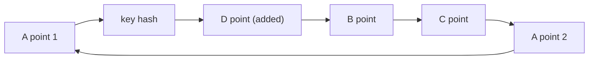
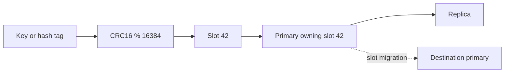

# Consistent hashing and Redis Cluster

The broker distributes cached replies across independent Redis instances. When a node joins or leaves, the routing change determines how many previously cached replies turn into misses. A consistent-hash ring limits that change to the keys the node acquires or used to own.

## Modulo and the hash ring

With `hash(key) % N`, node IDs run from 0 to `N - 1`. Changing `N` changes nearly every remainder. From three to four nodes, the shared node IDs are 0, 1 and 2. Only three of the twelve residues modulo 12 keep their owner, so 75% move. In general, for `N → N + 1`, the two moduli are coprime, giving `N` matches out of `N(N + 1)`.

On a ring, hash the key and each node's points into the same unsigned 64-bit space. Walk clockwise from the key to the first node point, wrapping back to zero when needed. A point owns the arc from its predecessor up to and including itself.

In this example the key belongs to B before D is inserted and to D afterwards. Only the arc from A's first point to D changes hands. Removing D gives that arc back to B. Each physical node has many virtual points. Their arcs are spread across the ring, reducing the imbalance that can result from one random point per node. The broker contract uses about 150 points per node. More points increase the size of the sorted routing table.

For equally configured nodes and uniform hashes, adding `K` nodes to reach `N` total moves an expected `K/N` share. Removing `K` of `N` existing nodes has the same expected share. The corresponding denominators for one join and one departure are the node count after the join and before the departure. A particular set of virtual points can differ from that expectation. [Karger et al., Consistent Hashing and Random Trees](https://doi.org/10.1145/258533.258660)

## Other consistent hashing schemes

| Scheme | How it picks a node | Trade-off |
| --- | --- | --- |
| Ketama | Hash node labels onto a continuum and choose the clockwise successor. The classic libketama implementation generates points with MD5 and supports weighting by creating more points for a larger server. | Works with named memcached servers and arbitrary departures. Clients need the same hashes, node labels, point rules and membership list. |
| Rendezvous or highest random weight (HRW) | Score each `(key, node)` pair and choose the highest score. Removing the winner exposes the next highest score. | Arbitrary membership and a natural ranked list for replicas. A direct implementation hashes every node at lookup time. |
| Jump consistent hash | Jump between numbered buckets using a deterministic calculation until the result is inside the current bucket count. | Constant storage and efficient lookups for contiguous buckets. Removing an arbitrary named server requires an additional mapping scheme to preserve stability. |

[libketama source](https://github.com/RJ/ketama), [Thaler and Ravishankar, Using Name-Based Mappings to Increase Hit Rates](https://www.microsoft.com/en-us/research/wp-content/uploads/2017/02/HRW98.pdf), [Lamping and Veach, A Fast, Minimal Memory, Consistent Hash Algorithm](https://arxiv.org/abs/1406.2294)

## Redis Cluster

Redis Cluster always calculates one of 16,384 slots using `CRC16(key) % 16384`. Each slot belongs to a primary. A cluster-aware client caches the slot-to-primary map and sends commands directly to the known owner. Membership changes can leave the hash calculation intact because the slot count stays fixed.

Resharding transfers chosen slots and their keys to another primary. `MOVED` tells the client the owner changed and its map needs updating. `ASK` redirects a single command during migration. The client sends `ASKING` to the target before retrying that command and keeps the previous mapping until it learns about the ownership change.

Multi-key operations need the keys in the same slot. Hash tags let callers colocate related keys. For example, `player:{42}:profile` and `player:{42}:friends` both hash the substring `42`. That concentrates the tagged keys in one slot, which matters for hot tenants.

The separate cluster bus carries gossip, failure detection, slot ownership updates and failover votes. When a suitable replica exists and the cluster authorizes it, the replica can be promoted to take its primary's slots. Replication is asynchronous, so a failover can lose acknowledged writes that had yet to replicate. [Redis Cluster specification](https://redis.io/docs/latest/operate/oss_and_stack/reference/cluster-spec/)

## Choosing between them

| Question | Broker ring over standalone Redis | Redis Cluster |
| --- | --- | --- |
| Mapping | Key hash → clockwise virtual point → owner | CRC16 → fixed slot → primary |
| Membership change | Swap the ring. Affected keys refill from the underlying service on demand. | Reassign selected slots and migrate their keys when adding or draining capacity. |
| Routing | The broker maintains membership and chooses an instance. | A cluster-aware client keeps the slot map and follows redirects. |
| Multi-key operations | Node-local commands work for keys the broker knows share a node. Cross-node operations need application coordination. | Server-side multi-key commands require a shared slot. Hash tags let callers arrange it. |
| High availability | A failed shard leaves the ring. Reassigned keys miss until they refill. | Replicas can take over slots with cluster failover and retain replicated keys. |
| Operational cost | Independent instances, plus broker membership, failure detection and refill monitoring. | Cluster topology, replicas, bus connectivity, resharding and client redirect support. |

The broker caches replies that it can fetch again from their source. It can evict or discard a shard's cached values and rebuild them on demand, so a node failure costs hits until those keys refill. That makes a ring over standalone Redis a suitable choice for this deployment. Redis Cluster is useful if the service needs warm replicas, managed slot migration, or a standard cluster protocol shared by multiple clients.

To adopt Redis Cluster, provision primaries and replicas with reachable command and cluster-bus addresses, replace the broker's ring routing with a cluster-aware client, and switch membership operations to slot resharding and replica promotion. Verify that cache lookups and invalidation work across redirects. Review multi-key commands, Lua scripts, and cache/tag key placement for same-slot requirements before enabling live traffic. The broker would still own reply cache policy, TTLs, and invalidation semantics. [Broker caching contract](../README.md#caching), [Redis Cluster scaling guide](https://redis.io/docs/latest/operate/oss_and_stack/management/scaling/)

## Reproduce the 3 → 4 change

From the repository root, run `python3 scripts/measure_cache_remapping.py`. The script compares the owner of each of 100,000 fixed keys before and after adding a node. Both methods use the same 64-bit BLAKE2b key hash. The ring has 150 points per node and keeps all existing points.

| Method | Changed owner | Expected share |
| --- | ---: | ---: |
| Ring | 22,990 (22.99%) | about 25% |
| Modulo | 75,288 (75.29%) | about 75% |

These percentages measure routing changes. Cache hit rates also depend on which keys are requested, how quickly they refill, and whether they expire during a membership change.
