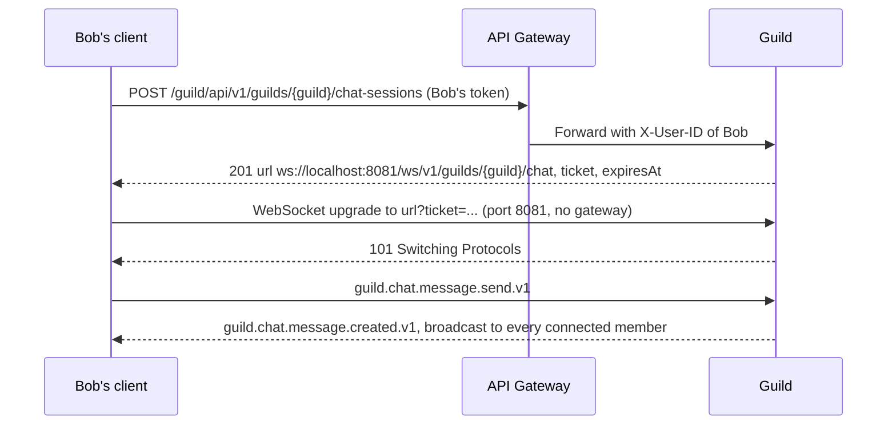
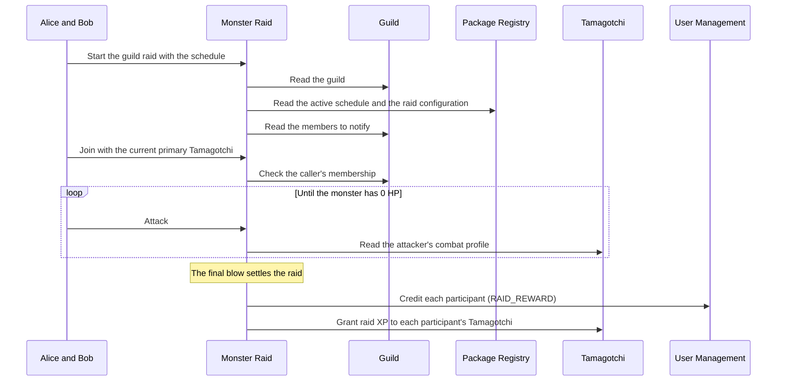

# Game Workflows

[`collections/game-workflows.postman_collection.json`](../collections/game-workflows.postman_collection.json) plays Tamagotchi Go end to end through the API Gateway. It has four game workflows that together reach all eight services, plus a set of resilience drills. This page describes what each flow does, which service calls happen behind every step, and what each check proves. The descriptions below follow the Lab 5 service contracts.

## Run locally

Start the Compose deployment on a disposable local stack and configure service auth with
`scripts/configure_services_auth.py`. Use a private Postman environment with `gatewayUrl`, `adminEmail`
and `adminPassword`. Register and log in to the raid administrator once through folder 3, then
allow-list that user's ID in `PACKAGE_REGISTRY_ADMIN_USER_IDS` and recreate Package Registry.

Run onboarding from the repository root so Newman can read the PNG fixture. In the Postman desktop
app, select `collections/fixtures/workflow-sprite.png` in **Upload the demo sprite** if the file
reference needs to be resolved locally. Run the folders with the same private environment. Folder 2
needs the PvP fixture between onboarding and the battle. Folder 3 can also run directly after
onboarding.

With Newman installed, run these commands from the CPR root. Replace the environment path with your
private Postman export containing the gateway and raid-admin settings.

```sh
workflow_state=$(mktemp -d)
newman run collections/game-workflows.postman_collection.json \
  --environment /path/to/private.postman_environment.json \
  --folder '1. Onboarding: players, package and pets' \
  --export-environment "$workflow_state/onboarded.json" --bail
python3 scripts/prepare_workflow_pvp.py "$workflow_state/onboarded.json"
newman run collections/game-workflows.postman_collection.json \
  --environment "$workflow_state/onboarded.json" \
  --folder '2. Social life and a PvP battle' \
  --folder '3. Guild life and a Monster Raid' --bail
```

The onboarding export contains the new players' access tokens and expires when their tokens do. Keep
it outside the repository and run the remaining steps before the tokens expire. For the Postman app,
export the private environment after onboarding to run the same fixture helper, then continue with
folders 2 and 3 using that environment.

## Overview

| Service | 0. Gateway | 1. Onboarding | 2. Battle | 3. Guild and raid | 4. Drills |
|---|:---:|:---:|:---:|:---:|:---:|
| API Gateway | ✓ | ✓ | ✓ | ✓ | ✓ |
| User Management | ✓ | ✓ | ✓ | ✓ | |
| Package Registry | | ✓ | ✓ | ✓ | |
| Tamagotchi | ✓ | ✓ | ✓ | ✓ | ✓ |
| Battle | ✓ | | ✓ | | |
| Map | | | ✓ | | |
| Guild | | | | ✓ | |
| Monster Raid | | | | ✓ | |
| Notification | | ✓ | ✓ | ✓ | |

Every run builds a new small world, so it never collides with an earlier run:

| Actor | Role in the story |
|---|---|
| Alice | Publishes the game package, challenges Bob, founds the guild |
| Bob | Accepts the challenge, joins Alice's guild, fights the raid with her |
| Carol | A stranger on the map and the source of both players' starter pets |
| Dave | A registered player outside Alice's package, used to show a guild rule |
| Raid admin | A Package Registry administrator who designs and schedules the monster |
| Probe | A throwaway player used only by the gateway checks |

Players get a unique suffix per run, for example `alice-mg2x7k1a`. The package is `Pocket Pets <run>` and the guild `Ember Squad <run>`.

## How a call travels

Postman sends public REST requests through the API Gateway. The gateway verifies bearer tokens using
User Management's JWKS and passes the verified caller identity to the broker. The broker dispatches
the request to a service instance. Peer calls use the broker with service credentials. Each hop
propagates `X-Correlation-ID`.

When Alice joins a package, User Management asks the broker to coordinate a two-phase commit with
Package Registry. The registration becomes visible in both services after they commit.

## 0. Gateway entry and authorization

These checks run before any game data exists. They show that the gateway alone decides who is calling.

| Check | Response | What it shows |
|---|---|---|
| Gateway status (`/status`) | `200` | The gateway reports readiness and lists JWKS and broker dependencies |
| Public signing keys | `200`, RS256 keys with a `kid`, no private members | Anyone can verify tokens, only User Management can issue them |
| Unknown service prefix | `404 ROUTE_NOT_FOUND` | Answered by the gateway; no service owns the path |
| Protected call without a token | `401 MISSING_TOKEN`, `WWW-Authenticate: Bearer` | The call never reaches Battle |
| Malformed token, or `Basic` instead of `Bearer` | `401 INVALID_TOKEN` | Only valid bearer JWTs pass |
| Probe registers, then logs in with a junk `Authorization` header | `201`, then `200` | Public operations drop `Authorization` without checking it |
| Token with the subject swapped and the signature kept | `401 INVALID_TOKEN` | A forged identity fails signature verification |
| Genuine token on the probe's own roster | `200 []` | The same request passes with an untouched token |
| Probe's token plus spoofed `X-User-ID`, `X-Caller-Kind: service`, `X-Service-Name: battle-service` | `403` | The gateway replaced the spoofed headers, so Tamagotchi saw the probe, not Battle |
| User token on the internal combat profile | `404 ROUTE_NOT_FOUND` | The gateway routes only the public API |

## 1. Onboarding: players, package and pets

Alice, Bob and Carol create accounts and a game world to play in.

| Step | What happens | Calls behind it |
|---|---|---|
| Register three players | Accounts are created without a package (`packageIds: []`) | Public operation, no other service involved |
| Log in | User Management issues each player a 15-minute RS256 user token | — |
| Alice creates her package | `Pocket Pets <run>` is created as a DRAFT with Alice as its developer | — |
| Alice defines the statistics | `hunger`, `happiness` and `energy`, each an integer from 0 to 100, with combat bonus rules: hunger ≥ 80 gives ATTACK −5, happiness ≥ 70 gives ATTACK +5, energy ≤ 20 gives DEFENSE −3 | — |
| Alice defines the battle boosts | `power_snack` (ATTACK +10) and `iron_shell` (DEFENSE +5), each usable once per battle | — |
| Alice activates the package | The package becomes ACTIVE, so players can join it | — |
| Alice, Bob and Carol join it | Package Registry becomes the authority for the membership, and User Management opens a local wallet for the package next to the global one | User Management → Package Registry: read the package, store the registration |
| Upload a sprite | The gateway sends the PNG to Tamagotchi and returns its object-store URL | Tamagotchi → object store |
| Combat types | The six types and their cycle: FLAME → NATURE → EARTH → ELECTRIC → WATER → SHADOW → FLAME | — |
| Each player hatches a Tamagotchi | Ember (Alice, FLAME), Ripple (Bob, WATER) and Sprout (Carol, NATURE) start as PRIMARY at level 1 | Tamagotchi → Package Registry: read the statistic definitions |
| Bob sets an undefined `mana` statistic | Rejected with `422 INVALID_LOCAL_STATS` | Tamagotchi → Package Registry: the definitions have no `mana` |
| Alice feeds Ember | Hunger 5 and happiness 95 are stored; energy keeps its value | Tamagotchi → Package Registry: values validated against their ranges |
| Players register phones | Android, iOS and web devices; the Firebase token is never returned | — |
| Alice reads her preferences | All six notification categories are enabled by default | — |

## 2. Social life and a PvP battle

### Friends and the map

Alice sends Bob a friend request, Bob accepts, and User Management reports them as FRIEND. The three players then share their positions: Alice in the city centre, Bob about 45 m north, and Carol about 2 m from Alice. Every location update and every map read makes Map ask User Management for the player's relationships.

- **Alice's map** shows Bob as FRIEND even though he is far away, and Carol as NONE because she is within the 6 m proximity radius.
- **Bob's map** shows Alice but not Carol, a stranger 45 m away.
- **Carol stepping within 6 m of Alice** makes Map publish `map.proximity.detected.v1`. The broker delivers the event to Notification, which looks up Alice's and Carol's devices.

### Starter pets and purses

Each player needs one PRIMARY and one SECONDARY Tamagotchi and enough coins to pay a battle loss.
The fixture helper uses the demo `battle-service` client and the broker's gRPC contracts to transfer
Carol's Sprout to Alice and Pebble to Bob, then credits each player 100 coins. Carol hatches Pebble
through the gateway. The battle folder reads both rosters and wallets before sending the challenge.

### The challenge

Alice challenges Bob with Ember as her primary, Sprout as her secondary, and `power_snack`. Before storing the PENDING challenge, Battle reads the inputs through the broker:

| Purpose | Calls |
|---|---|
| Both players exist and their balances | User Management: read each user and their balances |
| Alice's two Tamagotchis | Tamagotchi: read the combat profile and the record with owner and role, for each |
| Package-specific bonuses | Package Registry: read the statistic definitions, once per Tamagotchi |
| The equipped boost | Package Registry: read `power_snack` |

The `battle.request.created.v1` event goes to Bob's phone. Bob finds the challenge among his received, pending requests and accepts with Ripple, Pebble and `iron_shell`. Battle repeats the checks for all four Tamagotchis and both boosts, eighteen calls in all, and starts the battle as ACTIVE.

### The fight

The battle names whose turn it is. Each player opens with their boost, then attacks the opponent's active Tamagotchi. Battle computes the damage from the snapshot taken at the start: levels, type advantage, the package's statistic bonuses and active boosts. When an active Tamagotchi is knocked out, its partner takes over automatically. The battle ends when both of one player's Tamagotchis are down. In one live run the fight took about a dozen turns with hits of 9 to 28 damage: Alice's primary fell, and her secondary finished the fight.

### Settlement

The finishing action returns `202` with the battle in `SETTLING`. The broker runs Battle's settlement saga,
which updates currency, XP and ownership. The collection polls `GET /battle/api/v1/battles/{battleId}`
until settlement completes. A successful match ends in `COMPLETED` or `FORFEITED`. A compensated
settlement ends in `VOIDED` and fails the gameplay check.

After settlement the collection checks:

- The result identifies the winner, loser, captured Tamagotchi and XP awards.
- The captured Tamagotchi is in the winner's roster as SECONDARY.
- The winner's balance increased by the reward, and the loser's balance decreased by the loss.

The loser no longer has a primary Tamagotchi, so they promote their remaining secondary. Finally `battle.completed.v1` reaches both players' phones.

## 3. Guild life and a Monster Raid

### The raid window

The raid admin is a user listed in Package Registry's administrator allowlist. Package Registry allows only one SCHEDULED or ACTIVE raid window at a time, so the admin first deactivates any window an earlier run left open. The admin then designs the **Gloom Hydra**:

- 120 HP, attack 12, defence 4
- Weak to FLAME, WATER, NATURE and EARTH, and resistant to SHADOW
- At most 30 minutes and 10 participants
- Reward of 75 coins and 120 XP per participant

The admin schedules a window that opens 15 seconds later and lasts an hour, then activates it.

### The guild

Alice founds `Ember Squad <run>` and restricts membership to her package; Guild checks with Package Registry that the package exists.

| Invitation | Calls behind it | Result |
|---|---|---|
| Dave, who never joined the package | Guild → User Management: Dave exists. Guild → Package Registry: no registration (`404`) | `422 MEMBERSHIP_RULE_NOT_SATISFIED` |
| Bob | Same two checks, and Bob's registration exists | PENDING invitation |

The `guild.invitation.created.v1` event goes to Bob's phone. Bob finds the invitation and accepts it, and Guild checks his package registration again before adding him. The guild now has Alice as OWNER and Bob as MEMBER.

### Guild chat over WebSocket

Live chat is the one feature that doesn't run through the gateway. The gateway carries only the negotiation, and the chat traffic goes directly to Guild:



The ticket is 43 base64url characters, is bound to the guild and the user, lasts 60 seconds and works once; reusing it is refused with `401`. The collection checks that the socket URL points to Guild rather than the gateway. Stored messages are also readable over REST through the gateway.

### The raid

Once the window is open, Alice starts the raid for her guild:



Players call Monster Raid through the gateway. Monster Raid calls its peers through the broker.

- **Start.** The raid snapshots the monster when it starts, so later changes to the configuration cannot affect it. `raid.started.v1` goes to both players' phones.
- **Who can join.** Alice and Bob join with their current primary Tamagotchis. Battle may have changed these.
- **Damage.** Each attack deals `floor(baseDamage × (1 + (level − 1) / 10) × typeMultiplier)`. The base damage is the monster's attack of 12, and the multiplier is 1.5 against a weakness. In the live runs each level-1 hit did 18 damage, and seven hits brought the Hydra from 120 to 0. If a player is rate limited (`429 ATTACK_RATE_LIMITED`), the other player swings next.
- **Settlement.** The final blow marks the raid COMPLETED and publishes `raid.completed.v1`. Subscribers apply the 75-coin reward and 120-XP grant.
- **Checks.** The result lists rewards for both players. The collection polls Alice's balance and her Tamagotchi's XP, then checks for exactly 75 coins and 120 XP. `raid.completed.v1` reaches both phones.
- **Cleanup.** The admin deactivates the raid window, so the next run can schedule its own.

## 4. Resilience drills

Each drill needs a failure to be caused by hand. Without one, the drill reports that it was not armed. All drills use the same request, Alice listing her Tamagotchis, so the only difference between them is what fails.

| Failure | Who answers | Response | After |
|---|---|---|---|
| Tamagotchi's database hangs | Tamagotchi itself | `504 REQUEST_TIMEOUT` | about 4 s |
| The Tamagotchi service hangs | Gateway | `504 UPSTREAM_TIMEOUT` | about 5 s |
| The Tamagotchi service is down | Gateway | `502 UPSTREAM_UNAVAILABLE` | immediately |

The timeouts are layered: a service's own deadline (4 s for Tamagotchi and Notification) is shorter than the gateway's 5-second upstream timeout, which is shorter than the gateway's 10-second request deadline. So a slow request is answered by the innermost layer that gives up, and every timeout uses the shared error envelope.

Concurrency limits fail fast instead of queueing:

- **Gateway, per service:** 64 requests in flight. When 100 parallel requests hit a frozen Tamagotchi, 64 waited and timed out with `504`, and 36 were refused at once with `503 CONCURRENCY_LIMIT_REACHED` and `Retry-After: 1`. The gateway logged a `limit_reached` line for each refusal.
- **Gateway, per caller kind:** separate budgets for user, service and anonymous callers, so player traffic cannot starve the service-to-service calls it depends on.
- **Each service:** its own limit (`MAX_CONCURRENCY`). With Tamagotchi limited to 8 and its database frozen, 20 parallel requests gave 8 × `504 REQUEST_TIMEOUT` and 12 × `503 CONCURRENCY_LIMIT_REACHED`, all answered by Tamagotchi itself.

## Events delivered to Notification

The services publish gameplay events to the broker. Notification subscribes and handles deduplication,
preferences, device lookup and push delivery. Use the broker's `/topics` view to inspect deliveries.
The collection registers test devices and checks preferences. Actual device pushes require Firebase configuration.

| Event | Delivered as | Workflow | Recipients | Category |
|---|---|---|---|---|
| `map.proximity.detected.v1` | `map-service` | 2 | Alice, Carol | PROXIMITY |
| `battle.request.created.v1` | `battle-service` | 2 | Bob | BATTLE_REQUEST |
| `battle.completed.v1` | `battle-service` | 2 | Winner and loser | BATTLE_RESULT |
| `guild.invitation.created.v1` | `guild-service` | 3 | Bob | GUILD_INVITATION |
| `raid.started.v1` | `monster-raid-service` | 3 | Alice, Bob | RAID_LIFECYCLE |
| `raid.completed.v1` | `monster-raid-service` | 3 | Alice, Bob | RAID_LIFECYCLE |
